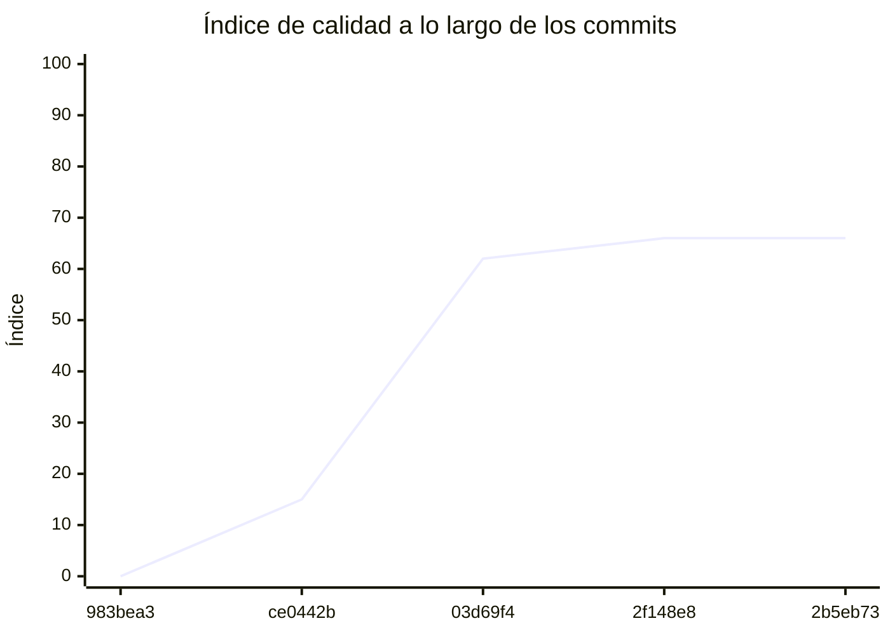

<!-- evaluacion:inicio -->
# Evaluación — manudiiez-um-programacion/turnos-catalogo-sync

> Documento **generado automáticamente** por la cátedra de Programación II (UM): RepoSense + análisis de calidad de **7 dimensiones**. **No editar a mano**: se regenera en cada evaluación.
> Rama evaluada: `main`. Análisis **heurístico** (regex + métricas) + build: es una criba para orientar la revisión, **no una nota**. La **documentación** del repositorio no se evalúa.
> Generado: 2026-11-20.

## 1. Veredicto

| Aspecto | Resultado |
|---|---|
| Índice de calidad | **77/100** |
| Tipo de repositorio | `backend` |
| Build (`mvnw verify` / `gradlew check`) | OK |
| Código (LOC) | 28,222 |
| Archivos de código | 335 |
| Clases | 379 |
| Código dentro de clases (%POO) | 53% |
| Funciones fuera de clases | 1 |
| Duplicación (puerta) | 4.4% |
| Duplicación lógica | 4.7% |
| Duplicación de boilerplate | 9.2% |
| Cobertura | 98% |
| Tope duro aplicado a D1 | `POO_BAJO` → D1 ≤ 60 |

> Este informe **describe** lo que el análisis midió con los criterios ya establecidos de la materia. No es una nota.

## 2. Semáforo de aprobación

Criterios de la cátedra (`CRITERIOS-CALIDAD.md`): **Aprobar** se juega con el perfil `estandar`; **destacar**, con el `exigente` (meta de excelencia).

| Semáforo | Resultado |
|---|---|
| Aprobar (`estandar`) | **no cumple** — 6/11 |
| Destacar (`exigente`) | **no cumple** — 5/11 |

**Para aprobar, falta cumplir:** SOLID; Duplicación

**Para destacar, falta cumplir:** SOLID; POO; Duplicación

## 3. Autoría (RepoSense)

| Autor | Commits | Código (LOC) | Tests (LOC) | Docs (LOC) | Días activos | % del código |
|---|---:|---:|---:|---:|---:|---:|
| Manuel Diez de Oñate | 91 | 15,169 | 17,061 | 6,624 | 13 | 100% |

> _El LOC de autoría lo calcula RepoSense sobre el historial y puede diferir del LOC de código del análisis (que mira el estado de `main`)._

## 4. Dimensiones evaluadas

Cada dimensión indica **qué mide**, **por qué importa** y **tu resultado**. Cuando el puntaje queda por debajo de la referencia, se agregan preguntas para **investigar la causa** (no hay recetas).

| Dimensión | Peso | Puntaje |
|:--|--:|--:|
| **D1** Diseño OO, SOLID y patrones (20%) | 20% | 2 |
| **D2** Arquitectura hexagonal — backend (15%) | 15% | 100 |
| **D3** Frontend KMP: MVVM y buenas prácticas (10%) | 10% | N/A |
| **D4** Integración y contrato (10%) | 10% | 90 |
| **D5** Seguridad y robustez (10%) | 10% | 100 |
| **D6** Pruebas y cobertura (20%) | 20% | 100 |
| **D7** Proceso y entrega (15%) | 15% | 100 |

### D1. Diseño OO, SOLID y patrones (20%)

- **Qué mide:** Métricas orientadas a objetos (clases, métodos, campos, cohesión, acoplamiento, herencia) y proxies de SOLID, más patrones de diseño.
- **Por qué importa:** El eje de la materia es el buen uso de la POO y su arquitectura: un diseño con clases claras y poco acopladas es más fácil de entender, probar y cambiar.
- **Tu resultado:** **2/100**
- **Para investigar la causa:**
    - ¿Se pensó el modelo de clases antes de codificar o se agrupó después?
    - ¿Qué clases concentran muchas responsabilidades a la vez?
    - ¿Los colaboradores llegan como parámetros o se crean por dentro?

### D2. Arquitectura hexagonal — backend (15%)

- **Qué mide:** Separación en capas (dominio, puertos de entrada/salida, adaptadores) y dirección de las dependencias del backend.
- **Por qué importa:** Aislar el dominio de la infraestructura permite cambiar la base de datos, el framework o el transporte sin tocar las reglas de negocio.
- **Tu resultado:** **100/100**

### D4. Integración y contrato (10%)

- **Qué mide:** Cumplimiento del contrato de integración de la cátedra (formato de errores, paginación, autenticación, endpoints esperados).
- **Por qué importa:** Los servicios deben poder integrarse entre sí y con la app sin sorpresas; el contrato es lo que hacen cumplir las pruebas de integración.
- **Tu resultado:** **90/100**

### D5. Seguridad y robustez (10%)

- **Qué mide:** Credenciales embebidas, consultas SQL por concatenación, y presencia de config de entorno; aislamiento de secretos.
- **Por qué importa:** Un secreto en el repositorio o una consulta construida por concatenación son riesgos concretos, no hipotéticos.
- **Tu resultado:** **100/100**

### D6. Pruebas y cobertura (20%)

- **Qué mide:** Cantidad y resultado de pruebas y cobertura de línea (JaCoCo/Kover, Surefire/Failsafe) cuando hay build.
- **Por qué importa:** Las pruebas son la red de seguridad para refactorizar e integrar; la cobertura acota las zonas sin verificar.
- **Tu resultado:** **100/100**

### D7. Proceso y entrega (15%)

- **Qué mide:** Artefactos verificables de proceso/entrega: `compose`, `.env.example`, CI (`.github/workflows/`), `CODEOWNERS` y wrapper de build (`mvnw`/`gradlew`). **No** puntúa documentación.
- **Por qué importa:** Un proyecto que compila, se levanta y se valida solo es más fácil de revisar y de integrar en equipo.
- **Tu resultado:** **100/100**

## 5. Señales detectadas

El análisis encontró las siguientes señales, con el archivo y la línea donde se originan cuando están disponibles:

**Archivos con más señales**

| Archivo | Señales |
|---|---:|
| `src/main/java/com/um/catalogsync/shared/infrastructure/security/ApiSecurityProperties.java` | 6 |
| `src/main/java/com/um/catalogsync/professional/infrastructure/persistence/adapter/JpaProfessionalRepositoryAdapter.java` | 5 |
| `src/main/java/com/um/catalogsync/professional/domain/model/ProfessionalSearchCriteria.java` | 5 |
| `src/main/java/com/um/catalogsync/sync/domain/model/SyncStatusReport.java` | 5 |
| `src/main/java/com/um/catalogsync/schedule/infrastructure/persistence/adapter/JpaWeeklyScheduleRepositoryAdapter.java` | 5 |
| `src/main/java/com/um/catalogsync/schedule/domain/model/AvailabilityCriteria.java` | 5 |
| `src/main/java/com/um/catalogsync/sync/infrastructure/redis/CatedraRedisConnection.java` | 4 |
| `src/main/java/com/um/catalogsync/sync/infrastructure/redis/mapper/PublishedCatalogMapper.java` | 4 |
| `src/main/java/com/um/catalogsync/sync/infrastructure/messaging/CatalogUpdatedConsumer.java` | 4 |
| `src/main/java/com/um/catalogsync/sync/application/usecases/SynchronizeCatalogUseCaseImpl.java` | 4 |

**DIP/concretos** (130)
- clase 'CategoryRepository' muy acoplada (CBO=12) — `src/main/java/com/um/catalogsync/category/domain/ports/out/CategoryRepository.java:23`
- clase 'JpaCategoryRepositoryAdapter' muy acoplada (CBO=14) — `src/main/java/com/um/catalogsync/category/infrastructure/persistence/adapter/JpaCategoryRepositoryAdapter.java:31`
- clase 'CatedraIntegrationUnavailableException' muy acoplada (CBO=8) — `src/main/java/com/um/catalogsync/integration/application/exception/CatedraIntegrationUnavailableException.java:18`
- clase 'IntegrationNotProvisionedException' muy acoplada (CBO=9) — `src/main/java/com/um/catalogsync/integration/application/exception/IntegrationNotProvisionedException.java:25`
- clase 'IntegrationService' muy acoplada (CBO=10) — `src/main/java/com/um/catalogsync/integration/application/service/IntegrationService.java:27`
- clase 'TechnicalSessionCache' muy acoplada (CBO=25) — `src/main/java/com/um/catalogsync/integration/application/session/TechnicalSessionCache.java:50`
- clase 'IntegrationConfig' muy acoplada (CBO=26) — `src/main/java/com/um/catalogsync/integration/domain/model/IntegrationConfig.java:35`
- clase 'ProvisioningStatus' muy acoplada (CBO=14) — `src/main/java/com/um/catalogsync/integration/domain/model/ProvisioningStatus.java:13`
- clase 'TechnicalSession' muy acoplada (CBO=9) — `src/main/java/com/um/catalogsync/integration/domain/model/TechnicalSession.java:29`
- clase 'CatedraRestClientConfig' muy acoplada (CBO=23) — `src/main/java/com/um/catalogsync/integration/infrastructure/client/CatedraRestClientConfig.java:30`
- clase 'RestIntegrationConfigAdapter' muy acoplada (CBO=22) — `src/main/java/com/um/catalogsync/integration/infrastructure/client/adapter/RestIntegrationConfigAdapter.java:34`
- clase 'RestIntegrationConfigAdapter' instancia 4 concretos (CBO=22) — `src/main/java/com/um/catalogsync/integration/infrastructure/client/adapter/RestIntegrationConfigAdapter.java:34`
- clase 'RestTechnicalAuthAdapter' muy acoplada (CBO=34) — `src/main/java/com/um/catalogsync/integration/infrastructure/client/adapter/RestTechnicalAuthAdapter.java:39`
- clase 'RestTechnicalAuthAdapter' instancia 7 concretos (CBO=34) — `src/main/java/com/um/catalogsync/integration/infrastructure/client/adapter/RestTechnicalAuthAdapter.java:39`
- clase 'CatedraApiProperties' muy acoplada (CBO=25) — `src/main/java/com/um/catalogsync/integration/infrastructure/config/CatedraApiProperties.java:41`
- clase 'ProfessionalService' muy acoplada (CBO=9) — `src/main/java/com/um/catalogsync/professional/application/service/ProfessionalService.java:29`
- clase 'SearchProfessionalsUseCaseImpl' muy acoplada (CBO=9) — `src/main/java/com/um/catalogsync/professional/application/usecases/SearchProfessionalsUseCaseImpl.java:47`
- clase 'ProfessionalSearchCriteria' muy acoplada (CBO=13) — `src/main/java/com/um/catalogsync/professional/domain/model/ProfessionalSearchCriteria.java:56`
- clase 'ProfessionalSearchCriteria' instancia 3 concretos (CBO=13) — `src/main/java/com/um/catalogsync/professional/domain/model/ProfessionalSearchCriteria.java:56`
- clase 'SearchableName' muy acoplada (CBO=12) — `src/main/java/com/um/catalogsync/professional/domain/model/SearchableName.java:20`
- clase 'ProfessionalRepository' muy acoplada (CBO=21) — `src/main/java/com/um/catalogsync/professional/domain/ports/out/ProfessionalRepository.java:20`
- clase 'JpaProfessionalRepositoryAdapter' muy acoplada (CBO=42) — `src/main/java/com/um/catalogsync/professional/infrastructure/persistence/adapter/JpaProfessionalRepositoryAdapter.java:57`
- clase 'ProfessionalEntity' muy acoplada (CBO=8) — `src/main/java/com/um/catalogsync/professional/infrastructure/persistence/entity/ProfessionalEntity.java:30`
- clase 'ProfessionalSpecifications' muy acoplada (CBO=32) — `src/main/java/com/um/catalogsync/professional/infrastructure/persistence/specification/ProfessionalSpecifications.java:39`
- clase 'ProfessionalSearchController' muy acoplada (CBO=31) — `src/main/java/com/um/catalogsync/professional/infrastructure/web/ProfessionalSearchController.java:52`
- clase 'ProfessionalSearchRequest' muy acoplada (CBO=11) — `src/main/java/com/um/catalogsync/professional/infrastructure/web/dto/ProfessionalSearchRequest.java:45`
- clase 'GetCurrentAgendaUseCaseImpl' muy acoplada (CBO=15) — `src/main/java/com/um/catalogsync/schedule/application/usecases/GetCurrentAgendaUseCaseImpl.java:53`
- clase 'AvailabilityCriteria' muy acoplada (CBO=36) — `src/main/java/com/um/catalogsync/schedule/domain/model/AvailabilityCriteria.java:58`
- clase 'AvailabilityCriteria' instancia 6 concretos (CBO=36) — `src/main/java/com/um/catalogsync/schedule/domain/model/AvailabilityCriteria.java:58`
- clase 'CurrentAgenda' muy acoplada (CBO=9) — `src/main/java/com/um/catalogsync/schedule/domain/model/CurrentAgenda.java:33`
- clase 'DayOfWeek' muy acoplada (CBO=15) — `src/main/java/com/um/catalogsync/schedule/domain/model/DayOfWeek.java:24`
- clase 'TimeOfDay' muy acoplada (CBO=19) — `src/main/java/com/um/catalogsync/schedule/domain/model/TimeOfDay.java:34`
- clase 'TimeOfDay' instancia 3 concretos (CBO=19) — `src/main/java/com/um/catalogsync/schedule/domain/model/TimeOfDay.java:34`
- clase 'WeeklySchedule' muy acoplada (CBO=19) — `src/main/java/com/um/catalogsync/schedule/domain/model/WeeklySchedule.java:36`
- clase 'WeeklyScheduleRepository' muy acoplada (CBO=21) — `src/main/java/com/um/catalogsync/schedule/domain/ports/out/WeeklyScheduleRepository.java:29`
- clase 'JpaWeeklyScheduleRepositoryAdapter' muy acoplada (CBO=27) — `src/main/java/com/um/catalogsync/schedule/infrastructure/persistence/adapter/JpaWeeklyScheduleRepositoryAdapter.java:38`
- clase 'WeeklyScheduleEntity' muy acoplada (CBO=22) — `src/main/java/com/um/catalogsync/schedule/infrastructure/persistence/entity/WeeklyScheduleEntity.java:31`
- clase 'JpaWeeklyScheduleRepository' muy acoplada (CBO=28) — `src/main/java/com/um/catalogsync/schedule/infrastructure/persistence/repository/JpaWeeklyScheduleRepository.java:15`
- clase 'CurrentAgendaController' muy acoplada (CBO=23) — `src/main/java/com/um/catalogsync/schedule/infrastructure/web/CurrentAgendaController.java:54`
- clase 'ProfessionalResponse' muy acoplada (CBO=8) — `src/main/java/com/um/catalogsync/schedule/infrastructure/web/dto/ProfessionalResponse.java:20`
- clase 'WeeklyScheduleResponse' muy acoplada (CBO=10) — `src/main/java/com/um/catalogsync/schedule/infrastructure/web/dto/WeeklyScheduleResponse.java:19`
- clase 'CurrentAgendaWebMapper' muy acoplada (CBO=11) — `src/main/java/com/um/catalogsync/schedule/infrastructure/web/mapper/CurrentAgendaWebMapper.java:25`
- clase 'CurrentAgendaWebMapper' instancia 3 concretos (CBO=11) — `src/main/java/com/um/catalogsync/schedule/infrastructure/web/mapper/CurrentAgendaWebMapper.java:25`
- clase 'Secret' muy acoplada (CBO=17) — `src/main/java/com/um/catalogsync/shared/domain/model/Secret.java:35`
- clase 'Secret' instancia 3 concretos (CBO=17) — `src/main/java/com/um/catalogsync/shared/domain/model/Secret.java:35`
- clase 'ProblemReader' muy acoplada (CBO=10) — `src/main/java/com/um/catalogsync/shared/infrastructure/client/ProblemReader.java:35`
- clase 'ApiSecurityProperties' muy acoplada (CBO=23) — `src/main/java/com/um/catalogsync/shared/infrastructure/security/ApiSecurityProperties.java:37`
- clase 'ApiSecurityProperties' instancia 3 concretos (CBO=23) — `src/main/java/com/um/catalogsync/shared/infrastructure/security/ApiSecurityProperties.java:37`
- clase 'Jwt' muy acoplada (CBO=14) — `src/main/java/com/um/catalogsync/shared/infrastructure/security/ApiSecurityProperties.java:84`
- clase 'ProblemAccessDeniedHandler' muy acoplada (CBO=11) — `src/main/java/com/um/catalogsync/shared/infrastructure/security/ProblemAccessDeniedHandler.java:23`
- clase 'ProblemAuthenticationEntryPoint' muy acoplada (CBO=23) — `src/main/java/com/um/catalogsync/shared/infrastructure/security/ProblemAuthenticationEntryPoint.java:33`
- clase 'SecurityConfig' muy acoplada (CBO=86) — `src/main/java/com/um/catalogsync/shared/infrastructure/security/SecurityConfig.java:68`
- clase 'SecurityConfig' instancia 7 concretos (CBO=86) — `src/main/java/com/um/catalogsync/shared/infrastructure/security/SecurityConfig.java:68`
- clase 'ApiErrorCode' muy acoplada (CBO=23) — `src/main/java/com/um/catalogsync/shared/infrastructure/web/ApiErrorCode.java:23`
- clase 'ApiExceptionHandler' muy acoplada (CBO=33) — `src/main/java/com/um/catalogsync/shared/infrastructure/web/ApiExceptionHandler.java:40`
- clase 'OpenApiConfig' muy acoplada (CBO=27) — `src/main/java/com/um/catalogsync/shared/infrastructure/web/OpenApiConfig.java:27`
- clase 'OpenApiConfig' instancia 5 concretos (CBO=27) — `src/main/java/com/um/catalogsync/shared/infrastructure/web/OpenApiConfig.java:27`
- clase 'ProblemJsonWriter' muy acoplada (CBO=19) — `src/main/java/com/um/catalogsync/shared/infrastructure/web/ProblemJsonWriter.java:36`
- clase 'CatalogSnapshotUnavailableException' muy acoplada (CBO=8) — `src/main/java/com/um/catalogsync/sync/application/exception/CatalogSnapshotUnavailableException.java:24`
- clase 'CatalogSyncService' muy acoplada (CBO=20) — `src/main/java/com/um/catalogsync/sync/application/service/CatalogSyncService.java:33`
- clase 'ApplyCatalogSnapshotUseCaseImpl' muy acoplada (CBO=32) — `src/main/java/com/um/catalogsync/sync/application/usecases/ApplyCatalogSnapshotUseCaseImpl.java:54`
- clase 'ApplyCatalogVersionUseCaseImpl' muy acoplada (CBO=22) — `src/main/java/com/um/catalogsync/sync/application/usecases/ApplyCatalogVersionUseCaseImpl.java:38`
- clase 'ApplyIncrementalChangesUseCaseImpl' muy acoplada (CBO=30) — `src/main/java/com/um/catalogsync/sync/application/usecases/ApplyIncrementalChangesUseCaseImpl.java:55`
- clase 'ApplyIncrementalChangesUseCaseImpl' instancia 4 concretos (CBO=30) — `src/main/java/com/um/catalogsync/sync/application/usecases/ApplyIncrementalChangesUseCaseImpl.java:55`
- clase 'GetSyncStatusUseCaseImpl' muy acoplada (CBO=31) — `src/main/java/com/um/catalogsync/sync/application/usecases/GetSyncStatusUseCaseImpl.java:54`
- clase 'GetSyncStatusUseCaseImpl' instancia 4 concretos (CBO=31) — `src/main/java/com/um/catalogsync/sync/application/usecases/GetSyncStatusUseCaseImpl.java:54`
- clase 'HandleCatalogUpdatedUseCaseImpl' muy acoplada (CBO=15) — `src/main/java/com/um/catalogsync/sync/application/usecases/HandleCatalogUpdatedUseCaseImpl.java:49`
- clase 'RunFullSyncUseCaseImpl' muy acoplada (CBO=42) — `src/main/java/com/um/catalogsync/sync/application/usecases/RunFullSyncUseCaseImpl.java:60`
- clase 'SynchronizeCatalogUseCaseImpl' muy acoplada (CBO=41) — `src/main/java/com/um/catalogsync/sync/application/usecases/SynchronizeCatalogUseCaseImpl.java:95`
- clase 'CatalogChanges' muy acoplada (CBO=8) — `src/main/java/com/um/catalogsync/sync/domain/model/CatalogChanges.java:52`
- clase 'CatalogSnapshot' muy acoplada (CBO=16) — `src/main/java/com/um/catalogsync/sync/domain/model/CatalogSnapshot.java:47`
- clase 'CatalogUpdatedEvent' muy acoplada (CBO=13) — `src/main/java/com/um/catalogsync/sync/domain/model/CatalogUpdatedEvent.java:42`
- clase 'CatalogVersion' muy acoplada (CBO=15) — `src/main/java/com/um/catalogsync/sync/domain/model/CatalogVersion.java:34`
- clase 'CatalogVersionDelta' muy acoplada (CBO=13) — `src/main/java/com/um/catalogsync/sync/domain/model/CatalogVersionDelta.java:47`
- clase 'IncrementalSyncOutcome' muy acoplada (CBO=11) — `src/main/java/com/um/catalogsync/sync/domain/model/IncrementalSyncOutcome.java:18`
- clase 'IncrementalSyncResult' muy acoplada (CBO=8) — `src/main/java/com/um/catalogsync/sync/domain/model/IncrementalSyncResult.java:24`
- clase 'PublishedCatalogMetadata' muy acoplada (CBO=8) — `src/main/java/com/um/catalogsync/sync/domain/model/PublishedCatalogMetadata.java:45`
- clase 'SyncDecisionReason' muy acoplada (CBO=16) — `src/main/java/com/um/catalogsync/sync/domain/model/SyncDecisionReason.java:19`
- clase 'SyncError' muy acoplada (CBO=8) — `src/main/java/com/um/catalogsync/sync/domain/model/SyncError.java:35`
- clase 'SyncErrorCode' muy acoplada (CBO=20) — `src/main/java/com/um/catalogsync/sync/domain/model/SyncErrorCode.java:20`
- clase 'SyncHealth' muy acoplada (CBO=16) — `src/main/java/com/um/catalogsync/sync/domain/model/SyncHealth.java:16`
- clase 'SyncOriginState' muy acoplada (CBO=11) — `src/main/java/com/um/catalogsync/sync/domain/model/SyncOriginState.java:16`
- clase 'SyncRun' muy acoplada (CBO=23) — `src/main/java/com/um/catalogsync/sync/domain/model/SyncRun.java:40`
- clase 'SyncStatusReport' muy acoplada (CBO=28) — `src/main/java/com/um/catalogsync/sync/domain/model/SyncStatusReport.java:34`
- clase 'SyncTrigger' muy acoplada (CBO=14) — `src/main/java/com/um/catalogsync/sync/domain/model/SyncTrigger.java:15`
- clase 'SynchronizeCatalogUseCase' muy acoplada (CBO=9) — `src/main/java/com/um/catalogsync/sync/domain/ports/in/SynchronizeCatalogUseCase.java:31`
- clase 'CatalogChangesPort' muy acoplada (CBO=11) — `src/main/java/com/um/catalogsync/sync/domain/ports/out/CatalogChangesPort.java:30`
- clase 'CatalogSnapshotPort' muy acoplada (CBO=11) — `src/main/java/com/um/catalogsync/sync/domain/ports/out/CatalogSnapshotPort.java:24`
- clase 'CatalogVersionRepository' muy acoplada (CBO=17) — `src/main/java/com/um/catalogsync/sync/domain/ports/out/CatalogVersionRepository.java:14`
- clase 'ProcessedEventRepository' muy acoplada (CBO=11) — `src/main/java/com/um/catalogsync/sync/domain/ports/out/ProcessedEventRepository.java:15`
- clase 'PublishedCatalogPort' muy acoplada (CBO=10) — `src/main/java/com/um/catalogsync/sync/domain/ports/out/PublishedCatalogPort.java:42`
- clase 'SyncRunRepository' muy acoplada (CBO=32) — `src/main/java/com/um/catalogsync/sync/domain/ports/out/SyncRunRepository.java:45`
- clase 'RestCatalogSnapshotAdapter' muy acoplada (CBO=40) — `src/main/java/com/um/catalogsync/sync/infrastructure/client/adapter/RestCatalogSnapshotAdapter.java:63`
- clase 'RestCatalogSnapshotAdapter' instancia 6 concretos (CBO=40) — `src/main/java/com/um/catalogsync/sync/infrastructure/client/adapter/RestCatalogSnapshotAdapter.java:63`
- clase 'CatalogSnapshotMapper' muy acoplada (CBO=14) — `src/main/java/com/um/catalogsync/sync/infrastructure/client/mapper/CatalogSnapshotMapper.java:45`
- clase 'CatalogSnapshotMapper' instancia 3 concretos (CBO=14) — `src/main/java/com/um/catalogsync/sync/infrastructure/client/mapper/CatalogSnapshotMapper.java:45`
- clase 'CatalogEntityMapper' muy acoplada (CBO=20) — `src/main/java/com/um/catalogsync/sync/infrastructure/mapper/CatalogEntityMapper.java:43`
- clase 'CatalogUpdatedConsumer' muy acoplada (CBO=45) — `src/main/java/com/um/catalogsync/sync/infrastructure/messaging/CatalogUpdatedConsumer.java:63`
- clase 'CatalogUpdatedConsumer' instancia 3 concretos (CBO=45) — `src/main/java/com/um/catalogsync/sync/infrastructure/messaging/CatalogUpdatedConsumer.java:63`
- clase 'CatalogUpdatedConsumerStarter' muy acoplada (CBO=10) — `src/main/java/com/um/catalogsync/sync/infrastructure/messaging/CatalogUpdatedConsumerStarter.java:35`
- clase 'CatalogUpdatedListener' muy acoplada (CBO=17) — `src/main/java/com/um/catalogsync/sync/infrastructure/messaging/CatalogUpdatedListener.java:59`
- clase 'CatalogUpdatedMapper' muy acoplada (CBO=8) — `src/main/java/com/um/catalogsync/sync/infrastructure/messaging/mapper/CatalogUpdatedMapper.java:47`
- clase 'CatalogUpdatedMapper' instancia 7 concretos (CBO=8) — `src/main/java/com/um/catalogsync/sync/infrastructure/messaging/mapper/CatalogUpdatedMapper.java:47`
- clase 'SyncMetrics' muy acoplada (CBO=25) — `src/main/java/com/um/catalogsync/sync/infrastructure/metrics/SyncMetrics.java:54`
- clase 'JpaCatalogVersionRepositoryAdapter' muy acoplada (CBO=33) — `src/main/java/com/um/catalogsync/sync/infrastructure/persistence/adapter/JpaCatalogVersionRepositoryAdapter.java:39`
- clase 'JpaProcessedEventRepositoryAdapter' muy acoplada (CBO=12) — `src/main/java/com/um/catalogsync/sync/infrastructure/persistence/adapter/JpaProcessedEventRepositoryAdapter.java:34`
- clase 'JpaSyncRunRepositoryAdapter' muy acoplada (CBO=49) — `src/main/java/com/um/catalogsync/sync/infrastructure/persistence/adapter/JpaSyncRunRepositoryAdapter.java:80`
- clase 'CatalogVersionEntity' muy acoplada (CBO=8) — `src/main/java/com/um/catalogsync/sync/infrastructure/persistence/entity/CatalogVersionEntity.java:29`
- clase 'SyncErrorEntity' muy acoplada (CBO=9) — `src/main/java/com/um/catalogsync/sync/infrastructure/persistence/entity/SyncErrorEntity.java:39`
- clase 'SyncRunMapper' muy acoplada (CBO=11) — `src/main/java/com/um/catalogsync/sync/infrastructure/persistence/mapper/SyncRunMapper.java:30`
- clase 'JpaCatalogVersionRepository' muy acoplada (CBO=19) — `src/main/java/com/um/catalogsync/sync/infrastructure/persistence/repository/JpaCatalogVersionRepository.java:14`
- clase 'JpaProcessedEventRepository' muy acoplada (CBO=24) — `src/main/java/com/um/catalogsync/sync/infrastructure/persistence/repository/JpaProcessedEventRepository.java:14`
- clase 'JpaSyncRunRepository' muy acoplada (CBO=29) — `src/main/java/com/um/catalogsync/sync/infrastructure/persistence/repository/JpaSyncRunRepository.java:15`
- clase 'CatalogReconciliationJob' muy acoplada (CBO=10) — `src/main/java/com/um/catalogsync/sync/infrastructure/reconciliation/CatalogReconciliationJob.java:57`
- clase 'CatedraRedisConnection' muy acoplada (CBO=35) — `src/main/java/com/um/catalogsync/sync/infrastructure/redis/CatedraRedisConnection.java:52`
- clase 'CatedraRedisConnection' instancia 3 concretos (CBO=35) — `src/main/java/com/um/catalogsync/sync/infrastructure/redis/CatedraRedisConnection.java:52`
- clase 'CatedraRedisProperties' muy acoplada (CBO=11) — `src/main/java/com/um/catalogsync/sync/infrastructure/redis/CatedraRedisProperties.java:34`
- clase 'RedisCatalogChangesAdapter' muy acoplada (CBO=9) — `src/main/java/com/um/catalogsync/sync/infrastructure/redis/adapter/RedisCatalogChangesAdapter.java:43`
- clase 'RedisPublishedCatalogAdapter' muy acoplada (CBO=18) — `src/main/java/com/um/catalogsync/sync/infrastructure/redis/adapter/RedisPublishedCatalogAdapter.java:49`
- clase 'CatalogChangesMapper' muy acoplada (CBO=15) — `src/main/java/com/um/catalogsync/sync/infrastructure/redis/mapper/CatalogChangesMapper.java:51`
- clase 'CatalogChangesMapper' instancia 7 concretos (CBO=15) — `src/main/java/com/um/catalogsync/sync/infrastructure/redis/mapper/CatalogChangesMapper.java:51`
- clase 'PublishedCatalogMapper' muy acoplada (CBO=28) — `src/main/java/com/um/catalogsync/sync/infrastructure/redis/mapper/PublishedCatalogMapper.java:51`
- clase 'PublishedCatalogMapper' instancia 7 concretos (CBO=28) — `src/main/java/com/um/catalogsync/sync/infrastructure/redis/mapper/PublishedCatalogMapper.java:51`
- clase 'ProcessedEventRetentionJob' muy acoplada (CBO=8) — `src/main/java/com/um/catalogsync/sync/infrastructure/retention/ProcessedEventRetentionJob.java:35`
- clase 'SyncHistoryRetentionJob' muy acoplada (CBO=8) — `src/main/java/com/um/catalogsync/sync/infrastructure/retention/SyncHistoryRetentionJob.java:34`
- clase 'InitialCatalogSyncRunner' muy acoplada (CBO=21) — `src/main/java/com/um/catalogsync/sync/infrastructure/startup/InitialCatalogSyncRunner.java:88`
- clase 'SyncStatusController' muy acoplada (CBO=25) — `src/main/java/com/um/catalogsync/sync/infrastructure/web/SyncStatusController.java:63`
- clase 'SyncErrorResponse' muy acoplada (CBO=9) — `src/main/java/com/um/catalogsync/sync/infrastructure/web/dto/SyncErrorResponse.java:29`
- clase 'SyncStatusWebMapper' muy acoplada (CBO=9) — `src/main/java/com/um/catalogsync/sync/infrastructure/web/mapper/SyncStatusWebMapper.java:32`
- clase 'SyncStatusWebMapper' instancia 5 concretos (CBO=9) — `src/main/java/com/um/catalogsync/sync/infrastructure/web/mapper/SyncStatusWebMapper.java:32`

**SRP/responsabilidad** (58)
- clase 'TechnicalSessionCache' con baja cohesión (40%) — `src/main/java/com/um/catalogsync/integration/application/session/TechnicalSessionCache.java:50`
- clase 'IntegrationConfig' con baja cohesión (33%) — `src/main/java/com/um/catalogsync/integration/domain/model/IntegrationConfig.java:35`
- clase 'RestIntegrationConfigAdapter' con baja cohesión (36%) — `src/main/java/com/um/catalogsync/integration/infrastructure/client/adapter/RestIntegrationConfigAdapter.java:34`
- clase 'RestTechnicalAuthAdapter' grande (LOC=84, métodos=10, campos=4) — `src/main/java/com/um/catalogsync/integration/infrastructure/client/adapter/RestTechnicalAuthAdapter.java:39`
- método 'IntegrationDto.IntegrationDto' con 13 parámetros — `src/main/java/com/um/catalogsync/integration/infrastructure/client/dto/IntegrationDto.java:22`
- método 'CatedraApiProperties.CatedraApiProperties' de 76 líneas — `src/main/java/com/um/catalogsync/integration/infrastructure/config/CatedraApiProperties.java:41`
- método 'CatedraApiProperties.CatedraApiProperties' con 6 parámetros — `src/main/java/com/um/catalogsync/integration/infrastructure/config/CatedraApiProperties.java:41`
- método 'CatedraApiProperties.CatedraApiProperties' con complejidad 7 — `src/main/java/com/um/catalogsync/integration/infrastructure/config/CatedraApiProperties.java:41`
- clase 'ProfessionalService' con baja cohesión (17%) — `src/main/java/com/um/catalogsync/professional/application/service/ProfessionalService.java:29`
- método 'ProfessionalSearchCriteria.ProfessionalSearchCriteria' de 67 líneas — `src/main/java/com/um/catalogsync/professional/domain/model/ProfessionalSearchCriteria.java:56`
- método 'ProfessionalSearchCriteria.ProfessionalSearchCriteria' con 6 parámetros — `src/main/java/com/um/catalogsync/professional/domain/model/ProfessionalSearchCriteria.java:56`
- clase 'JpaProfessionalRepositoryAdapter' grande (LOC=142, métodos=11, campos=6) — `src/main/java/com/um/catalogsync/professional/infrastructure/persistence/adapter/JpaProfessionalRepositoryAdapter.java:57`
- clase 'JpaProfessionalRepositoryAdapter' con baja cohesión (29%) — `src/main/java/com/um/catalogsync/professional/infrastructure/persistence/adapter/JpaProfessionalRepositoryAdapter.java:57`
- clase 'AvailabilityCriteria' grande (LOC=150, métodos=10, campos=0) — `src/main/java/com/um/catalogsync/schedule/domain/model/AvailabilityCriteria.java:58`
- método 'AvailabilityCriteria.AvailabilityCriteria' de 150 líneas — `src/main/java/com/um/catalogsync/schedule/domain/model/AvailabilityCriteria.java:58`
- método 'AvailabilityCriteria.AvailabilityCriteria' con complejidad 12 — `src/main/java/com/um/catalogsync/schedule/domain/model/AvailabilityCriteria.java:58`
- clase 'JpaWeeklyScheduleRepositoryAdapter' grande (LOC=115, métodos=12, campos=4) — `src/main/java/com/um/catalogsync/schedule/infrastructure/persistence/adapter/JpaWeeklyScheduleRepositoryAdapter.java:38`
- clase 'JpaWeeklyScheduleRepositoryAdapter' con baja cohesión (33%) — `src/main/java/com/um/catalogsync/schedule/infrastructure/persistence/adapter/JpaWeeklyScheduleRepositoryAdapter.java:38`
- método 'CurrentAgendaController.agendaVigente' con 5 parámetros — `src/main/java/com/um/catalogsync/schedule/infrastructure/web/CurrentAgendaController.java:100`
- método 'ApiSecurityProperties.ApiSecurityProperties' de 75 líneas — `src/main/java/com/um/catalogsync/shared/infrastructure/security/ApiSecurityProperties.java:37`
- método 'ApiSecurityProperties.Jwt' de 33 líneas — `src/main/java/com/um/catalogsync/shared/infrastructure/security/ApiSecurityProperties.java:84`
- método 'Jwt.Jwt' de 33 líneas — `src/main/java/com/um/catalogsync/shared/infrastructure/security/ApiSecurityProperties.java:84`
- clase 'SecurityConfig' grande (LOC=235, métodos=8, campos=8) — `src/main/java/com/um/catalogsync/shared/infrastructure/security/SecurityConfig.java:68`
- clase 'SecurityConfig' con baja cohesión (39%) — `src/main/java/com/um/catalogsync/shared/infrastructure/security/SecurityConfig.java:68`
- método 'OpenApiConfig.contratoDelServicio' de 47 líneas — `src/main/java/com/um/catalogsync/shared/infrastructure/web/OpenApiConfig.java:38`
- método 'ProblemJsonWriter.write' con 5 parámetros — `src/main/java/com/um/catalogsync/shared/infrastructure/web/ProblemJsonWriter.java:90`
- clase 'CatalogSyncService' con baja cohesión (0%) — `src/main/java/com/um/catalogsync/sync/application/service/CatalogSyncService.java:33`
- método 'ApplyIncrementalChangesUseCaseImpl.applyUpTo' de 40 líneas — `src/main/java/com/um/catalogsync/sync/application/usecases/ApplyIncrementalChangesUseCaseImpl.java:63`
- clase 'GetSyncStatusUseCaseImpl' con baja cohesión (0%) — `src/main/java/com/um/catalogsync/sync/application/usecases/GetSyncStatusUseCaseImpl.java:54`
- método 'RunFullSyncUseCaseImpl.codigoDe' con complejidad 10 — `src/main/java/com/um/catalogsync/sync/application/usecases/RunFullSyncUseCaseImpl.java:120`
- clase 'SynchronizeCatalogUseCaseImpl' con baja cohesión (0%) — `src/main/java/com/um/catalogsync/sync/application/usecases/SynchronizeCatalogUseCaseImpl.java:95`
- método 'SynchronizeCatalogUseCaseImpl.decidirYSincronizar' de 47 líneas — `src/main/java/com/um/catalogsync/sync/application/usecases/SynchronizeCatalogUseCaseImpl.java:127`
- método 'SynchronizeCatalogUseCaseImpl.decidirYSincronizar' con complejidad 6 — `src/main/java/com/um/catalogsync/sync/application/usecases/SynchronizeCatalogUseCaseImpl.java:127`
- método 'IncrementalSyncResult.IncrementalSyncResult' con 5 parámetros — `src/main/java/com/um/catalogsync/sync/domain/model/IncrementalSyncResult.java:24`
- método 'SyncStatusReport.SyncStatusReport' de 80 líneas — `src/main/java/com/um/catalogsync/sync/domain/model/SyncStatusReport.java:34`
- método 'SyncStatusReport.SyncStatusReport' con 5 parámetros — `src/main/java/com/um/catalogsync/sync/domain/model/SyncStatusReport.java:34`
- método 'SyncStatusReport.SyncStatusReport' con complejidad 8 — `src/main/java/com/um/catalogsync/sync/domain/model/SyncStatusReport.java:34`
- método 'SyncStatusReport.health' con complejidad 6 — `src/main/java/com/um/catalogsync/sync/domain/model/SyncStatusReport.java:78`
- clase 'RestCatalogSnapshotAdapter' con baja cohesión (48%) — `src/main/java/com/um/catalogsync/sync/infrastructure/client/adapter/RestCatalogSnapshotAdapter.java:63`
- método 'CatalogSnapshotDto.CatalogSnapshotDto' con 5 parámetros — `src/main/java/com/um/catalogsync/sync/infrastructure/client/dto/CatalogSnapshotDto.java:41`
- método 'CatalogSnapshotMapper.mapear' con 5 parámetros — `src/main/java/com/um/catalogsync/sync/infrastructure/client/mapper/CatalogSnapshotMapper.java:94`
- método 'ProfessionalCategoryDto.ProfessionalCategoryDto' con 6 parámetros — `src/main/java/com/um/catalogsync/sync/infrastructure/dto/ProfessionalCategoryDto.java:20`
- método 'ProfessionalDto.ProfessionalDto' con 7 parámetros — `src/main/java/com/um/catalogsync/sync/infrastructure/dto/ProfessionalDto.java:19`
- método 'WeeklyScheduleDto.WeeklyScheduleDto' con 9 parámetros — `src/main/java/com/um/catalogsync/sync/infrastructure/dto/WeeklyScheduleDto.java:30`
- clase 'CatalogUpdatedConsumer' con baja cohesión (40%) — `src/main/java/com/um/catalogsync/sync/infrastructure/messaging/CatalogUpdatedConsumer.java:63`
- método 'CatalogUpdatedConsumer.construir' de 31 líneas — `src/main/java/com/um/catalogsync/sync/infrastructure/messaging/CatalogUpdatedConsumer.java:112`
- método 'CatedraKafkaProperties.CatedraKafkaProperties' de 36 líneas — `src/main/java/com/um/catalogsync/sync/infrastructure/messaging/CatedraKafkaProperties.java:34`
- método 'CatedraKafkaProperties.CatedraKafkaProperties' con 5 parámetros — `src/main/java/com/um/catalogsync/sync/infrastructure/messaging/CatedraKafkaProperties.java:34`
- método 'CatalogUpdatedDto.CatalogUpdatedDto' con 6 parámetros — `src/main/java/com/um/catalogsync/sync/infrastructure/messaging/dto/CatalogUpdatedDto.java:28`
- clase 'CatalogUpdatedMapper' con baja cohesión (0%) — `src/main/java/com/um/catalogsync/sync/infrastructure/messaging/mapper/CatalogUpdatedMapper.java:47`
- clase 'JpaSyncRunRepositoryAdapter' con baja cohesión (44%) — `src/main/java/com/um/catalogsync/sync/infrastructure/persistence/adapter/JpaSyncRunRepositoryAdapter.java:80`
- clase 'CatedraRedisConnection' con baja cohesión (20%) — `src/main/java/com/um/catalogsync/sync/infrastructure/redis/CatedraRedisConnection.java:52`
- método 'CatedraRedisConnection.abrir' de 40 líneas — `src/main/java/com/um/catalogsync/sync/infrastructure/redis/CatedraRedisConnection.java:119`
- clase 'PublishedCatalogKeys' grande (LOC=36, métodos=2, campos=8) — `src/main/java/com/um/catalogsync/sync/infrastructure/redis/PublishedCatalogKeys.java:21`
- clase 'CatalogChangesMapper' con baja cohesión (0%) — `src/main/java/com/um/catalogsync/sync/infrastructure/redis/mapper/CatalogChangesMapper.java:51`
- clase 'PublishedCatalogMapper' grande (LOC=127, métodos=11, campos=5) — `src/main/java/com/um/catalogsync/sync/infrastructure/redis/mapper/PublishedCatalogMapper.java:51`
- clase 'PublishedCatalogMapper' con baja cohesión (11%) — `src/main/java/com/um/catalogsync/sync/infrastructure/redis/mapper/PublishedCatalogMapper.java:51`
- método 'SyncStatusResponse.SyncStatusResponse' con 5 parámetros — `src/main/java/com/um/catalogsync/sync/infrastructure/web/dto/SyncStatusResponse.java:42`

**OCP/type-switch** (4)
- clase 'JpaProfessionalRepositoryAdapter' con 1 type-checks — `src/main/java/com/um/catalogsync/professional/infrastructure/persistence/adapter/JpaProfessionalRepositoryAdapter.java:57`
- clase 'JpaWeeklyScheduleRepositoryAdapter' con 1 type-checks — `src/main/java/com/um/catalogsync/schedule/infrastructure/persistence/adapter/JpaWeeklyScheduleRepositoryAdapter.java:38`
- clase 'Secret' con 1 type-checks — `src/main/java/com/um/catalogsync/shared/domain/model/Secret.java:35`
- clase 'CatalogEntityMapper' con 1 type-checks — `src/main/java/com/um/catalogsync/sync/infrastructure/mapper/CatalogEntityMapper.java:43`

**LSP/overrides** (3)
- 'ProfessionalSearchCriteria.ProfessionalSearchCriteria' vacío o 'no implementado' — `src/main/java/com/um/catalogsync/professional/domain/model/ProfessionalSearchCriteria.java:56`
- 'JpaProfessionalRepositoryAdapter.replaceAll' vacío o 'no implementado' — `src/main/java/com/um/catalogsync/professional/infrastructure/persistence/adapter/JpaProfessionalRepositoryAdapter.java:162`
- 'JpaWeeklyScheduleRepositoryAdapter.replaceAll' vacío o 'no implementado' — `src/main/java/com/um/catalogsync/schedule/infrastructure/persistence/adapter/JpaWeeklyScheduleRepositoryAdapter.java:112`

**POO** (2)
- función 'toCriteria' fuera de una clase — `src/main/java/com/um/catalogsync/professional/infrastructure/web/dto/ProfessionalSearchRequest.java:111`
- clase 'PublishedCatalogKeys' con 8 campos públicos (encapsulación) — `src/main/java/com/um/catalogsync/sync/infrastructure/redis/PublishedCatalogKeys.java:21`

**duplicación** (6)
- duplicación lógica: 4.4% · boilerplate: 9.2%
- bloque de 8 líneas repetido 9 veces en src/main/java/com/um/catalogsync/professional/infrastructure/web/ProfessionalSearchController.java:85, src/main/java/com/um/catalogsync/professional/infrastructure/web/ProfessionalSearchController.java:86, src/main/java/com/um/catalogsync/professional/infrastructure/web/ProfessionalSearchController.java:87 — `src/main/java/com/um/catalogsync/professional/infrastructure/web/ProfessionalSearchController.java:85`
- bloque de 8 líneas repetido 8 veces en src/test/java/com/um/catalogsync/professional/domain/model/SearchableNameTest.java:22, src/test/java/com/um/catalogsync/integration/domain/model/IntegrationConfigTest.java:41, src/test/java/com/um/catalogsync/integration/domain/model/IntegrationConfigTest.java:42 — `src/test/java/com/um/catalogsync/professional/domain/model/SearchableNameTest.java:22`
- bloque de 8 líneas repetido 3 veces en src/test/java/com/um/catalogsync/professional/infrastructure/persistence/adapter/ProfessionalSearchQueryTest.java:285, src/test/java/com/um/catalogsync/professional/infrastructure/persistence/adapter/ProfessionalAvailabilityQueryTest.java:289, src/test/java/com/um/catalogsync/professional/infrastructure/web/ProfessionalSearchApiIntegrationTest.java:514 — `src/test/java/com/um/catalogsync/professional/infrastructure/persistence/adapter/ProfessionalSearchQueryTest.java:285`
- bloque de 8 líneas repetido 3 veces en src/test/java/com/um/catalogsync/professional/infrastructure/persistence/adapter/ProfessionalSearchQueryTest.java:286, src/test/java/com/um/catalogsync/professional/infrastructure/persistence/adapter/ProfessionalAvailabilityQueryTest.java:290, src/test/java/com/um/catalogsync/professional/infrastructure/web/ProfessionalSearchApiIntegrationTest.java:515 — `src/test/java/com/um/catalogsync/professional/infrastructure/persistence/adapter/ProfessionalSearchQueryTest.java:286`
- bloque de 8 líneas repetido 3 veces en src/test/java/com/um/catalogsync/sync/application/usecases/ApplyCatalogVersionUseCaseImplTest.java:75, src/test/java/com/um/catalogsync/shared/infrastructure/FlywayMigrationsTest.java:65, src/test/java/com/um/catalogsync/integration/domain/model/IntegrationConfigTest.java:44 — `src/test/java/com/um/catalogsync/sync/application/usecases/ApplyCatalogVersionUseCaseImplTest.java:75`

## 6. Evolución por commit

Métricas calculadas sobre el estado de `main` en **cada commit** (5 commits con trabajo), del primero al último. La calidad usa el perfil `exigente`; el aporte de código lo mide RepoSense. El índice puede **bajar** al crecer el proyecto: se acumulan señales.

| # | Fecha | Commit | Autor | LOC | Índice | %POO | Duplic. | Sueltas |
|---|---|---|---|---:|---:|---:|---:|---:|
| 1 | 2026-09-10 | `983bea3` | Ing. Daniel Quinteros | 0 | 0 | 0% | 0.0% | 0 |
| 2 | 2026-09-10 | `ce0442b` | Ing. Daniel Quinteros | 0 | 15 | 0% | 0.0% | 0 |
| 3 | 2026-10-17 | `03d69f4` | Manuel Diez de Oñate | 4,494 | 62 | 47% | 4.7% | 0 |
| 4 | 2026-11-02 | `2f148e8` | Manuel Diez de Oñate | 17,407 | 66 | 53% | 4.5% | 1 |
| 5 | 2026-11-04 | `2b5eb73` | Manuel Diez de Oñate | 28,222 | 66 | 53% | 4.4% | 1 |

---
_Informe generado por la cátedra. Las dimensiones y umbrales corresponden a `calidad.py` (perfil `exigente`); el semáforo, a `CRITERIOS-CALIDAD.md`. La documentación del repositorio no se evalúa. Ante dudas, revisá el archivo señalado._
<!-- evaluacion:fin -->
