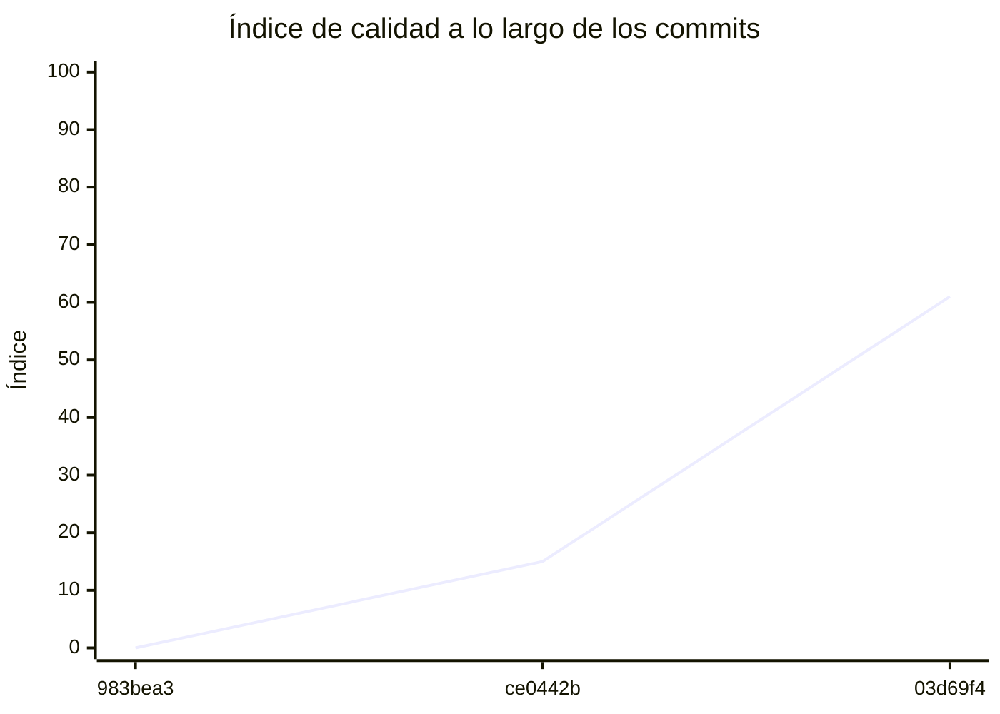

<!-- evaluacion:inicio -->
# Evaluación — manudiiez-um-programacion/turnos-catalogo-sync

> Documento **generado automáticamente** por la cátedra de Programación II (UM): RepoSense + análisis de calidad de **7 dimensiones**. **No editar a mano**: se regenera en cada evaluación.
> Rama evaluada: `main`. Análisis **heurístico** (regex + métricas) + build: es una criba para orientar la revisión, **no una nota**. La **documentación** del repositorio no se evalúa.
> Generado: 2026-10-17.

## 1. Veredicto

| Aspecto | Resultado |
|---|---|
| Índice de calidad | **72/100** |
| Tipo de repositorio | `backend` |
| Build (`mvnw verify` / `gradlew check`) | OK |
| Código (LOC) | 4,494 |
| Archivos de código | 99 |
| Clases | 74 |
| Código dentro de clases (%POO) | 62% |
| Funciones fuera de clases | 0 |
| Duplicación | 23.0% |
| Cobertura | 94% |
| Tope duro aplicado a D1 | `DUP>=15%` → D1 ≤ 50 |

> Este informe **describe** lo que el análisis midió con los criterios ya establecidos de la materia. No es una nota.

## 2. Semáforo de aprobación

Criterios de la cátedra (`CRITERIOS-CALIDAD.md`): **Aprobar** se juega con el perfil `estandar`; **destacar**, con el `exigente` (meta de excelencia).

| Semáforo | Resultado |
|---|---|
| Aprobar (`estandar`) | **no cumple** — 6/11 |
| Destacar (`exigente`) | **no cumple** — 5/11 |

**Para aprobar, falta cumplir:** SOLID; Duplicación

**Para destacar, falta cumplir:** SOLID; POO; Duplicación

## 3. Autoría (RepoSense)

| Autor | Commits | Código (LOC) | Tests (LOC) | Docs (LOC) | Días activos | % del código |
|---|---:|---:|---:|---:|---:|---:|
| Manuel Diez de Oñate | 30 | 3,681 | 2,243 | 3,433 | 4 | 100% |

> _El LOC de autoría lo calcula RepoSense sobre el historial y puede diferir del LOC de código del análisis (que mira el estado de `main`)._

## 4. Dimensiones evaluadas

Cada dimensión indica **qué mide**, **por qué importa** y **tu resultado**. Cuando el puntaje queda por debajo de la referencia, se agregan preguntas para **investigar la causa** (no hay recetas).

| Dimensión | Peso | Puntaje |
|:--|--:|--:|
| **D1** Diseño OO, SOLID y patrones (20%) | 20% | 4 |
| **D2** Arquitectura hexagonal — backend (15%) | 15% | 100 |
| **D3** Frontend KMP: MVVM y buenas prácticas (10%) | 10% | N/A |
| **D4** Integración y contrato (10%) | 10% | 40 |
| **D5** Seguridad y robustez (10%) | 10% | 100 |
| **D6** Pruebas y cobertura (20%) | 20% | 100 |
| **D7** Proceso y entrega (15%) | 15% | 100 |

### D1. Diseño OO, SOLID y patrones (20%)

- **Qué mide:** Métricas orientadas a objetos (clases, métodos, campos, cohesión, acoplamiento, herencia) y proxies de SOLID, más patrones de diseño.
- **Por qué importa:** El eje de la materia es el buen uso de la POO y su arquitectura: un diseño con clases claras y poco acopladas es más fácil de entender, probar y cambiar.
- **Tu resultado:** **4/100**
- **Para investigar la causa:**
    - ¿Se pensó el modelo de clases antes de codificar o se agrupó después?
    - ¿Qué clases concentran muchas responsabilidades a la vez?
    - ¿Los colaboradores llegan como parámetros o se crean por dentro?

### D2. Arquitectura hexagonal — backend (15%)

- **Qué mide:** Separación en capas (dominio, puertos de entrada/salida, adaptadores) y dirección de las dependencias del backend.
- **Por qué importa:** Aislar el dominio de la infraestructura permite cambiar la base de datos, el framework o el transporte sin tocar las reglas de negocio.
- **Tu resultado:** **100/100**

### D4. Integración y contrato (10%)

- **Qué mide:** Cumplimiento del contrato de integración de la cátedra (formato de errores, paginación, autenticación, endpoints esperados).
- **Por qué importa:** Los servicios deben poder integrarse entre sí y con la app sin sorpresas; el contrato es lo que hacen cumplir las pruebas de integración.
- **Tu resultado:** **40/100**
- **Para investigar la causa:**
    - ¿Qué endpoints difieren del contrato acordado?
    - ¿Los errores se devuelven con un formato uniforme?
    - ¿La autenticación es consistente entre servicios?

### D5. Seguridad y robustez (10%)

- **Qué mide:** Credenciales embebidas, consultas SQL por concatenación, y presencia de config de entorno; aislamiento de secretos.
- **Por qué importa:** Un secreto en el repositorio o una consulta construida por concatenación son riesgos concretos, no hipotéticos.
- **Tu resultado:** **100/100**

### D6. Pruebas y cobertura (20%)

- **Qué mide:** Cantidad y resultado de pruebas y cobertura de línea (JaCoCo/Kover, Surefire/Failsafe) cuando hay build.
- **Por qué importa:** Las pruebas son la red de seguridad para refactorizar e integrar; la cobertura acota las zonas sin verificar.
- **Tu resultado:** **100/100**

### D7. Proceso y entrega (15%)

- **Qué mide:** Artefactos verificables de proceso/entrega: `compose`, `.env.example`, CI (`.github/workflows/`), `CODEOWNERS` y wrapper de build (`mvnw`/`gradlew`). **No** puntúa documentación.
- **Por qué importa:** Un proyecto que compila, se levanta y se valida solo es más fácil de revisar y de integrar en equipo.
- **Tu resultado:** **100/100**

## 5. Señales detectadas

El análisis encontró las siguientes señales (archivo, sin número de línea a propósito):

**SRP/responsabilidad** (22)
- clase 'JpaProfessionalRepositoryAdapter' grande (LOC=86, métodos=11, campos=4) — `src/main/java/com/um/catalogsync/professional/infrastructure/persistence/adapter/JpaProfessionalRepositoryAdapter.java`
- clase 'JpaProfessionalRepositoryAdapter' con baja cohesión (24%) — `src/main/java/com/um/catalogsync/professional/infrastructure/persistence/adapter/JpaProfessionalRepositoryAdapter.java`
- clase 'ProfessionalEntity' grande (LOC=28, métodos=0, campos=8) — `src/main/java/com/um/catalogsync/professional/infrastructure/persistence/entity/ProfessionalEntity.java`
- clase 'ProfessionalEntity' sin métodos (8 campos): solo datos — `src/main/java/com/um/catalogsync/professional/infrastructure/persistence/entity/ProfessionalEntity.java`
- clase 'Professional' sin métodos (7 campos): solo datos — `src/main/java/com/um/catalogsync/professional/domain/model/Professional.java`
- clase 'CatalogVersionEntity' sin métodos (5 campos): solo datos — `src/main/java/com/um/catalogsync/sync/infrastructure/persistence/entity/CatalogVersionEntity.java`
- clase 'ProfessionalCategoryEntity' sin métodos (6 campos): solo datos — `src/main/java/com/um/catalogsync/category/infrastructure/persistence/entity/ProfessionalCategoryEntity.java`
- clase 'ProfessionalCategory' sin métodos (6 campos): solo datos — `src/main/java/com/um/catalogsync/category/domain/model/ProfessionalCategory.java`
- clase 'JpaWeeklyScheduleRepositoryAdapter' grande (LOC=93, métodos=12, campos=4) — `src/main/java/com/um/catalogsync/schedule/infrastructure/persistence/adapter/JpaWeeklyScheduleRepositoryAdapter.java`
- clase 'JpaWeeklyScheduleRepositoryAdapter' con baja cohesión (27%) — `src/main/java/com/um/catalogsync/schedule/infrastructure/persistence/adapter/JpaWeeklyScheduleRepositoryAdapter.java`
- clase 'WeeklyScheduleEntity' grande (LOC=47, métodos=0, campos=9) — `src/main/java/com/um/catalogsync/schedule/infrastructure/persistence/entity/WeeklyScheduleEntity.java`
- clase 'WeeklyScheduleEntity' sin métodos (9 campos): solo datos — `src/main/java/com/um/catalogsync/schedule/infrastructure/persistence/entity/WeeklyScheduleEntity.java`
- clase 'WeeklySchedule' grande (LOC=28, métodos=0, campos=10) — `src/main/java/com/um/catalogsync/schedule/domain/model/WeeklySchedule.java`
- clase 'WeeklySchedule' sin métodos (10 campos): solo datos — `src/main/java/com/um/catalogsync/schedule/domain/model/WeeklySchedule.java`
- clase 'JpaProfessionalRepositoryAdapterTest' grande (LOC=172, métodos=15, campos=8) — `src/test/java/com/um/catalogsync/professional/infrastructure/persistence/adapter/JpaProfessionalRepositoryAdapterTest.java`
- clase 'JpaCatalogVersionRepositoryAdapterTest' grande (LOC=255, métodos=20, campos=5) — `src/test/java/com/um/catalogsync/sync/infrastructure/persistence/adapter/JpaCatalogVersionRepositoryAdapterTest.java`
- método 'JpaCatalogVersionRepositoryAdapterTest.extracting' de 36 líneas — `src/test/java/com/um/catalogsync/sync/infrastructure/persistence/adapter/JpaCatalogVersionRepositoryAdapterTest.java`
- método 'JpaCatalogVersionRepositoryAdapterTest.extracting' con complejidad 6 — `src/test/java/com/um/catalogsync/sync/infrastructure/persistence/adapter/JpaCatalogVersionRepositoryAdapterTest.java`
- método 'JpaCatalogVersionRepositoryAdapterTest.enParalelo' con complejidad 6 — `src/test/java/com/um/catalogsync/sync/infrastructure/persistence/adapter/JpaCatalogVersionRepositoryAdapterTest.java`
- clase 'JpaCategoryRepositoryAdapterTest' grande (LOC=112, métodos=10, campos=4) — `src/test/java/com/um/catalogsync/category/infrastructure/persistence/adapter/JpaCategoryRepositoryAdapterTest.java`
- clase 'JpaWeeklyScheduleRepositoryAdapterTest' grande (LOC=215, métodos=20, campos=10) — `src/test/java/com/um/catalogsync/schedule/infrastructure/persistence/adapter/JpaWeeklyScheduleRepositoryAdapterTest.java`
- clase 'GetSchedulesByProfessionalUseCaseImplTest' grande (LOC=61, métodos=10, campos=0) — `src/test/java/com/um/catalogsync/schedule/application/usecases/GetSchedulesByProfessionalUseCaseImplTest.java`

**DIP/concretos** (38)
- clase 'JpaProfessionalRepositoryAdapter' muy acoplada (CBO=21) — `src/main/java/com/um/catalogsync/professional/infrastructure/persistence/adapter/JpaProfessionalRepositoryAdapter.java`
- clase 'ProfessionalEntity' muy acoplada (CBO=8) — `src/main/java/com/um/catalogsync/professional/infrastructure/persistence/entity/ProfessionalEntity.java`
- clase 'ProfessionalRepository' muy acoplada (CBO=10) — `src/main/java/com/um/catalogsync/professional/domain/ports/out/ProfessionalRepository.java`
- clase 'SearchableName' muy acoplada (CBO=12) — `src/main/java/com/um/catalogsync/professional/domain/model/SearchableName.java`
- clase 'JpaCatalogVersionRepository' muy acoplada (CBO=19) — `src/main/java/com/um/catalogsync/sync/infrastructure/persistence/repository/JpaCatalogVersionRepository.java`
- clase 'JpaCatalogVersionRepositoryAdapter' muy acoplada (CBO=28) — `src/main/java/com/um/catalogsync/sync/infrastructure/persistence/adapter/JpaCatalogVersionRepositoryAdapter.java`
- clase 'CatalogVersionEntity' muy acoplada (CBO=8) — `src/main/java/com/um/catalogsync/sync/infrastructure/persistence/entity/CatalogVersionEntity.java`
- clase 'CatalogVersionRepository' muy acoplada (CBO=17) — `src/main/java/com/um/catalogsync/sync/domain/ports/out/CatalogVersionRepository.java`
- clase 'CatalogVersion' muy acoplada (CBO=15) — `src/main/java/com/um/catalogsync/sync/domain/model/CatalogVersion.java`
- clase 'JpaCategoryRepositoryAdapter' muy acoplada (CBO=14) — `src/main/java/com/um/catalogsync/category/infrastructure/persistence/adapter/JpaCategoryRepositoryAdapter.java`
- clase 'CategoryRepository' muy acoplada (CBO=12) — `src/main/java/com/um/catalogsync/category/domain/ports/out/CategoryRepository.java`
- clase 'JpaWeeklyScheduleRepositoryAdapter' muy acoplada (CBO=21) — `src/main/java/com/um/catalogsync/schedule/infrastructure/persistence/adapter/JpaWeeklyScheduleRepositoryAdapter.java`
- clase 'WeeklyScheduleEntity' muy acoplada (CBO=22) — `src/main/java/com/um/catalogsync/schedule/infrastructure/persistence/entity/WeeklyScheduleEntity.java`
- clase 'WeeklyScheduleRepository' muy acoplada (CBO=10) — `src/main/java/com/um/catalogsync/schedule/domain/ports/out/WeeklyScheduleRepository.java`
- clase 'DayOfWeek' muy acoplada (CBO=15) — `src/main/java/com/um/catalogsync/schedule/domain/model/DayOfWeek.java`
- clase 'WeeklySchedule' muy acoplada (CBO=19) — `src/main/java/com/um/catalogsync/schedule/domain/model/WeeklySchedule.java`
- clase 'TimeOfDay' muy acoplada (CBO=19) — `src/main/java/com/um/catalogsync/schedule/domain/model/TimeOfDay.java`
- clase 'TimeOfDay' instancia 3 concretos (CBO=19) — `src/main/java/com/um/catalogsync/schedule/domain/model/TimeOfDay.java`
- clase 'ProfessionalMapperTest' muy acoplada (CBO=9) — `src/test/java/com/um/catalogsync/professional/infrastructure/persistence/mapper/ProfessionalMapperTest.java`
- clase 'JpaProfessionalRepositoryAdapterTest' muy acoplada (CBO=38) — `src/test/java/com/um/catalogsync/professional/infrastructure/persistence/adapter/JpaProfessionalRepositoryAdapterTest.java`
- clase 'SearchableNameTest' muy acoplada (CBO=8) — `src/test/java/com/um/catalogsync/professional/domain/model/SearchableNameTest.java`
- clase 'CatalogVersionMapperTest' muy acoplada (CBO=15) — `src/test/java/com/um/catalogsync/sync/infrastructure/persistence/mapper/CatalogVersionMapperTest.java`
- clase 'JpaCatalogVersionRepositoryAdapterTest' muy acoplada (CBO=57) — `src/test/java/com/um/catalogsync/sync/infrastructure/persistence/adapter/JpaCatalogVersionRepositoryAdapterTest.java`
- clase 'JpaCatalogVersionRepositoryAdapterTest' instancia 5 concretos (CBO=57) — `src/test/java/com/um/catalogsync/sync/infrastructure/persistence/adapter/JpaCatalogVersionRepositoryAdapterTest.java`
- clase 'GetLocalCatalogVersionUseCaseImplTest' muy acoplada (CBO=10) — `src/test/java/com/um/catalogsync/sync/application/usecases/GetLocalCatalogVersionUseCaseImplTest.java`
- clase 'GetLocalCatalogVersionUseCaseImplTest' instancia 4 concretos (CBO=10) — `src/test/java/com/um/catalogsync/sync/application/usecases/GetLocalCatalogVersionUseCaseImplTest.java`
- clase 'CatalogVersionTest' muy acoplada (CBO=11) — `src/test/java/com/um/catalogsync/sync/domain/model/CatalogVersionTest.java`
- clase 'ProfessionalCategoryMapperTest' muy acoplada (CBO=11) — `src/test/java/com/um/catalogsync/category/infrastructure/persistence/mapper/ProfessionalCategoryMapperTest.java`
- clase 'JpaCategoryRepositoryAdapterTest' muy acoplada (CBO=15) — `src/test/java/com/um/catalogsync/category/infrastructure/persistence/adapter/JpaCategoryRepositoryAdapterTest.java`
- clase 'FlywayMigrationsTest' muy acoplada (CBO=31) — `src/test/java/com/um/catalogsync/shared/infrastructure/FlywayMigrationsTest.java`
- clase 'AbstractPostgresIntegrationTest' muy acoplada (CBO=16) — `src/test/java/com/um/catalogsync/shared/infrastructure/AbstractPostgresIntegrationTest.java`
- clase 'WeeklyScheduleMapperTest' muy acoplada (CBO=17) — `src/test/java/com/um/catalogsync/schedule/infrastructure/persistence/mapper/WeeklyScheduleMapperTest.java`
- clase 'JpaWeeklyScheduleRepositoryAdapterTest' muy acoplada (CBO=43) — `src/test/java/com/um/catalogsync/schedule/infrastructure/persistence/adapter/JpaWeeklyScheduleRepositoryAdapterTest.java`
- clase 'GetSchedulesByProfessionalUseCaseImplTest' muy acoplada (CBO=12) — `src/test/java/com/um/catalogsync/schedule/application/usecases/GetSchedulesByProfessionalUseCaseImplTest.java`
- clase 'GetSchedulesByProfessionalUseCaseImplTest' instancia 8 concretos (CBO=12) — `src/test/java/com/um/catalogsync/schedule/application/usecases/GetSchedulesByProfessionalUseCaseImplTest.java`
- clase 'TimeOfDayTest' muy acoplada (CBO=12) — `src/test/java/com/um/catalogsync/schedule/domain/model/TimeOfDayTest.java`
- clase 'DayOfWeekTest' muy acoplada (CBO=17) — `src/test/java/com/um/catalogsync/schedule/domain/model/DayOfWeekTest.java`
- clase 'WeeklyScheduleTest' muy acoplada (CBO=13) — `src/test/java/com/um/catalogsync/schedule/domain/model/WeeklyScheduleTest.java`

**OCP/type-switch** (2)
- clase 'JpaProfessionalRepositoryAdapter' con 1 type-checks — `src/main/java/com/um/catalogsync/professional/infrastructure/persistence/adapter/JpaProfessionalRepositoryAdapter.java`
- clase 'JpaWeeklyScheduleRepositoryAdapter' con 1 type-checks — `src/main/java/com/um/catalogsync/schedule/infrastructure/persistence/adapter/JpaWeeklyScheduleRepositoryAdapter.java`

**LSP/overrides** (2)
- 'JpaProfessionalRepositoryAdapter.replaceAll' vacío o 'no implementado' — `src/main/java/com/um/catalogsync/professional/infrastructure/persistence/adapter/JpaProfessionalRepositoryAdapter.java`
- 'JpaWeeklyScheduleRepositoryAdapter.replaceAll' vacío o 'no implementado' — `src/main/java/com/um/catalogsync/schedule/infrastructure/persistence/adapter/JpaWeeklyScheduleRepositoryAdapter.java`

**duplicación** (1)
- duplicación de bloques: 23.0% del código

## 6. Evolución por commit

Métricas calculadas sobre el estado de `main` en **cada commit** (3 commits con trabajo), del primero al último. La calidad usa el perfil `exigente`; el aporte de código lo mide RepoSense. El índice puede **bajar** al crecer el proyecto: se acumulan señales.

| # | Fecha | Commit | Autor | LOC | Índice | %POO | Duplic. | Sueltas |
|---|---|---|---|---:|---:|---:|---:|---:|
| 1 | 2026-09-10 | `983bea3` | Ing. Daniel Quinteros | 0 | 0 | 0% | 0.0% | 0 |
| 2 | 2026-09-10 | `ce0442b` | Ing. Daniel Quinteros | 0 | 15 | 0% | 0.0% | 0 |
| 3 | 2026-10-17 | `03d69f4` | Manuel Diez de Oñate | 4,494 | 61 | 62% | 23.0% | 0 |

---
_Informe generado por la cátedra. Las dimensiones y umbrales corresponden a `calidad.py` (perfil `exigente`); el semáforo, a `CRITERIOS-CALIDAD.md`. La documentación del repositorio no se evalúa. Ante dudas, revisá el archivo señalado._
<!-- evaluacion:fin -->
