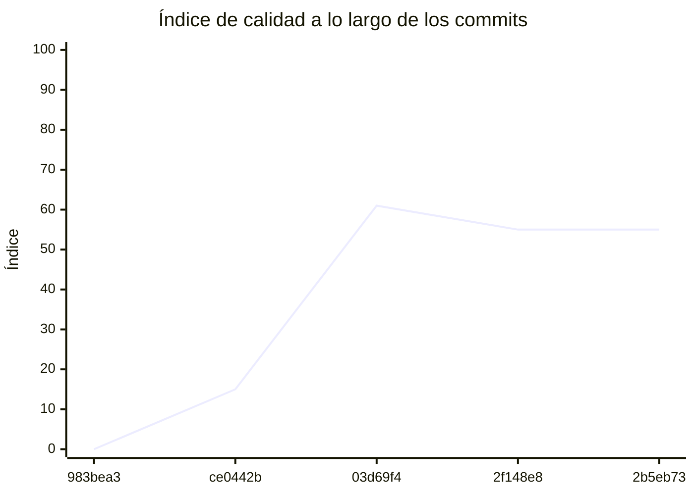

<!-- evaluacion:inicio -->
# Evaluación — manudiiez-um-programacion/turnos-catalogo-sync

> Documento **generado automáticamente** por la cátedra de Programación II (UM): RepoSense + análisis de calidad de **7 dimensiones**. **No editar a mano**: se regenera en cada evaluación.
> Rama evaluada: `main`. Análisis **heurístico** (regex + métricas) + build: es una criba para orientar la revisión, **no una nota**. La **documentación** del repositorio no se evalúa.
> Generado: 2026-11-12.

## 1. Veredicto

| Aspecto | Resultado |
|---|---|
| Índice de calidad | **66/100** |
| Tipo de repositorio | `backend` |
| Build (`mvnw verify` / `gradlew check`) | OK |
| Código (LOC) | 28,222 |
| Archivos de código | 335 |
| Clases | 379 |
| Código dentro de clases (%POO) | 76% |
| Funciones fuera de clases | 1 |
| Duplicación (puerta) | 4.4% |
| Duplicación lógica | 4.7% |
| Duplicación de boilerplate | 9.2% |
| Cobertura | 98% |
| Tope duro aplicado a D1 | `POO_BAJO` → D1 ≤ 60 |

> Este informe **describe** lo que el análisis midió con los criterios ya establecidos de la materia. No es una nota.

## 2. Semáforo de aprobación

Criterios de la cátedra (`CRITERIOS-CALIDAD.md`): **Aprobar** se juega con el perfil `estandar`; **destacar**, con el `exigente` (meta de excelencia).

| Semáforo | Resultado |
|---|---|
| Aprobar (`estandar`) | **no cumple** — 5/11 |
| Destacar (`exigente`) | **no cumple** — 4/11 |

**Para aprobar, falta cumplir:** SOLID; Duplicación; SEC

**Para destacar, falta cumplir:** SOLID; POO; Duplicación; SEC

## 3. Autoría (RepoSense)

| Autor | Commits | Código (LOC) | Tests (LOC) | Docs (LOC) | Días activos | % del código |
|---|---:|---:|---:|---:|---:|---:|
| Manuel Diez de Oñate | 91 | 15,169 | 17,061 | 6,624 | 13 | 100% |

> _El LOC de autoría lo calcula RepoSense sobre el historial y puede diferir del LOC de código del análisis (que mira el estado de `main`)._

## 4. Dimensiones evaluadas

Cada dimensión indica **qué mide**, **por qué importa** y **tu resultado**. Cuando el puntaje queda por debajo de la referencia, se agregan preguntas para **investigar la causa** (no hay recetas).

| Dimensión | Peso | Puntaje |
|:--|--:|--:|
| **D1** Diseño OO, SOLID y patrones (20%) | 20% | 1 |
| **D2** Arquitectura hexagonal — backend (15%) | 15% | 100 |
| **D3** Frontend KMP: MVVM y buenas prácticas (10%) | 10% | N/A |
| **D4** Integración y contrato (10%) | 10% | 90 |
| **D5** Seguridad y robustez (10%) | 10% | 0 |
| **D6** Pruebas y cobertura (20%) | 20% | 100 |
| **D7** Proceso y entrega (15%) | 15% | 100 |

### D1. Diseño OO, SOLID y patrones (20%)

- **Qué mide:** Métricas orientadas a objetos (clases, métodos, campos, cohesión, acoplamiento, herencia) y proxies de SOLID, más patrones de diseño.
- **Por qué importa:** El eje de la materia es el buen uso de la POO y su arquitectura: un diseño con clases claras y poco acopladas es más fácil de entender, probar y cambiar.
- **Tu resultado:** **1/100**
- **Para investigar la causa:**
    - ¿Se pensó el modelo de clases antes de codificar o se agrupó después?
    - ¿Qué clases concentran muchas responsabilidades a la vez?
    - ¿Los colaboradores llegan como parámetros o se crean por dentro?

### D2. Arquitectura hexagonal — backend (15%)

- **Qué mide:** Separación en capas (dominio, puertos de entrada/salida, adaptadores) y dirección de las dependencias del backend.
- **Por qué importa:** Aislar el dominio de la infraestructura permite cambiar la base de datos, el framework o el transporte sin tocar las reglas de negocio.
- **Tu resultado:** **100/100**

### D4. Integración y contrato (10%)

- **Qué mide:** Cumplimiento del contrato de integración de la cátedra (formato de errores, paginación, autenticación, endpoints esperados).
- **Por qué importa:** Los servicios deben poder integrarse entre sí y con la app sin sorpresas; el contrato es lo que hacen cumplir las pruebas de integración.
- **Tu resultado:** **90/100**

### D5. Seguridad y robustez (10%)

- **Qué mide:** Credenciales embebidas, consultas SQL por concatenación, y presencia de config de entorno; aislamiento de secretos.
- **Por qué importa:** Un secreto en el repositorio o una consulta construida por concatenación son riesgos concretos, no hipotéticos.
- **Tu resultado:** **0/100**
- **Para investigar la causa:**
    - ¿De dónde salen las credenciales que usa el sistema?
    - ¿Qué consultas se arman con texto en vez de parámetros?
    - ¿Qué pasa si falta una variable de entorno al arrancar?

### D6. Pruebas y cobertura (20%)

- **Qué mide:** Cantidad y resultado de pruebas y cobertura de línea (JaCoCo/Kover, Surefire/Failsafe) cuando hay build.
- **Por qué importa:** Las pruebas son la red de seguridad para refactorizar e integrar; la cobertura acota las zonas sin verificar.
- **Tu resultado:** **100/100**

### D7. Proceso y entrega (15%)

- **Qué mide:** Artefactos verificables de proceso/entrega: `compose`, `.env.example`, CI (`.github/workflows/`), `CODEOWNERS` y wrapper de build (`mvnw`/`gradlew`). **No** puntúa documentación.
- **Por qué importa:** Un proyecto que compila, se levanta y se valida solo es más fácil de revisar y de integrar en equipo.
- **Tu resultado:** **100/100**

## 5. Señales detectadas

El análisis encontró las siguientes señales (archivo, sin número de línea a propósito):

**DIP/concretos** (291)
- clase 'ProfessionalSpecifications' muy acoplada (CBO=32) — `src/main/java/com/um/catalogsync/professional/infrastructure/persistence/specification/ProfessionalSpecifications.java`
- clase 'JpaProfessionalRepositoryAdapter' muy acoplada (CBO=42) — `src/main/java/com/um/catalogsync/professional/infrastructure/persistence/adapter/JpaProfessionalRepositoryAdapter.java`
- clase 'ProfessionalEntity' muy acoplada (CBO=8) — `src/main/java/com/um/catalogsync/professional/infrastructure/persistence/entity/ProfessionalEntity.java`
- clase 'ProfessionalSearchController' muy acoplada (CBO=31) — `src/main/java/com/um/catalogsync/professional/infrastructure/web/ProfessionalSearchController.java`
- clase 'ProfessionalSearchRequest' muy acoplada (CBO=11) — `src/main/java/com/um/catalogsync/professional/infrastructure/web/dto/ProfessionalSearchRequest.java`
- clase 'ProfessionalService' muy acoplada (CBO=9) — `src/main/java/com/um/catalogsync/professional/application/service/ProfessionalService.java`
- clase 'SearchProfessionalsUseCaseImpl' muy acoplada (CBO=9) — `src/main/java/com/um/catalogsync/professional/application/usecases/SearchProfessionalsUseCaseImpl.java`
- clase 'ProfessionalRepository' muy acoplada (CBO=21) — `src/main/java/com/um/catalogsync/professional/domain/ports/out/ProfessionalRepository.java`
- clase 'SearchableName' muy acoplada (CBO=12) — `src/main/java/com/um/catalogsync/professional/domain/model/SearchableName.java`
- clase 'ProfessionalSearchCriteria' muy acoplada (CBO=11) — `src/main/java/com/um/catalogsync/professional/domain/model/ProfessionalSearchCriteria.java`
- clase 'ProfessionalSearchCriteria' instancia 3 concretos (CBO=11) — `src/main/java/com/um/catalogsync/professional/domain/model/ProfessionalSearchCriteria.java`
- clase 'CatedraRedisConnection' muy acoplada (CBO=35) — `src/main/java/com/um/catalogsync/sync/infrastructure/redis/CatedraRedisConnection.java`
- clase 'CatedraRedisConnection' instancia 3 concretos (CBO=35) — `src/main/java/com/um/catalogsync/sync/infrastructure/redis/CatedraRedisConnection.java`
- clase 'CatedraRedisProperties' muy acoplada (CBO=11) — `src/main/java/com/um/catalogsync/sync/infrastructure/redis/CatedraRedisProperties.java`
- clase 'CatalogChangesMapper' muy acoplada (CBO=15) — `src/main/java/com/um/catalogsync/sync/infrastructure/redis/mapper/CatalogChangesMapper.java`
- clase 'CatalogChangesMapper' instancia 7 concretos (CBO=15) — `src/main/java/com/um/catalogsync/sync/infrastructure/redis/mapper/CatalogChangesMapper.java`
- clase 'PublishedCatalogMapper' muy acoplada (CBO=28) — `src/main/java/com/um/catalogsync/sync/infrastructure/redis/mapper/PublishedCatalogMapper.java`
- clase 'PublishedCatalogMapper' instancia 7 concretos (CBO=28) — `src/main/java/com/um/catalogsync/sync/infrastructure/redis/mapper/PublishedCatalogMapper.java`
- clase 'RedisPublishedCatalogAdapter' muy acoplada (CBO=18) — `src/main/java/com/um/catalogsync/sync/infrastructure/redis/adapter/RedisPublishedCatalogAdapter.java`
- clase 'RedisCatalogChangesAdapter' muy acoplada (CBO=9) — `src/main/java/com/um/catalogsync/sync/infrastructure/redis/adapter/RedisCatalogChangesAdapter.java`
- clase 'InitialCatalogSyncRunner' muy acoplada (CBO=21) — `src/main/java/com/um/catalogsync/sync/infrastructure/startup/InitialCatalogSyncRunner.java`
- clase 'JpaSyncRunRepository' muy acoplada (CBO=29) — `src/main/java/com/um/catalogsync/sync/infrastructure/persistence/repository/JpaSyncRunRepository.java`
- clase 'JpaCatalogVersionRepository' muy acoplada (CBO=19) — `src/main/java/com/um/catalogsync/sync/infrastructure/persistence/repository/JpaCatalogVersionRepository.java`
- clase 'JpaProcessedEventRepository' muy acoplada (CBO=24) — `src/main/java/com/um/catalogsync/sync/infrastructure/persistence/repository/JpaProcessedEventRepository.java`
- clase 'SyncRunMapper' muy acoplada (CBO=11) — `src/main/java/com/um/catalogsync/sync/infrastructure/persistence/mapper/SyncRunMapper.java`
- clase 'JpaSyncRunRepositoryAdapter' muy acoplada (CBO=49) — `src/main/java/com/um/catalogsync/sync/infrastructure/persistence/adapter/JpaSyncRunRepositoryAdapter.java`
- clase 'JpaCatalogVersionRepositoryAdapter' muy acoplada (CBO=33) — `src/main/java/com/um/catalogsync/sync/infrastructure/persistence/adapter/JpaCatalogVersionRepositoryAdapter.java`
- clase 'JpaProcessedEventRepositoryAdapter' muy acoplada (CBO=12) — `src/main/java/com/um/catalogsync/sync/infrastructure/persistence/adapter/JpaProcessedEventRepositoryAdapter.java`
- clase 'CatalogVersionEntity' muy acoplada (CBO=8) — `src/main/java/com/um/catalogsync/sync/infrastructure/persistence/entity/CatalogVersionEntity.java`
- clase 'SyncErrorEntity' muy acoplada (CBO=9) — `src/main/java/com/um/catalogsync/sync/infrastructure/persistence/entity/SyncErrorEntity.java`
- clase 'SyncMetrics' muy acoplada (CBO=25) — `src/main/java/com/um/catalogsync/sync/infrastructure/metrics/SyncMetrics.java`
- clase 'CatalogUpdatedConsumer' muy acoplada (CBO=45) — `src/main/java/com/um/catalogsync/sync/infrastructure/messaging/CatalogUpdatedConsumer.java`
- clase 'CatalogUpdatedConsumer' instancia 3 concretos (CBO=45) — `src/main/java/com/um/catalogsync/sync/infrastructure/messaging/CatalogUpdatedConsumer.java`
- clase 'CatalogUpdatedListener' muy acoplada (CBO=17) — `src/main/java/com/um/catalogsync/sync/infrastructure/messaging/CatalogUpdatedListener.java`
- clase 'CatalogUpdatedConsumerStarter' muy acoplada (CBO=10) — `src/main/java/com/um/catalogsync/sync/infrastructure/messaging/CatalogUpdatedConsumerStarter.java`
- clase 'CatalogUpdatedMapper' muy acoplada (CBO=8) — `src/main/java/com/um/catalogsync/sync/infrastructure/messaging/mapper/CatalogUpdatedMapper.java`
- clase 'CatalogUpdatedMapper' instancia 7 concretos (CBO=8) — `src/main/java/com/um/catalogsync/sync/infrastructure/messaging/mapper/CatalogUpdatedMapper.java`
- clase 'CatalogSnapshotMapper' muy acoplada (CBO=14) — `src/main/java/com/um/catalogsync/sync/infrastructure/client/mapper/CatalogSnapshotMapper.java`
- clase 'CatalogSnapshotMapper' instancia 3 concretos (CBO=14) — `src/main/java/com/um/catalogsync/sync/infrastructure/client/mapper/CatalogSnapshotMapper.java`
- clase 'RestCatalogSnapshotAdapter' muy acoplada (CBO=40) — `src/main/java/com/um/catalogsync/sync/infrastructure/client/adapter/RestCatalogSnapshotAdapter.java`
- clase 'RestCatalogSnapshotAdapter' instancia 6 concretos (CBO=40) — `src/main/java/com/um/catalogsync/sync/infrastructure/client/adapter/RestCatalogSnapshotAdapter.java`
- clase 'CatalogReconciliationJob' muy acoplada (CBO=10) — `src/main/java/com/um/catalogsync/sync/infrastructure/reconciliation/CatalogReconciliationJob.java`
- clase 'CatalogEntityMapper' muy acoplada (CBO=20) — `src/main/java/com/um/catalogsync/sync/infrastructure/mapper/CatalogEntityMapper.java`
- clase 'ProcessedEventRetentionJob' muy acoplada (CBO=8) — `src/main/java/com/um/catalogsync/sync/infrastructure/retention/ProcessedEventRetentionJob.java`
- clase 'SyncHistoryRetentionJob' muy acoplada (CBO=8) — `src/main/java/com/um/catalogsync/sync/infrastructure/retention/SyncHistoryRetentionJob.java`
- clase 'SyncStatusController' muy acoplada (CBO=25) — `src/main/java/com/um/catalogsync/sync/infrastructure/web/SyncStatusController.java`
- clase 'SyncStatusWebMapper' muy acoplada (CBO=9) — `src/main/java/com/um/catalogsync/sync/infrastructure/web/mapper/SyncStatusWebMapper.java`
- clase 'SyncStatusWebMapper' instancia 5 concretos (CBO=9) — `src/main/java/com/um/catalogsync/sync/infrastructure/web/mapper/SyncStatusWebMapper.java`
- clase 'SyncErrorResponse' muy acoplada (CBO=9) — `src/main/java/com/um/catalogsync/sync/infrastructure/web/dto/SyncErrorResponse.java`
- clase 'CatalogSyncService' muy acoplada (CBO=20) — `src/main/java/com/um/catalogsync/sync/application/service/CatalogSyncService.java`
- clase 'HandleCatalogUpdatedUseCaseImpl' muy acoplada (CBO=15) — `src/main/java/com/um/catalogsync/sync/application/usecases/HandleCatalogUpdatedUseCaseImpl.java`
- clase 'ApplyIncrementalChangesUseCaseImpl' muy acoplada (CBO=30) — `src/main/java/com/um/catalogsync/sync/application/usecases/ApplyIncrementalChangesUseCaseImpl.java`
- clase 'ApplyIncrementalChangesUseCaseImpl' instancia 4 concretos (CBO=30) — `src/main/java/com/um/catalogsync/sync/application/usecases/ApplyIncrementalChangesUseCaseImpl.java`
- clase 'RunFullSyncUseCaseImpl' muy acoplada (CBO=42) — `src/main/java/com/um/catalogsync/sync/application/usecases/RunFullSyncUseCaseImpl.java`
- clase 'GetSyncStatusUseCaseImpl' muy acoplada (CBO=31) — `src/main/java/com/um/catalogsync/sync/application/usecases/GetSyncStatusUseCaseImpl.java`
- clase 'GetSyncStatusUseCaseImpl' instancia 4 concretos (CBO=31) — `src/main/java/com/um/catalogsync/sync/application/usecases/GetSyncStatusUseCaseImpl.java`
- clase 'ApplyCatalogSnapshotUseCaseImpl' muy acoplada (CBO=32) — `src/main/java/com/um/catalogsync/sync/application/usecases/ApplyCatalogSnapshotUseCaseImpl.java`
- clase 'SynchronizeCatalogUseCaseImpl' muy acoplada (CBO=41) — `src/main/java/com/um/catalogsync/sync/application/usecases/SynchronizeCatalogUseCaseImpl.java`
- clase 'ApplyCatalogVersionUseCaseImpl' muy acoplada (CBO=22) — `src/main/java/com/um/catalogsync/sync/application/usecases/ApplyCatalogVersionUseCaseImpl.java`
- clase 'CatalogSnapshotUnavailableException' muy acoplada (CBO=8) — `src/main/java/com/um/catalogsync/sync/application/exception/CatalogSnapshotUnavailableException.java`
- clase 'ProcessedEventRepository' muy acoplada (CBO=11) — `src/main/java/com/um/catalogsync/sync/domain/ports/out/ProcessedEventRepository.java`
- clase 'PublishedCatalogPort' muy acoplada (CBO=10) — `src/main/java/com/um/catalogsync/sync/domain/ports/out/PublishedCatalogPort.java`
- clase 'SyncRunRepository' muy acoplada (CBO=32) — `src/main/java/com/um/catalogsync/sync/domain/ports/out/SyncRunRepository.java`
- clase 'CatalogSnapshotPort' muy acoplada (CBO=11) — `src/main/java/com/um/catalogsync/sync/domain/ports/out/CatalogSnapshotPort.java`
- clase 'CatalogVersionRepository' muy acoplada (CBO=17) — `src/main/java/com/um/catalogsync/sync/domain/ports/out/CatalogVersionRepository.java`
- clase 'CatalogChangesPort' muy acoplada (CBO=11) — `src/main/java/com/um/catalogsync/sync/domain/ports/out/CatalogChangesPort.java`
- clase 'SynchronizeCatalogUseCase' muy acoplada (CBO=9) — `src/main/java/com/um/catalogsync/sync/domain/ports/in/SynchronizeCatalogUseCase.java`
- clase 'SyncErrorCode' muy acoplada (CBO=20) — `src/main/java/com/um/catalogsync/sync/domain/model/SyncErrorCode.java`
- clase 'CatalogVersion' muy acoplada (CBO=15) — `src/main/java/com/um/catalogsync/sync/domain/model/CatalogVersion.java`
- clase 'CatalogSnapshot' muy acoplada (CBO=16) — `src/main/java/com/um/catalogsync/sync/domain/model/CatalogSnapshot.java`
- clase 'SyncTrigger' muy acoplada (CBO=14) — `src/main/java/com/um/catalogsync/sync/domain/model/SyncTrigger.java`
- clase 'CatalogVersionDelta' muy acoplada (CBO=13) — `src/main/java/com/um/catalogsync/sync/domain/model/CatalogVersionDelta.java`
- clase 'SyncOriginState' muy acoplada (CBO=11) — `src/main/java/com/um/catalogsync/sync/domain/model/SyncOriginState.java`
- clase 'IncrementalSyncOutcome' muy acoplada (CBO=11) — `src/main/java/com/um/catalogsync/sync/domain/model/IncrementalSyncOutcome.java`
- clase 'SyncRun' muy acoplada (CBO=23) — `src/main/java/com/um/catalogsync/sync/domain/model/SyncRun.java`
- clase 'CatalogUpdatedEvent' muy acoplada (CBO=13) — `src/main/java/com/um/catalogsync/sync/domain/model/CatalogUpdatedEvent.java`
- clase 'SyncError' muy acoplada (CBO=8) — `src/main/java/com/um/catalogsync/sync/domain/model/SyncError.java`
- clase 'SyncHealth' muy acoplada (CBO=16) — `src/main/java/com/um/catalogsync/sync/domain/model/SyncHealth.java`
- clase 'SyncDecisionReason' muy acoplada (CBO=16) — `src/main/java/com/um/catalogsync/sync/domain/model/SyncDecisionReason.java`
- clase 'CatalogChanges' muy acoplada (CBO=8) — `src/main/java/com/um/catalogsync/sync/domain/model/CatalogChanges.java`
- clase 'PublishedCatalogMetadata' muy acoplada (CBO=8) — `src/main/java/com/um/catalogsync/sync/domain/model/PublishedCatalogMetadata.java`
- clase 'IncrementalSyncResult' muy acoplada (CBO=8) — `src/main/java/com/um/catalogsync/sync/domain/model/IncrementalSyncResult.java`
- clase 'SyncStatusReport' muy acoplada (CBO=28) — `src/main/java/com/um/catalogsync/sync/domain/model/SyncStatusReport.java`
- clase 'JpaCategoryRepositoryAdapter' muy acoplada (CBO=14) — `src/main/java/com/um/catalogsync/category/infrastructure/persistence/adapter/JpaCategoryRepositoryAdapter.java`
- clase 'CategoryRepository' muy acoplada (CBO=12) — `src/main/java/com/um/catalogsync/category/domain/ports/out/CategoryRepository.java`
- clase 'ProblemAuthenticationEntryPoint' muy acoplada (CBO=23) — `src/main/java/com/um/catalogsync/shared/infrastructure/security/ProblemAuthenticationEntryPoint.java`
- clase 'SecurityConfig' muy acoplada (CBO=86) — `src/main/java/com/um/catalogsync/shared/infrastructure/security/SecurityConfig.java`
- clase 'SecurityConfig' instancia 7 concretos (CBO=86) — `src/main/java/com/um/catalogsync/shared/infrastructure/security/SecurityConfig.java`
- clase 'ApiSecurityProperties' muy acoplada (CBO=23) — `src/main/java/com/um/catalogsync/shared/infrastructure/security/ApiSecurityProperties.java`
- clase 'ApiSecurityProperties' instancia 3 concretos (CBO=23) — `src/main/java/com/um/catalogsync/shared/infrastructure/security/ApiSecurityProperties.java`
- clase 'Jwt' muy acoplada (CBO=14) — `src/main/java/com/um/catalogsync/shared/infrastructure/security/ApiSecurityProperties.java`
- clase 'ProblemAccessDeniedHandler' muy acoplada (CBO=11) — `src/main/java/com/um/catalogsync/shared/infrastructure/security/ProblemAccessDeniedHandler.java`
- clase 'ProblemReader' muy acoplada (CBO=10) — `src/main/java/com/um/catalogsync/shared/infrastructure/client/ProblemReader.java`
- clase 'ProblemJsonWriter' muy acoplada (CBO=19) — `src/main/java/com/um/catalogsync/shared/infrastructure/web/ProblemJsonWriter.java`
- clase 'ApiExceptionHandler' muy acoplada (CBO=33) — `src/main/java/com/um/catalogsync/shared/infrastructure/web/ApiExceptionHandler.java`
- clase 'ApiErrorCode' muy acoplada (CBO=23) — `src/main/java/com/um/catalogsync/shared/infrastructure/web/ApiErrorCode.java`
- clase 'OpenApiConfig' muy acoplada (CBO=27) — `src/main/java/com/um/catalogsync/shared/infrastructure/web/OpenApiConfig.java`
- clase 'OpenApiConfig' instancia 5 concretos (CBO=27) — `src/main/java/com/um/catalogsync/shared/infrastructure/web/OpenApiConfig.java`
- clase 'Secret' muy acoplada (CBO=17) — `src/main/java/com/um/catalogsync/shared/domain/model/Secret.java`
- clase 'Secret' instancia 3 concretos (CBO=17) — `src/main/java/com/um/catalogsync/shared/domain/model/Secret.java`
- clase 'CatedraRestClientConfig' muy acoplada (CBO=23) — `src/main/java/com/um/catalogsync/integration/infrastructure/client/CatedraRestClientConfig.java`
- clase 'RestIntegrationConfigAdapter' muy acoplada (CBO=22) — `src/main/java/com/um/catalogsync/integration/infrastructure/client/adapter/RestIntegrationConfigAdapter.java`
- clase 'RestIntegrationConfigAdapter' instancia 4 concretos (CBO=22) — `src/main/java/com/um/catalogsync/integration/infrastructure/client/adapter/RestIntegrationConfigAdapter.java`
- clase 'RestTechnicalAuthAdapter' muy acoplada (CBO=34) — `src/main/java/com/um/catalogsync/integration/infrastructure/client/adapter/RestTechnicalAuthAdapter.java`
- clase 'RestTechnicalAuthAdapter' instancia 7 concretos (CBO=34) — `src/main/java/com/um/catalogsync/integration/infrastructure/client/adapter/RestTechnicalAuthAdapter.java`
- clase 'CatedraApiProperties' muy acoplada (CBO=25) — `src/main/java/com/um/catalogsync/integration/infrastructure/config/CatedraApiProperties.java`
- clase 'TechnicalSessionCache' muy acoplada (CBO=25) — `src/main/java/com/um/catalogsync/integration/application/session/TechnicalSessionCache.java`
- clase 'IntegrationService' muy acoplada (CBO=10) — `src/main/java/com/um/catalogsync/integration/application/service/IntegrationService.java`
- clase 'IntegrationNotProvisionedException' muy acoplada (CBO=9) — `src/main/java/com/um/catalogsync/integration/application/exception/IntegrationNotProvisionedException.java`
- clase 'CatedraIntegrationUnavailableException' muy acoplada (CBO=8) — `src/main/java/com/um/catalogsync/integration/application/exception/CatedraIntegrationUnavailableException.java`
- clase 'ProvisioningStatus' muy acoplada (CBO=14) — `src/main/java/com/um/catalogsync/integration/domain/model/ProvisioningStatus.java`
- clase 'IntegrationConfig' muy acoplada (CBO=26) — `src/main/java/com/um/catalogsync/integration/domain/model/IntegrationConfig.java`
- clase 'TechnicalSession' muy acoplada (CBO=9) — `src/main/java/com/um/catalogsync/integration/domain/model/TechnicalSession.java`
- clase 'JpaWeeklyScheduleRepository' muy acoplada (CBO=28) — `src/main/java/com/um/catalogsync/schedule/infrastructure/persistence/repository/JpaWeeklyScheduleRepository.java`
- clase 'JpaWeeklyScheduleRepositoryAdapter' muy acoplada (CBO=27) — `src/main/java/com/um/catalogsync/schedule/infrastructure/persistence/adapter/JpaWeeklyScheduleRepositoryAdapter.java`
- clase 'WeeklyScheduleEntity' muy acoplada (CBO=22) — `src/main/java/com/um/catalogsync/schedule/infrastructure/persistence/entity/WeeklyScheduleEntity.java`
- clase 'CurrentAgendaController' muy acoplada (CBO=23) — `src/main/java/com/um/catalogsync/schedule/infrastructure/web/CurrentAgendaController.java`
- clase 'CurrentAgendaWebMapper' muy acoplada (CBO=11) — `src/main/java/com/um/catalogsync/schedule/infrastructure/web/mapper/CurrentAgendaWebMapper.java`
- clase 'CurrentAgendaWebMapper' instancia 3 concretos (CBO=11) — `src/main/java/com/um/catalogsync/schedule/infrastructure/web/mapper/CurrentAgendaWebMapper.java`
- clase 'ProfessionalResponse' muy acoplada (CBO=8) — `src/main/java/com/um/catalogsync/schedule/infrastructure/web/dto/ProfessionalResponse.java`
- clase 'WeeklyScheduleResponse' muy acoplada (CBO=10) — `src/main/java/com/um/catalogsync/schedule/infrastructure/web/dto/WeeklyScheduleResponse.java`
- clase 'GetCurrentAgendaUseCaseImpl' muy acoplada (CBO=15) — `src/main/java/com/um/catalogsync/schedule/application/usecases/GetCurrentAgendaUseCaseImpl.java`
- clase 'WeeklyScheduleRepository' muy acoplada (CBO=21) — `src/main/java/com/um/catalogsync/schedule/domain/ports/out/WeeklyScheduleRepository.java`
- clase 'AvailabilityCriteria' muy acoplada (CBO=36) — `src/main/java/com/um/catalogsync/schedule/domain/model/AvailabilityCriteria.java`
- clase 'AvailabilityCriteria' instancia 6 concretos (CBO=36) — `src/main/java/com/um/catalogsync/schedule/domain/model/AvailabilityCriteria.java`
- clase 'DayOfWeek' muy acoplada (CBO=15) — `src/main/java/com/um/catalogsync/schedule/domain/model/DayOfWeek.java`
- clase 'WeeklySchedule' muy acoplada (CBO=19) — `src/main/java/com/um/catalogsync/schedule/domain/model/WeeklySchedule.java`
- clase 'TimeOfDay' muy acoplada (CBO=19) — `src/main/java/com/um/catalogsync/schedule/domain/model/TimeOfDay.java`
- clase 'TimeOfDay' instancia 3 concretos (CBO=19) — `src/main/java/com/um/catalogsync/schedule/domain/model/TimeOfDay.java`
- clase 'CurrentAgenda' muy acoplada (CBO=9) — `src/main/java/com/um/catalogsync/schedule/domain/model/CurrentAgenda.java`
- clase 'ProfessionalMapperTest' muy acoplada (CBO=9) — `src/test/java/com/um/catalogsync/professional/infrastructure/persistence/mapper/ProfessionalMapperTest.java`
- clase 'JpaProfessionalRepositoryAdapterTest' muy acoplada (CBO=38) — `src/test/java/com/um/catalogsync/professional/infrastructure/persistence/adapter/JpaProfessionalRepositoryAdapterTest.java`
- clase 'ProfessionalSearchQueryTest' muy acoplada (CBO=38) — `src/test/java/com/um/catalogsync/professional/infrastructure/persistence/adapter/ProfessionalSearchQueryTest.java`
- clase 'OrdenYPaginado' muy acoplada (CBO=9) — `src/test/java/com/um/catalogsync/professional/infrastructure/persistence/adapter/ProfessionalSearchQueryTest.java`
- clase 'ProfessionalAvailabilityQueryTest' muy acoplada (CBO=44) — `src/test/java/com/um/catalogsync/professional/infrastructure/persistence/adapter/ProfessionalAvailabilityQueryTest.java`
- clase 'Rango' muy acoplada (CBO=10) — `src/test/java/com/um/catalogsync/professional/infrastructure/persistence/adapter/ProfessionalAvailabilityQueryTest.java`
- clase 'Combinado' muy acoplada (CBO=11) — `src/test/java/com/um/catalogsync/professional/infrastructure/persistence/adapter/ProfessionalAvailabilityQueryTest.java`
- clase 'ProfessionalSearchApiIntegrationTest' muy acoplada (CBO=71) — `src/test/java/com/um/catalogsync/professional/infrastructure/web/ProfessionalSearchApiIntegrationTest.java`
- clase 'CopiaSincronizada' muy acoplada (CBO=19) — `src/test/java/com/um/catalogsync/professional/infrastructure/web/ProfessionalSearchApiIntegrationTest.java`
- clase 'Disponibilidad' muy acoplada (CBO=19) — `src/test/java/com/um/catalogsync/professional/infrastructure/web/ProfessionalSearchApiIntegrationTest.java`
- clase 'ProfessionalServiceTest' muy acoplada (CBO=19) — `src/test/java/com/um/catalogsync/professional/application/service/ProfessionalServiceTest.java`
- clase 'ProfessionalServiceTest' instancia 7 concretos (CBO=19) — `src/test/java/com/um/catalogsync/professional/application/service/ProfessionalServiceTest.java`
- clase 'SearchProfessionalsUseCaseImplTest' muy acoplada (CBO=17) — `src/test/java/com/um/catalogsync/professional/application/usecases/SearchProfessionalsUseCaseImplTest.java`
- clase 'SearchProfessionalsUseCaseImplTest' instancia 3 concretos (CBO=17) — `src/test/java/com/um/catalogsync/professional/application/usecases/SearchProfessionalsUseCaseImplTest.java`
- clase 'ProfessionalSearchCriteriaTest' muy acoplada (CBO=15) — `src/test/java/com/um/catalogsync/professional/domain/model/ProfessionalSearchCriteriaTest.java`
- clase 'ProfessionalSearchCriteriaTest' instancia 7 concretos (CBO=15) — `src/test/java/com/um/catalogsync/professional/domain/model/ProfessionalSearchCriteriaTest.java`
- clase 'ProfessionalPageTest' muy acoplada (CBO=8) — `src/test/java/com/um/catalogsync/professional/domain/model/ProfessionalPageTest.java`
- clase 'ProfessionalPageTest' instancia 6 concretos (CBO=8) — `src/test/java/com/um/catalogsync/professional/domain/model/ProfessionalPageTest.java`
- clase 'SearchableNameTest' muy acoplada (CBO=8) — `src/test/java/com/um/catalogsync/professional/domain/model/SearchableNameTest.java`
- clase 'CatalogSnapshotFixtures' muy acoplada (CBO=23) — `src/test/java/com/um/catalogsync/sync/CatalogSnapshotFixtures.java`
- clase 'SyncRecoveryEndToEndTest' muy acoplada (CBO=125) — `src/test/java/com/um/catalogsync/sync/SyncRecoveryEndToEndTest.java`
- clase 'SyncRecoveryEndToEndTest' instancia 8 concretos (CBO=125) — `src/test/java/com/um/catalogsync/sync/SyncRecoveryEndToEndTest.java`
- clase 'Idempotencia' muy acoplada (CBO=24) — `src/test/java/com/um/catalogsync/sync/SyncRecoveryEndToEndTest.java`
- clase 'OrdenDeLasVersiones' muy acoplada (CBO=31) — `src/test/java/com/um/catalogsync/sync/SyncRecoveryEndToEndTest.java`
- clase 'RecuperacionPorDiscontinuidad' muy acoplada (CBO=28) — `src/test/java/com/um/catalogsync/sync/SyncRecoveryEndToEndTest.java`
- clase 'ReinicioConUnaSincronizacionAMedias' muy acoplada (CBO=24) — `src/test/java/com/um/catalogsync/sync/SyncRecoveryEndToEndTest.java`
- clase 'ReconciliationIntegrationTest' muy acoplada (CBO=40) — `src/test/java/com/um/catalogsync/sync/ReconciliationIntegrationTest.java`
- clase 'FullSyncIntegrationTest' muy acoplada (CBO=55) — `src/test/java/com/um/catalogsync/sync/FullSyncIntegrationTest.java`
- clase 'FullSyncEndToEndTest' muy acoplada (CBO=89) — `src/test/java/com/um/catalogsync/sync/FullSyncEndToEndTest.java`
- clase 'FullSyncEndToEndTest' instancia 3 concretos (CBO=89) — `src/test/java/com/um/catalogsync/sync/FullSyncEndToEndTest.java`
- clase 'IncrementalSyncIntegrationTest' muy acoplada (CBO=47) — `src/test/java/com/um/catalogsync/sync/IncrementalSyncIntegrationTest.java`
- clase 'PublishedCatalogFixtures' muy acoplada (CBO=15) — `src/test/java/com/um/catalogsync/sync/infrastructure/redis/PublishedCatalogFixtures.java`
- clase 'CatedraRedisPropertiesTest' muy acoplada (CBO=9) — `src/test/java/com/um/catalogsync/sync/infrastructure/redis/CatedraRedisPropertiesTest.java`
- clase 'CatedraRedisPropertiesTest' instancia 5 concretos (CBO=9) — `src/test/java/com/um/catalogsync/sync/infrastructure/redis/CatedraRedisPropertiesTest.java`
- clase 'CatedraRedisForTests' muy acoplada (CBO=31) — `src/test/java/com/um/catalogsync/sync/infrastructure/redis/CatedraRedisForTests.java`
- clase 'CatedraRedisForTests' instancia 4 concretos (CBO=31) — `src/test/java/com/um/catalogsync/sync/infrastructure/redis/CatedraRedisForTests.java`
- clase 'CatalogChangesMapperTest' muy acoplada (CBO=23) — `src/test/java/com/um/catalogsync/sync/infrastructure/redis/mapper/CatalogChangesMapperTest.java`
- clase 'PublishedCatalogMapperTest' muy acoplada (CBO=39) — `src/test/java/com/um/catalogsync/sync/infrastructure/redis/mapper/PublishedCatalogMapperTest.java`
- clase 'RedisCatalogChangesAdapterTest' muy acoplada (CBO=44) — `src/test/java/com/um/catalogsync/sync/infrastructure/redis/adapter/RedisCatalogChangesAdapterTest.java`
- clase 'RedisCatalogChangesAdapterTest' instancia 9 concretos (CBO=44) — `src/test/java/com/um/catalogsync/sync/infrastructure/redis/adapter/RedisCatalogChangesAdapterTest.java`
- clase 'RedisPublishedCatalogAdapterTest' muy acoplada (CBO=62) — `src/test/java/com/um/catalogsync/sync/infrastructure/redis/adapter/RedisPublishedCatalogAdapterTest.java`
- clase 'RedisPublishedCatalogAdapterTest' instancia 9 concretos (CBO=62) — `src/test/java/com/um/catalogsync/sync/infrastructure/redis/adapter/RedisPublishedCatalogAdapterTest.java`
- clase 'InitialSyncOnStartupIntegrationTest' muy acoplada (CBO=55) — `src/test/java/com/um/catalogsync/sync/infrastructure/startup/InitialSyncOnStartupIntegrationTest.java`
- clase 'InitialSyncOnStartupIntegrationTest' instancia 10 concretos (CBO=55) — `src/test/java/com/um/catalogsync/sync/infrastructure/startup/InitialSyncOnStartupIntegrationTest.java`
- clase 'InitialCatalogSyncRunnerTest' muy acoplada (CBO=33) — `src/test/java/com/um/catalogsync/sync/infrastructure/startup/InitialCatalogSyncRunnerTest.java`
- clase 'InitialCatalogSyncRunnerTest' instancia 12 concretos (CBO=33) — `src/test/java/com/um/catalogsync/sync/infrastructure/startup/InitialCatalogSyncRunnerTest.java`
- clase 'SyncRunMapperTest' muy acoplada (CBO=23) — `src/test/java/com/um/catalogsync/sync/infrastructure/persistence/mapper/SyncRunMapperTest.java`
- clase 'CatalogVersionMapperTest' muy acoplada (CBO=15) — `src/test/java/com/um/catalogsync/sync/infrastructure/persistence/mapper/CatalogVersionMapperTest.java`
- clase 'JpaProcessedEventRepositoryAdapterTest' muy acoplada (CBO=34) — `src/test/java/com/um/catalogsync/sync/infrastructure/persistence/adapter/JpaProcessedEventRepositoryAdapterTest.java`
- clase 'JpaCatalogVersionRepositoryAdapterTest' muy acoplada (CBO=57) — `src/test/java/com/um/catalogsync/sync/infrastructure/persistence/adapter/JpaCatalogVersionRepositoryAdapterTest.java`
- clase 'JpaCatalogVersionRepositoryAdapterTest' instancia 5 concretos (CBO=57) — `src/test/java/com/um/catalogsync/sync/infrastructure/persistence/adapter/JpaCatalogVersionRepositoryAdapterTest.java`
- clase 'JpaSyncRunRepositoryAdapterTest' muy acoplada (CBO=64) — `src/test/java/com/um/catalogsync/sync/infrastructure/persistence/adapter/JpaSyncRunRepositoryAdapterTest.java`
- clase 'SyncMetricsTest' muy acoplada (CBO=27) — `src/test/java/com/um/catalogsync/sync/infrastructure/metrics/SyncMetricsTest.java`
- clase 'CatalogSyncHealthIndicatorTest' muy acoplada (CBO=17) — `src/test/java/com/um/catalogsync/sync/infrastructure/health/CatalogSyncHealthIndicatorTest.java`
- clase 'CatalogUpdatedConsumerIntegrationTest' muy acoplada (CBO=53) — `src/test/java/com/um/catalogsync/sync/infrastructure/messaging/CatalogUpdatedConsumerIntegrationTest.java`
- clase 'CatalogUpdatedConsumerIntegrationTest' instancia 13 concretos (CBO=53) — `src/test/java/com/um/catalogsync/sync/infrastructure/messaging/CatalogUpdatedConsumerIntegrationTest.java`
- clase 'CatedraKafkaPropertiesTest' muy acoplada (CBO=9) — `src/test/java/com/um/catalogsync/sync/infrastructure/messaging/CatedraKafkaPropertiesTest.java`
- clase 'CatedraKafkaPropertiesTest' instancia 6 concretos (CBO=9) — `src/test/java/com/um/catalogsync/sync/infrastructure/messaging/CatedraKafkaPropertiesTest.java`
- clase 'CatalogUpdatedFixtures' muy acoplada (CBO=8) — `src/test/java/com/um/catalogsync/sync/infrastructure/messaging/CatalogUpdatedFixtures.java`
- clase 'CatalogUpdatedListenerTest' muy acoplada (CBO=29) — `src/test/java/com/um/catalogsync/sync/infrastructure/messaging/CatalogUpdatedListenerTest.java`
- clase 'CatalogUpdatedListenerTest' instancia 8 concretos (CBO=29) — `src/test/java/com/um/catalogsync/sync/infrastructure/messaging/CatalogUpdatedListenerTest.java`
- clase 'CatalogUpdatedMapperTest' muy acoplada (CBO=27) — `src/test/java/com/um/catalogsync/sync/infrastructure/messaging/mapper/CatalogUpdatedMapperTest.java`
- clase 'SnapshotFixtures' muy acoplada (CBO=18) — `src/test/java/com/um/catalogsync/sync/infrastructure/client/SnapshotFixtures.java`
- clase 'CatalogSnapshotMapperTest' muy acoplada (CBO=32) — `src/test/java/com/um/catalogsync/sync/infrastructure/client/mapper/CatalogSnapshotMapperTest.java`
- clase 'CatalogSnapshotMapperTest' instancia 24 concretos (CBO=32) — `src/test/java/com/um/catalogsync/sync/infrastructure/client/mapper/CatalogSnapshotMapperTest.java`
- clase 'RestCatalogSnapshotAdapterTest' muy acoplada (CBO=62) — `src/test/java/com/um/catalogsync/sync/infrastructure/client/adapter/RestCatalogSnapshotAdapterTest.java`
- clase 'RestCatalogSnapshotAdapterTest' instancia 4 concretos (CBO=62) — `src/test/java/com/um/catalogsync/sync/infrastructure/client/adapter/RestCatalogSnapshotAdapterTest.java`
- clase 'CatalogReconciliationJobTest' muy acoplada (CBO=32) — `src/test/java/com/um/catalogsync/sync/infrastructure/reconciliation/CatalogReconciliationJobTest.java`
- clase 'CatalogReconciliationJobTest' instancia 9 concretos (CBO=32) — `src/test/java/com/um/catalogsync/sync/infrastructure/reconciliation/CatalogReconciliationJobTest.java`
- clase 'CatalogEntityMapperTest' muy acoplada (CBO=17) — `src/test/java/com/um/catalogsync/sync/infrastructure/mapper/CatalogEntityMapperTest.java`
- clase 'CatalogEntityMapperTest' instancia 6 concretos (CBO=17) — `src/test/java/com/um/catalogsync/sync/infrastructure/mapper/CatalogEntityMapperTest.java`
- clase 'ProcessedEventRetentionJobTest' muy acoplada (CBO=16) — `src/test/java/com/um/catalogsync/sync/infrastructure/retention/ProcessedEventRetentionJobTest.java`
- clase 'ProcessedEventRetentionJobTest' instancia 9 concretos (CBO=16) — `src/test/java/com/um/catalogsync/sync/infrastructure/retention/ProcessedEventRetentionJobTest.java`
- clase 'SyncHistoryRetentionJobTest' muy acoplada (CBO=23) — `src/test/java/com/um/catalogsync/sync/infrastructure/retention/SyncHistoryRetentionJobTest.java`
- clase 'SyncHistoryRetentionJobTest' instancia 14 concretos (CBO=23) — `src/test/java/com/um/catalogsync/sync/infrastructure/retention/SyncHistoryRetentionJobTest.java`
- clase 'PurgasRegistradas' muy acoplada (CBO=10) — `src/test/java/com/um/catalogsync/sync/infrastructure/retention/SyncHistoryRetentionJobTest.java`
- clase 'PurgasRegistradas' instancia 5 concretos (CBO=10) — `src/test/java/com/um/catalogsync/sync/infrastructure/retention/SyncHistoryRetentionJobTest.java`
- clase 'SyncStatusApiIntegrationTest' muy acoplada (CBO=66) — `src/test/java/com/um/catalogsync/sync/infrastructure/web/SyncStatusApiIntegrationTest.java`
- clase 'SyncStatusApiIntegrationTest' instancia 5 concretos (CBO=66) — `src/test/java/com/um/catalogsync/sync/infrastructure/web/SyncStatusApiIntegrationTest.java`
- clase 'Reporte' muy acoplada (CBO=23) — `src/test/java/com/um/catalogsync/sync/infrastructure/web/SyncStatusApiIntegrationTest.java`
- clase 'EstadosDegradados' muy acoplada (CBO=15) — `src/test/java/com/um/catalogsync/sync/infrastructure/web/SyncStatusApiIntegrationTest.java`
- clase 'CatalogSyncServiceTest' muy acoplada (CBO=27) — `src/test/java/com/um/catalogsync/sync/application/service/CatalogSyncServiceTest.java`
- clase 'CatalogSyncServiceTest' instancia 13 concretos (CBO=27) — `src/test/java/com/um/catalogsync/sync/application/service/CatalogSyncServiceTest.java`
- clase 'HandleCatalogUpdatedUseCaseImplTest' muy acoplada (CBO=29) — `src/test/java/com/um/catalogsync/sync/application/usecases/HandleCatalogUpdatedUseCaseImplTest.java`
- clase 'HandleCatalogUpdatedUseCaseImplTest' instancia 10 concretos (CBO=29) — `src/test/java/com/um/catalogsync/sync/application/usecases/HandleCatalogUpdatedUseCaseImplTest.java`
- clase 'SincronizacionesRegistradas' muy acoplada (CBO=8) — `src/test/java/com/um/catalogsync/sync/application/usecases/HandleCatalogUpdatedUseCaseImplTest.java`
- clase 'ApplyCatalogSnapshotUseCaseImplTest' muy acoplada (CBO=30) — `src/test/java/com/um/catalogsync/sync/application/usecases/ApplyCatalogSnapshotUseCaseImplTest.java`
- clase 'ApplyCatalogSnapshotUseCaseImplTest' instancia 24 concretos (CBO=30) — `src/test/java/com/um/catalogsync/sync/application/usecases/ApplyCatalogSnapshotUseCaseImplTest.java`
- clase 'GetLocalCatalogVersionUseCaseImplTest' muy acoplada (CBO=10) — `src/test/java/com/um/catalogsync/sync/application/usecases/GetLocalCatalogVersionUseCaseImplTest.java`
- clase 'GetLocalCatalogVersionUseCaseImplTest' instancia 4 concretos (CBO=10) — `src/test/java/com/um/catalogsync/sync/application/usecases/GetLocalCatalogVersionUseCaseImplTest.java`
- clase 'GetSyncStatusUseCaseImplTest' muy acoplada (CBO=52) — `src/test/java/com/um/catalogsync/sync/application/usecases/GetSyncStatusUseCaseImplTest.java`
- clase 'GetSyncStatusUseCaseImplTest' instancia 18 concretos (CBO=52) — `src/test/java/com/um/catalogsync/sync/application/usecases/GetSyncStatusUseCaseImplTest.java`
- clase 'Historial' muy acoplada (CBO=11) — `src/test/java/com/um/catalogsync/sync/application/usecases/GetSyncStatusUseCaseImplTest.java`
- clase 'Historial' instancia 4 concretos (CBO=11) — `src/test/java/com/um/catalogsync/sync/application/usecases/GetSyncStatusUseCaseImplTest.java`
- clase 'Origen' muy acoplada (CBO=9) — `src/test/java/com/um/catalogsync/sync/application/usecases/GetSyncStatusUseCaseImplTest.java`
- clase 'Origen' instancia 5 concretos (CBO=9) — `src/test/java/com/um/catalogsync/sync/application/usecases/GetSyncStatusUseCaseImplTest.java`
- clase 'ApplyCatalogVersionUseCaseImplTest' muy acoplada (CBO=42) — `src/test/java/com/um/catalogsync/sync/application/usecases/ApplyCatalogVersionUseCaseImplTest.java`
- clase 'ApplyCatalogVersionUseCaseImplTest' instancia 5 concretos (CBO=42) — `src/test/java/com/um/catalogsync/sync/application/usecases/ApplyCatalogVersionUseCaseImplTest.java`
- clase 'RunFullSyncUseCaseImplTest' muy acoplada (CBO=61) — `src/test/java/com/um/catalogsync/sync/application/usecases/RunFullSyncUseCaseImplTest.java`
- clase 'RunFullSyncUseCaseImplTest' instancia 17 concretos (CBO=61) — `src/test/java/com/um/catalogsync/sync/application/usecases/RunFullSyncUseCaseImplTest.java`
- clase 'CorridasQueRegistran' muy acoplada (CBO=14) — `src/test/java/com/um/catalogsync/sync/application/usecases/RunFullSyncUseCaseImplTest.java`
- clase 'SynchronizeCatalogUseCaseImplTest' muy acoplada (CBO=68) — `src/test/java/com/um/catalogsync/sync/application/usecases/SynchronizeCatalogUseCaseImplTest.java`
- clase 'SynchronizeCatalogUseCaseImplTest' instancia 25 concretos (CBO=68) — `src/test/java/com/um/catalogsync/sync/application/usecases/SynchronizeCatalogUseCaseImplTest.java`
- clase 'Origen' muy acoplada (CBO=9) — `src/test/java/com/um/catalogsync/sync/application/usecases/SynchronizeCatalogUseCaseImplTest.java`
- clase 'Origen' instancia 5 concretos (CBO=9) — `src/test/java/com/um/catalogsync/sync/application/usecases/SynchronizeCatalogUseCaseImplTest.java`
- clase 'Incremental' muy acoplada (CBO=11) — `src/test/java/com/um/catalogsync/sync/application/usecases/SynchronizeCatalogUseCaseImplTest.java`
- clase 'Completa' muy acoplada (CBO=10) — `src/test/java/com/um/catalogsync/sync/application/usecases/SynchronizeCatalogUseCaseImplTest.java`
- clase 'Corridas' muy acoplada (CBO=15) — `src/test/java/com/um/catalogsync/sync/application/usecases/SynchronizeCatalogUseCaseImplTest.java`
- clase 'ApplyIncrementalChangesUseCaseImplTest' muy acoplada (CBO=47) — `src/test/java/com/um/catalogsync/sync/application/usecases/ApplyIncrementalChangesUseCaseImplTest.java`
- clase 'ApplyIncrementalChangesUseCaseImplTest' instancia 7 concretos (CBO=47) — `src/test/java/com/um/catalogsync/sync/application/usecases/ApplyIncrementalChangesUseCaseImplTest.java`
- clase 'VersionLocalEnMemoria' muy acoplada (CBO=8) — `src/test/java/com/um/catalogsync/sync/application/usecases/ApplyIncrementalChangesUseCaseImplTest.java`
- clase 'CatalogoPublicadoEnMemoria' muy acoplada (CBO=9) — `src/test/java/com/um/catalogsync/sync/application/usecases/ApplyIncrementalChangesUseCaseImplTest.java`
- clase 'SyncStatusReportTest' muy acoplada (CBO=49) — `src/test/java/com/um/catalogsync/sync/domain/model/SyncStatusReportTest.java`
- clase 'SyncStatusReportTest' instancia 5 concretos (CBO=49) — `src/test/java/com/um/catalogsync/sync/domain/model/SyncStatusReportTest.java`
- clase 'CatalogVersionTest' muy acoplada (CBO=11) — `src/test/java/com/um/catalogsync/sync/domain/model/CatalogVersionTest.java`
- clase 'ProfessionalCategoryMapperTest' muy acoplada (CBO=11) — `src/test/java/com/um/catalogsync/category/infrastructure/persistence/mapper/ProfessionalCategoryMapperTest.java`
- clase 'JpaCategoryRepositoryAdapterTest' muy acoplada (CBO=15) — `src/test/java/com/um/catalogsync/category/infrastructure/persistence/adapter/JpaCategoryRepositoryAdapterTest.java`
- clase 'FlywayMigrationsTest' muy acoplada (CBO=31) — `src/test/java/com/um/catalogsync/shared/infrastructure/FlywayMigrationsTest.java`
- clase 'AbstractPostgresIntegrationTest' muy acoplada (CBO=16) — `src/test/java/com/um/catalogsync/shared/infrastructure/AbstractPostgresIntegrationTest.java`
- clase 'TokensDePrueba' muy acoplada (CBO=25) — `src/test/java/com/um/catalogsync/shared/infrastructure/security/TokensDePrueba.java`
- clase 'TokensDePrueba' instancia 4 concretos (CBO=25) — `src/test/java/com/um/catalogsync/shared/infrastructure/security/TokensDePrueba.java`
- clase 'ApiSecurityIntegrationTest' muy acoplada (CBO=49) — `src/test/java/com/um/catalogsync/shared/infrastructure/security/ApiSecurityIntegrationTest.java`
- clase 'ApiDeUsuario' muy acoplada (CBO=12) — `src/test/java/com/um/catalogsync/shared/infrastructure/security/ApiSecurityIntegrationTest.java`
- clase 'IdentidadesSeparadas' muy acoplada (CBO=8) — `src/test/java/com/um/catalogsync/shared/infrastructure/security/ApiSecurityIntegrationTest.java`
- clase 'ApiSecurityPropertiesTest' muy acoplada (CBO=13) — `src/test/java/com/um/catalogsync/shared/infrastructure/security/ApiSecurityPropertiesTest.java`
- clase 'ContratoOpenApiVersionadoTest' muy acoplada (CBO=17) — `src/test/java/com/um/catalogsync/shared/infrastructure/web/ContratoOpenApiVersionadoTest.java`
- clase 'ApiDeSoloLecturaTest' muy acoplada (CBO=25) — `src/test/java/com/um/catalogsync/shared/infrastructure/web/ApiDeSoloLecturaTest.java`
- clase 'IntegrationFixtures' muy acoplada (CBO=18) — `src/test/java/com/um/catalogsync/integration/IntegrationFixtures.java`
- clase 'SecretosNoSeFiltranTest' muy acoplada (CBO=53) — `src/test/java/com/um/catalogsync/integration/SecretosNoSeFiltranTest.java`
- clase 'SecretosNoSeFiltranTest' instancia 13 concretos (CBO=53) — `src/test/java/com/um/catalogsync/integration/SecretosNoSeFiltranTest.java`
- clase 'IntegrationConfigStartupVerifierTest' muy acoplada (CBO=11) — `src/test/java/com/um/catalogsync/integration/infrastructure/startup/IntegrationConfigStartupVerifierTest.java`
- clase 'IntegrationConfigStartupVerifierTest' instancia 4 concretos (CBO=11) — `src/test/java/com/um/catalogsync/integration/infrastructure/startup/IntegrationConfigStartupVerifierTest.java`
- clase 'IntegrationConfigMapperTest' muy acoplada (CBO=15) — `src/test/java/com/um/catalogsync/integration/infrastructure/client/mapper/IntegrationConfigMapperTest.java`
- clase 'RestTechnicalAuthAdapterTest' muy acoplada (CBO=30) — `src/test/java/com/um/catalogsync/integration/infrastructure/client/adapter/RestTechnicalAuthAdapterTest.java`
- clase 'RestTechnicalAuthAdapterTest' instancia 3 concretos (CBO=30) — `src/test/java/com/um/catalogsync/integration/infrastructure/client/adapter/RestTechnicalAuthAdapterTest.java`
- clase 'RestIntegrationConfigAdapterTest' muy acoplada (CBO=21) — `src/test/java/com/um/catalogsync/integration/infrastructure/client/adapter/RestIntegrationConfigAdapterTest.java`
- clase 'CatedraApiPropertiesTest' muy acoplada (CBO=19) — `src/test/java/com/um/catalogsync/integration/infrastructure/config/CatedraApiPropertiesTest.java`
- clase 'CatedraApiPropertiesTest' instancia 3 concretos (CBO=19) — `src/test/java/com/um/catalogsync/integration/infrastructure/config/CatedraApiPropertiesTest.java`
- clase 'TechnicalSessionCacheTest' muy acoplada (CBO=28) — `src/test/java/com/um/catalogsync/integration/application/session/TechnicalSessionCacheTest.java`
- clase 'TechnicalSessionCacheTest' instancia 15 concretos (CBO=28) — `src/test/java/com/um/catalogsync/integration/application/session/TechnicalSessionCacheTest.java`
- clase 'IntegrationServiceTest' muy acoplada (CBO=8) — `src/test/java/com/um/catalogsync/integration/application/service/IntegrationServiceTest.java`
- clase 'ProvisioningStatusTest' muy acoplada (CBO=10) — `src/test/java/com/um/catalogsync/integration/domain/model/ProvisioningStatusTest.java`
- clase 'IntegrationConfigTest' muy acoplada (CBO=18) — `src/test/java/com/um/catalogsync/integration/domain/model/IntegrationConfigTest.java`
- clase 'WeeklyScheduleMapperTest' muy acoplada (CBO=17) — `src/test/java/com/um/catalogsync/schedule/infrastructure/persistence/mapper/WeeklyScheduleMapperTest.java`
- clase 'JpaWeeklyScheduleRepositoryAdapterTest' muy acoplada (CBO=54) — `src/test/java/com/um/catalogsync/schedule/infrastructure/persistence/adapter/JpaWeeklyScheduleRepositoryAdapterTest.java`
- clase 'AgendaOpenApiContractTest' muy acoplada (CBO=21) — `src/test/java/com/um/catalogsync/schedule/infrastructure/web/AgendaOpenApiContractTest.java`
- clase 'CurrentAgendaApiIntegrationTest' muy acoplada (CBO=58) — `src/test/java/com/um/catalogsync/schedule/infrastructure/web/CurrentAgendaApiIntegrationTest.java`
- clase 'CurrentAgendaApiIntegrationTest' instancia 3 concretos (CBO=58) — `src/test/java/com/um/catalogsync/schedule/infrastructure/web/CurrentAgendaApiIntegrationTest.java`
- clase 'CopiaSincronizada' muy acoplada (CBO=12) — `src/test/java/com/um/catalogsync/schedule/infrastructure/web/CurrentAgendaApiIntegrationTest.java`
- clase 'Errores' muy acoplada (CBO=10) — `src/test/java/com/um/catalogsync/schedule/infrastructure/web/CurrentAgendaApiIntegrationTest.java`
- clase 'Autorizacion' muy acoplada (CBO=9) — `src/test/java/com/um/catalogsync/schedule/infrastructure/web/CurrentAgendaApiIntegrationTest.java`
- clase 'WeeklyScheduleServiceTest' muy acoplada (CBO=13) — `src/test/java/com/um/catalogsync/schedule/application/service/WeeklyScheduleServiceTest.java`
- clase 'GetSchedulesByProfessionalUseCaseImplTest' muy acoplada (CBO=13) — `src/test/java/com/um/catalogsync/schedule/application/usecases/GetSchedulesByProfessionalUseCaseImplTest.java`
- clase 'GetSchedulesByProfessionalUseCaseImplTest' instancia 9 concretos (CBO=13) — `src/test/java/com/um/catalogsync/schedule/application/usecases/GetSchedulesByProfessionalUseCaseImplTest.java`
- clase 'GetCurrentAgendaUseCaseImplTest' muy acoplada (CBO=29) — `src/test/java/com/um/catalogsync/schedule/application/usecases/GetCurrentAgendaUseCaseImplTest.java`
- clase 'GetCurrentAgendaUseCaseImplTest' instancia 16 concretos (CBO=29) — `src/test/java/com/um/catalogsync/schedule/application/usecases/GetCurrentAgendaUseCaseImplTest.java`
- clase 'AvailabilityCriteriaTest' muy acoplada (CBO=18) — `src/test/java/com/um/catalogsync/schedule/domain/model/AvailabilityCriteriaTest.java`
- clase 'FormasInvalidas' muy acoplada (CBO=12) — `src/test/java/com/um/catalogsync/schedule/domain/model/AvailabilityCriteriaTest.java`
- clase 'TimeOfDayTest' muy acoplada (CBO=12) — `src/test/java/com/um/catalogsync/schedule/domain/model/TimeOfDayTest.java`
- clase 'DayOfWeekTest' muy acoplada (CBO=17) — `src/test/java/com/um/catalogsync/schedule/domain/model/DayOfWeekTest.java`
- clase 'WeeklyScheduleTest' muy acoplada (CBO=13) — `src/test/java/com/um/catalogsync/schedule/domain/model/WeeklyScheduleTest.java`

**SRP/responsabilidad** (167)
- clase 'JpaProfessionalRepositoryAdapter' grande (LOC=142, métodos=12, campos=6) — `src/main/java/com/um/catalogsync/professional/infrastructure/persistence/adapter/JpaProfessionalRepositoryAdapter.java`
- clase 'JpaProfessionalRepositoryAdapter' con baja cohesión (27%) — `src/main/java/com/um/catalogsync/professional/infrastructure/persistence/adapter/JpaProfessionalRepositoryAdapter.java`
- clase 'ProfessionalEntity' grande (LOC=28, métodos=0, campos=8) — `src/main/java/com/um/catalogsync/professional/infrastructure/persistence/entity/ProfessionalEntity.java`
- clase 'ProfessionalEntity' sin métodos (8 campos): solo datos — `src/main/java/com/um/catalogsync/professional/infrastructure/persistence/entity/ProfessionalEntity.java`
- clase 'ProfessionalService' con baja cohesión (30%) — `src/main/java/com/um/catalogsync/professional/application/service/ProfessionalService.java`
- clase 'Professional' sin métodos (7 campos): solo datos — `src/main/java/com/um/catalogsync/professional/domain/model/Professional.java`
- clase 'PublishedCatalogKeys' grande (LOC=36, métodos=2, campos=8) — `src/main/java/com/um/catalogsync/sync/infrastructure/redis/PublishedCatalogKeys.java`
- clase 'CatedraRedisConnection' con baja cohesión (36%) — `src/main/java/com/um/catalogsync/sync/infrastructure/redis/CatedraRedisConnection.java`
- método 'CatedraRedisConnection.abrir' de 40 líneas — `src/main/java/com/um/catalogsync/sync/infrastructure/redis/CatedraRedisConnection.java`
- clase 'CatalogChangesMapper' con baja cohesión (20%) — `src/main/java/com/um/catalogsync/sync/infrastructure/redis/mapper/CatalogChangesMapper.java`
- clase 'PublishedCatalogMapper' grande (LOC=127, métodos=12, campos=5) — `src/main/java/com/um/catalogsync/sync/infrastructure/redis/mapper/PublishedCatalogMapper.java`
- clase 'PublishedCatalogMapper' con baja cohesión (17%) — `src/main/java/com/um/catalogsync/sync/infrastructure/redis/mapper/PublishedCatalogMapper.java`
- clase 'JpaSyncRunRepositoryAdapter' grande (LOC=154, métodos=10, campos=5) — `src/main/java/com/um/catalogsync/sync/infrastructure/persistence/adapter/JpaSyncRunRepositoryAdapter.java`
- clase 'CatalogVersionEntity' sin métodos (5 campos): solo datos — `src/main/java/com/um/catalogsync/sync/infrastructure/persistence/entity/CatalogVersionEntity.java`
- clase 'SyncErrorEntity' sin métodos (5 campos): solo datos — `src/main/java/com/um/catalogsync/sync/infrastructure/persistence/entity/SyncErrorEntity.java`
- clase 'ProcessedEventEntity' sin métodos (6 campos): solo datos — `src/main/java/com/um/catalogsync/sync/infrastructure/persistence/entity/ProcessedEventEntity.java`
- clase 'SyncRunEntity' grande (LOC=31, métodos=0, campos=9) — `src/main/java/com/um/catalogsync/sync/infrastructure/persistence/entity/SyncRunEntity.java`
- clase 'SyncRunEntity' sin métodos (9 campos): solo datos — `src/main/java/com/um/catalogsync/sync/infrastructure/persistence/entity/SyncRunEntity.java`
- clase 'CatalogUpdatedConsumer' con baja cohesión (40%) — `src/main/java/com/um/catalogsync/sync/infrastructure/messaging/CatalogUpdatedConsumer.java`
- método 'CatalogUpdatedConsumer.construir' de 31 líneas — `src/main/java/com/um/catalogsync/sync/infrastructure/messaging/CatalogUpdatedConsumer.java`
- clase 'CatalogUpdatedMapper' con baja cohesión (7%) — `src/main/java/com/um/catalogsync/sync/infrastructure/messaging/mapper/CatalogUpdatedMapper.java`
- clase 'RestCatalogSnapshotAdapter' con baja cohesión (29%) — `src/main/java/com/um/catalogsync/sync/infrastructure/client/adapter/RestCatalogSnapshotAdapter.java`
- clase 'CatalogSyncService' con baja cohesión (0%) — `src/main/java/com/um/catalogsync/sync/application/service/CatalogSyncService.java`
- clase 'ApplyIncrementalChangesUseCaseImpl' con baja cohesión (0%) — `src/main/java/com/um/catalogsync/sync/application/usecases/ApplyIncrementalChangesUseCaseImpl.java`
- método 'ApplyIncrementalChangesUseCaseImpl.applyUpTo' de 40 líneas — `src/main/java/com/um/catalogsync/sync/application/usecases/ApplyIncrementalChangesUseCaseImpl.java`
- método 'RunFullSyncUseCaseImpl.codigoDe' con complejidad 10 — `src/main/java/com/um/catalogsync/sync/application/usecases/RunFullSyncUseCaseImpl.java`
- clase 'GetSyncStatusUseCaseImpl' con baja cohesión (0%) — `src/main/java/com/um/catalogsync/sync/application/usecases/GetSyncStatusUseCaseImpl.java`
- clase 'SynchronizeCatalogUseCaseImpl' con baja cohesión (0%) — `src/main/java/com/um/catalogsync/sync/application/usecases/SynchronizeCatalogUseCaseImpl.java`
- método 'SynchronizeCatalogUseCaseImpl.decidirYSincronizar' de 47 líneas — `src/main/java/com/um/catalogsync/sync/application/usecases/SynchronizeCatalogUseCaseImpl.java`
- método 'SynchronizeCatalogUseCaseImpl.decidirYSincronizar' con complejidad 6 — `src/main/java/com/um/catalogsync/sync/application/usecases/SynchronizeCatalogUseCaseImpl.java`
- clase 'CatalogSnapshot' sin métodos (5 campos): solo datos — `src/main/java/com/um/catalogsync/sync/domain/model/CatalogSnapshot.java`
- clase 'SyncRun' grande (LOC=49, métodos=2, campos=9) — `src/main/java/com/um/catalogsync/sync/domain/model/SyncRun.java`
- clase 'CatalogUpdatedEvent' sin métodos (5 campos): solo datos — `src/main/java/com/um/catalogsync/sync/domain/model/CatalogUpdatedEvent.java`
- clase 'SyncError' sin métodos (4 campos): solo datos — `src/main/java/com/um/catalogsync/sync/domain/model/SyncError.java`
- método 'SyncStatusReport.health' con complejidad 6 — `src/main/java/com/um/catalogsync/sync/domain/model/SyncStatusReport.java`
- clase 'ProfessionalCategoryEntity' sin métodos (6 campos): solo datos — `src/main/java/com/um/catalogsync/category/infrastructure/persistence/entity/ProfessionalCategoryEntity.java`
- clase 'ProfessionalCategory' sin métodos (6 campos): solo datos — `src/main/java/com/um/catalogsync/category/domain/model/ProfessionalCategory.java`
- clase 'SecurityConfig' grande (LOC=235, métodos=7, campos=8) — `src/main/java/com/um/catalogsync/shared/infrastructure/security/SecurityConfig.java`
- clase 'SecurityConfig' con baja cohesión (38%) — `src/main/java/com/um/catalogsync/shared/infrastructure/security/SecurityConfig.java`
- método 'SecurityConfig.authenticationEntryPoint' de 30 líneas — `src/main/java/com/um/catalogsync/shared/infrastructure/security/SecurityConfig.java`
- método 'ApiSecurityProperties.ApiSecurityProperties' de 75 líneas — `src/main/java/com/um/catalogsync/shared/infrastructure/security/ApiSecurityProperties.java`
- método 'ApiSecurityProperties.Jwt' de 33 líneas — `src/main/java/com/um/catalogsync/shared/infrastructure/security/ApiSecurityProperties.java`
- método 'Jwt.Jwt' de 33 líneas — `src/main/java/com/um/catalogsync/shared/infrastructure/security/ApiSecurityProperties.java`
- método 'OpenApiConfig.contratoDelServicio' de 47 líneas — `src/main/java/com/um/catalogsync/shared/infrastructure/web/OpenApiConfig.java`
- clase 'RestIntegrationConfigAdapter' con baja cohesión (29%) — `src/main/java/com/um/catalogsync/integration/infrastructure/client/adapter/RestIntegrationConfigAdapter.java`
- clase 'RestTechnicalAuthAdapter' con baja cohesión (40%) — `src/main/java/com/um/catalogsync/integration/infrastructure/client/adapter/RestTechnicalAuthAdapter.java`
- clase 'TechnicalSessionCache' con baja cohesión (40%) — `src/main/java/com/um/catalogsync/integration/application/session/TechnicalSessionCache.java`
- clase 'IntegrationConfig' grande (LOC=105, métodos=4, campos=13) — `src/main/java/com/um/catalogsync/integration/domain/model/IntegrationConfig.java`
- clase 'IntegrationConfig' con baja cohesión (33%) — `src/main/java/com/um/catalogsync/integration/domain/model/IntegrationConfig.java`
- clase 'JpaWeeklyScheduleRepositoryAdapter' grande (LOC=115, métodos=13, campos=4) — `src/main/java/com/um/catalogsync/schedule/infrastructure/persistence/adapter/JpaWeeklyScheduleRepositoryAdapter.java`
- clase 'JpaWeeklyScheduleRepositoryAdapter' con baja cohesión (31%) — `src/main/java/com/um/catalogsync/schedule/infrastructure/persistence/adapter/JpaWeeklyScheduleRepositoryAdapter.java`
- clase 'WeeklyScheduleEntity' grande (LOC=47, métodos=0, campos=9) — `src/main/java/com/um/catalogsync/schedule/infrastructure/persistence/entity/WeeklyScheduleEntity.java`
- clase 'WeeklyScheduleEntity' sin métodos (9 campos): solo datos — `src/main/java/com/um/catalogsync/schedule/infrastructure/persistence/entity/WeeklyScheduleEntity.java`
- clase 'AvailabilityCriteria' grande (LOC=150, métodos=10, campos=0) — `src/main/java/com/um/catalogsync/schedule/domain/model/AvailabilityCriteria.java`
- método 'AvailabilityCriteria.AvailabilityCriteria' de 150 líneas — `src/main/java/com/um/catalogsync/schedule/domain/model/AvailabilityCriteria.java`
- método 'AvailabilityCriteria.AvailabilityCriteria' con complejidad 12 — `src/main/java/com/um/catalogsync/schedule/domain/model/AvailabilityCriteria.java`
- clase 'WeeklySchedule' grande (LOC=28, métodos=0, campos=10) — `src/main/java/com/um/catalogsync/schedule/domain/model/WeeklySchedule.java`
- clase 'WeeklySchedule' sin métodos (10 campos): solo datos — `src/main/java/com/um/catalogsync/schedule/domain/model/WeeklySchedule.java`
- clase 'JpaProfessionalRepositoryAdapterTest' grande (LOC=172, métodos=15, campos=8) — `src/test/java/com/um/catalogsync/professional/infrastructure/persistence/adapter/JpaProfessionalRepositoryAdapterTest.java`
- clase 'ProfessionalSearchQueryTest' grande (LOC=214, métodos=20, campos=6) — `src/test/java/com/um/catalogsync/professional/infrastructure/persistence/adapter/ProfessionalSearchQueryTest.java`
- clase 'ProfessionalSearchQueryTest' con baja cohesión (5%) — `src/test/java/com/um/catalogsync/professional/infrastructure/persistence/adapter/ProfessionalSearchQueryTest.java`
- clase 'ProfessionalAvailabilityQueryTest' grande (LOC=228, métodos=18, campos=8) — `src/test/java/com/um/catalogsync/professional/infrastructure/persistence/adapter/ProfessionalAvailabilityQueryTest.java`
- clase 'ProfessionalAvailabilityQueryTest' con baja cohesión (8%) — `src/test/java/com/um/catalogsync/professional/infrastructure/persistence/adapter/ProfessionalAvailabilityQueryTest.java`
- clase 'ProfessionalSearchApiIntegrationTest' grande (LOC=414, métodos=36, campos=13) — `src/test/java/com/um/catalogsync/professional/infrastructure/web/ProfessionalSearchApiIntegrationTest.java`
- clase 'ProfessionalSearchApiIntegrationTest' con baja cohesión (5%) — `src/test/java/com/um/catalogsync/professional/infrastructure/web/ProfessionalSearchApiIntegrationTest.java`
- clase 'ProfessionalSearchCriteriaTest' grande (LOC=88, métodos=10, campos=1) — `src/test/java/com/um/catalogsync/professional/domain/model/ProfessionalSearchCriteriaTest.java`
- clase 'CatalogSnapshotFixtures' grande (LOC=122, métodos=12, campos=3) — `src/test/java/com/um/catalogsync/sync/CatalogSnapshotFixtures.java`
- clase 'SyncRecoveryEndToEndTest' grande (LOC=522, métodos=48, campos=24) — `src/test/java/com/um/catalogsync/sync/SyncRecoveryEndToEndTest.java`
- clase 'SyncRecoveryEndToEndTest' con baja cohesión (11%) — `src/test/java/com/um/catalogsync/sync/SyncRecoveryEndToEndTest.java`
- método 'SyncRecoveryEndToEndTest.laCaidaEntrePersistirYConfirmarNoDuplicaEfectos' de 32 líneas — `src/test/java/com/um/catalogsync/sync/SyncRecoveryEndToEndTest.java`
- método 'SyncRecoveryEndToEndTest.dosVersionesPendientesDejanLaLocalEnLaUltima' de 35 líneas — `src/test/java/com/um/catalogsync/sync/SyncRecoveryEndToEndTest.java`
- método 'SyncRecoveryEndToEndTest.noSeSalteaLaVersionQueFalta' de 30 líneas — `src/test/java/com/um/catalogsync/sync/SyncRecoveryEndToEndTest.java`
- método 'SyncRecoveryEndToEndTest.elReinicioRecuperaElAtraso' de 37 líneas — `src/test/java/com/um/catalogsync/sync/SyncRecoveryEndToEndTest.java`
- método 'Idempotencia.laCaidaEntrePersistirYConfirmarNoDuplicaEfectos' de 32 líneas — `src/test/java/com/um/catalogsync/sync/SyncRecoveryEndToEndTest.java`
- método 'OrdenDeLasVersiones.dosVersionesPendientesDejanLaLocalEnLaUltima' de 35 líneas — `src/test/java/com/um/catalogsync/sync/SyncRecoveryEndToEndTest.java`
- método 'OrdenDeLasVersiones.noSeSalteaLaVersionQueFalta' de 30 líneas — `src/test/java/com/um/catalogsync/sync/SyncRecoveryEndToEndTest.java`
- método 'ReinicioConUnaSincronizacionAMedias.elReinicioRecuperaElAtraso' de 37 líneas — `src/test/java/com/um/catalogsync/sync/SyncRecoveryEndToEndTest.java`
- clase 'ReconciliationIntegrationTest' grande (LOC=123, métodos=16, campos=6) — `src/test/java/com/um/catalogsync/sync/ReconciliationIntegrationTest.java`
- clase 'ReconciliationIntegrationTest' con baja cohesión (9%) — `src/test/java/com/um/catalogsync/sync/ReconciliationIntegrationTest.java`
- clase 'FullSyncIntegrationTest' grande (LOC=235, métodos=23, campos=8) — `src/test/java/com/um/catalogsync/sync/FullSyncIntegrationTest.java`
- clase 'FullSyncIntegrationTest' con baja cohesión (20%) — `src/test/java/com/um/catalogsync/sync/FullSyncIntegrationTest.java`
- clase 'FullSyncEndToEndTest' grande (LOC=392, métodos=26, campos=20) — `src/test/java/com/um/catalogsync/sync/FullSyncEndToEndTest.java`
- clase 'FullSyncEndToEndTest' con baja cohesión (24%) — `src/test/java/com/um/catalogsync/sync/FullSyncEndToEndTest.java`
- método 'FullSyncEndToEndTest.baseVaciaQuedaSincronizada' de 40 líneas — `src/test/java/com/um/catalogsync/sync/FullSyncEndToEndTest.java`
- método 'FullSyncEndToEndTest.elFalloAMitadNoAvanzaLaVersion' de 34 líneas — `src/test/java/com/um/catalogsync/sync/FullSyncEndToEndTest.java`
- método 'FullSyncEndToEndTest.catalogoDeLaCatedra' de 56 líneas — `src/test/java/com/um/catalogsync/sync/FullSyncEndToEndTest.java`
- clase 'IncrementalSyncIntegrationTest' grande (LOC=156, métodos=16, campos=7) — `src/test/java/com/um/catalogsync/sync/IncrementalSyncIntegrationTest.java`
- clase 'IncrementalSyncIntegrationTest' con baja cohesión (22%) — `src/test/java/com/um/catalogsync/sync/IncrementalSyncIntegrationTest.java`
- clase 'PublishedCatalogFixtures' con baja cohesión (0%) — `src/test/java/com/um/catalogsync/sync/infrastructure/redis/PublishedCatalogFixtures.java`
- clase 'CatedraRedisForTests' con baja cohesión (14%) — `src/test/java/com/um/catalogsync/sync/infrastructure/redis/CatedraRedisForTests.java`
- clase 'CatalogChangesMapperTest' grande (LOC=170, métodos=14, campos=3) — `src/test/java/com/um/catalogsync/sync/infrastructure/redis/mapper/CatalogChangesMapperTest.java`
- clase 'PublishedCatalogMapperTest' grande (LOC=162, métodos=14, campos=1) — `src/test/java/com/um/catalogsync/sync/infrastructure/redis/mapper/PublishedCatalogMapperTest.java`
- clase 'RedisCatalogChangesAdapterTest' grande (LOC=158, métodos=17, campos=4) — `src/test/java/com/um/catalogsync/sync/infrastructure/redis/adapter/RedisCatalogChangesAdapterTest.java`
- clase 'RedisPublishedCatalogAdapterTest' grande (LOC=261, métodos=33, campos=4) — `src/test/java/com/um/catalogsync/sync/infrastructure/redis/adapter/RedisPublishedCatalogAdapterTest.java`
- clase 'RedisPublishedCatalogAdapterTest' con baja cohesión (34%) — `src/test/java/com/um/catalogsync/sync/infrastructure/redis/adapter/RedisPublishedCatalogAdapterTest.java`
- método 'RedisPublishedCatalogAdapterTest.leeLasTresEntidades' de 30 líneas — `src/test/java/com/um/catalogsync/sync/infrastructure/redis/adapter/RedisPublishedCatalogAdapterTest.java`
- clase 'InitialSyncOnStartupIntegrationTest' grande (LOC=180, métodos=19, campos=8) — `src/test/java/com/um/catalogsync/sync/infrastructure/startup/InitialSyncOnStartupIntegrationTest.java`
- clase 'InitialSyncOnStartupIntegrationTest' con baja cohesión (11%) — `src/test/java/com/um/catalogsync/sync/infrastructure/startup/InitialSyncOnStartupIntegrationTest.java`
- clase 'InitialCatalogSyncRunnerTest' grande (LOC=128, métodos=14, campos=1) — `src/test/java/com/um/catalogsync/sync/infrastructure/startup/InitialCatalogSyncRunnerTest.java`
- clase 'JpaProcessedEventRepositoryAdapterTest' grande (LOC=102, métodos=10, campos=3) — `src/test/java/com/um/catalogsync/sync/infrastructure/persistence/adapter/JpaProcessedEventRepositoryAdapterTest.java`
- clase 'JpaProcessedEventRepositoryAdapterTest' con baja cohesión (49%) — `src/test/java/com/um/catalogsync/sync/infrastructure/persistence/adapter/JpaProcessedEventRepositoryAdapterTest.java`
- clase 'JpaCatalogVersionRepositoryAdapterTest' grande (LOC=255, métodos=20, campos=5) — `src/test/java/com/um/catalogsync/sync/infrastructure/persistence/adapter/JpaCatalogVersionRepositoryAdapterTest.java`
- método 'JpaCatalogVersionRepositoryAdapterTest.extracting' de 36 líneas — `src/test/java/com/um/catalogsync/sync/infrastructure/persistence/adapter/JpaCatalogVersionRepositoryAdapterTest.java`
- método 'JpaCatalogVersionRepositoryAdapterTest.extracting' con complejidad 6 — `src/test/java/com/um/catalogsync/sync/infrastructure/persistence/adapter/JpaCatalogVersionRepositoryAdapterTest.java`
- método 'JpaCatalogVersionRepositoryAdapterTest.enParalelo' con complejidad 6 — `src/test/java/com/um/catalogsync/sync/infrastructure/persistence/adapter/JpaCatalogVersionRepositoryAdapterTest.java`
- clase 'JpaSyncRunRepositoryAdapterTest' grande (LOC=277, métodos=27, campos=4) — `src/test/java/com/um/catalogsync/sync/infrastructure/persistence/adapter/JpaSyncRunRepositoryAdapterTest.java`
- clase 'SyncMetricsTest' grande (LOC=107, métodos=11, campos=2) — `src/test/java/com/um/catalogsync/sync/infrastructure/metrics/SyncMetricsTest.java`
- clase 'CatalogUpdatedConsumerIntegrationTest' grande (LOC=243, métodos=26, campos=6) — `src/test/java/com/um/catalogsync/sync/infrastructure/messaging/CatalogUpdatedConsumerIntegrationTest.java`
- clase 'CatalogUpdatedConsumerIntegrationTest' con baja cohesión (20%) — `src/test/java/com/um/catalogsync/sync/infrastructure/messaging/CatalogUpdatedConsumerIntegrationTest.java`
- clase 'CatalogUpdatedFixtures' con baja cohesión (0%) — `src/test/java/com/um/catalogsync/sync/infrastructure/messaging/CatalogUpdatedFixtures.java`
- clase 'CatalogUpdatedListenerTest' grande (LOC=88, métodos=8, campos=8) — `src/test/java/com/um/catalogsync/sync/infrastructure/messaging/CatalogUpdatedListenerTest.java`
- clase 'CatalogUpdatedListenerTest' con baja cohesión (29%) — `src/test/java/com/um/catalogsync/sync/infrastructure/messaging/CatalogUpdatedListenerTest.java`
- clase 'CatalogUpdatedMapperTest' grande (LOC=139, métodos=13, campos=2) — `src/test/java/com/um/catalogsync/sync/infrastructure/messaging/mapper/CatalogUpdatedMapperTest.java`
- clase 'SnapshotFixtures' con baja cohesión (0%) — `src/test/java/com/um/catalogsync/sync/infrastructure/client/SnapshotFixtures.java`
- método 'SnapshotFixtures.snapshotDeLaReferencia' de 42 líneas — `src/test/java/com/um/catalogsync/sync/infrastructure/client/SnapshotFixtures.java`
- método 'SnapshotFixtures.snapshotDeLaReferencia' de 86 líneas — `src/test/java/com/um/catalogsync/sync/infrastructure/client/SnapshotFixtures.java`
- método 'SnapshotFixtures.snapshotConEntidadesDeshabilitadas' de 72 líneas — `src/test/java/com/um/catalogsync/sync/infrastructure/client/SnapshotFixtures.java`
- clase 'CatalogSnapshotMapperTest' grande (LOC=221, métodos=26, campos=4) — `src/test/java/com/um/catalogsync/sync/infrastructure/client/mapper/CatalogSnapshotMapperTest.java`
- clase 'RestCatalogSnapshotAdapterTest' grande (LOC=221, métodos=22, campos=2) — `src/test/java/com/um/catalogsync/sync/infrastructure/client/adapter/RestCatalogSnapshotAdapterTest.java`
- clase 'CatalogReconciliationJobTest' grande (LOC=91, métodos=11, campos=1) — `src/test/java/com/um/catalogsync/sync/infrastructure/reconciliation/CatalogReconciliationJobTest.java`
- clase 'ProcessedEventRetentionJobTest' grande (LOC=81, métodos=11, campos=2) — `src/test/java/com/um/catalogsync/sync/infrastructure/retention/ProcessedEventRetentionJobTest.java`
- clase 'SyncHistoryRetentionJobTest' grande (LOC=83, métodos=12, campos=2) — `src/test/java/com/um/catalogsync/sync/infrastructure/retention/SyncHistoryRetentionJobTest.java`
- clase 'SyncStatusApiIntegrationTest' grande (LOC=234, métodos=20, campos=7) — `src/test/java/com/um/catalogsync/sync/infrastructure/web/SyncStatusApiIntegrationTest.java`
- clase 'SyncStatusApiIntegrationTest' con baja cohesión (11%) — `src/test/java/com/um/catalogsync/sync/infrastructure/web/SyncStatusApiIntegrationTest.java`
- clase 'CatalogSyncServiceTest' con baja cohesión (14%) — `src/test/java/com/um/catalogsync/sync/application/service/CatalogSyncServiceTest.java`
- clase 'HandleCatalogUpdatedUseCaseImplTest' grande (LOC=128, métodos=14, campos=5) — `src/test/java/com/um/catalogsync/sync/application/usecases/HandleCatalogUpdatedUseCaseImplTest.java`
- clase 'HandleCatalogUpdatedUseCaseImplTest' con baja cohesión (14%) — `src/test/java/com/um/catalogsync/sync/application/usecases/HandleCatalogUpdatedUseCaseImplTest.java`
- clase 'ApplyCatalogSnapshotUseCaseImplTest' grande (LOC=174, métodos=27, campos=5) — `src/test/java/com/um/catalogsync/sync/application/usecases/ApplyCatalogSnapshotUseCaseImplTest.java`
- clase 'ApplyCatalogSnapshotUseCaseImplTest' con baja cohesión (11%) — `src/test/java/com/um/catalogsync/sync/application/usecases/ApplyCatalogSnapshotUseCaseImplTest.java`
- clase 'GetSyncStatusUseCaseImplTest' grande (LOC=207, métodos=28, campos=11) — `src/test/java/com/um/catalogsync/sync/application/usecases/GetSyncStatusUseCaseImplTest.java`
- clase 'GetSyncStatusUseCaseImplTest' con baja cohesión (15%) — `src/test/java/com/um/catalogsync/sync/application/usecases/GetSyncStatusUseCaseImplTest.java`
- clase 'Historial' con baja cohesión (10%) — `src/test/java/com/um/catalogsync/sync/application/usecases/GetSyncStatusUseCaseImplTest.java`
- clase 'Origen' con baja cohesión (14%) — `src/test/java/com/um/catalogsync/sync/application/usecases/GetSyncStatusUseCaseImplTest.java`
- clase 'ApplyCatalogVersionUseCaseImplTest' grande (LOC=211, métodos=26, campos=6) — `src/test/java/com/um/catalogsync/sync/application/usecases/ApplyCatalogVersionUseCaseImplTest.java`
- clase 'ApplyCatalogVersionUseCaseImplTest' con baja cohesión (37%) — `src/test/java/com/um/catalogsync/sync/application/usecases/ApplyCatalogVersionUseCaseImplTest.java`
- método 'ApplyCatalogVersionUseCaseImplTest.removedScheduleIds' de 31 líneas — `src/test/java/com/um/catalogsync/sync/application/usecases/ApplyCatalogVersionUseCaseImplTest.java`
- clase 'RunFullSyncUseCaseImplTest' grande (LOC=232, métodos=24, campos=5) — `src/test/java/com/um/catalogsync/sync/application/usecases/RunFullSyncUseCaseImplTest.java`
- clase 'RunFullSyncUseCaseImplTest' con baja cohesión (10%) — `src/test/java/com/um/catalogsync/sync/application/usecases/RunFullSyncUseCaseImplTest.java`
- clase 'CorridasQueRegistran' con baja cohesión (21%) — `src/test/java/com/um/catalogsync/sync/application/usecases/RunFullSyncUseCaseImplTest.java`
- clase 'SynchronizeCatalogUseCaseImplTest' grande (LOC=345, métodos=30, campos=12) — `src/test/java/com/um/catalogsync/sync/application/usecases/SynchronizeCatalogUseCaseImplTest.java`
- clase 'SynchronizeCatalogUseCaseImplTest' con baja cohesión (38%) — `src/test/java/com/um/catalogsync/sync/application/usecases/SynchronizeCatalogUseCaseImplTest.java`
- clase 'ApplyIncrementalChangesUseCaseImplTest' grande (LOC=252, métodos=25, campos=12) — `src/test/java/com/um/catalogsync/sync/application/usecases/ApplyIncrementalChangesUseCaseImplTest.java`
- clase 'ApplyIncrementalChangesUseCaseImplTest' con baja cohesión (36%) — `src/test/java/com/um/catalogsync/sync/application/usecases/ApplyIncrementalChangesUseCaseImplTest.java`
- clase 'CatalogoPublicadoEnMemoria' con baja cohesión (7%) — `src/test/java/com/um/catalogsync/sync/application/usecases/ApplyIncrementalChangesUseCaseImplTest.java`
- clase 'SyncStatusReportTest' grande (LOC=156, métodos=20, campos=1) — `src/test/java/com/um/catalogsync/sync/domain/model/SyncStatusReportTest.java`
- clase 'JpaCategoryRepositoryAdapterTest' grande (LOC=112, métodos=10, campos=4) — `src/test/java/com/um/catalogsync/category/infrastructure/persistence/adapter/JpaCategoryRepositoryAdapterTest.java`
- clase 'TokensDePrueba' con baja cohesión (33%) — `src/test/java/com/um/catalogsync/shared/infrastructure/security/TokensDePrueba.java`
- clase 'ApiSecurityIntegrationTest' grande (LOC=208, métodos=21, campos=5) — `src/test/java/com/um/catalogsync/shared/infrastructure/security/ApiSecurityIntegrationTest.java`
- clase 'ApiSecurityIntegrationTest' con baja cohesión (17%) — `src/test/java/com/um/catalogsync/shared/infrastructure/security/ApiSecurityIntegrationTest.java`
- clase 'ApiSecurityPropertiesTest' grande (LOC=97, métodos=11, campos=1) — `src/test/java/com/um/catalogsync/shared/infrastructure/security/ApiSecurityPropertiesTest.java`
- clase 'ApiDeSoloLecturaTest' con baja cohesión (20%) — `src/test/java/com/um/catalogsync/shared/infrastructure/web/ApiDeSoloLecturaTest.java`
- clase 'IntegrationFixtures' grande (LOC=129, métodos=10, campos=5) — `src/test/java/com/um/catalogsync/integration/IntegrationFixtures.java`
- clase 'IntegrationFixtures' con baja cohesión (13%) — `src/test/java/com/um/catalogsync/integration/IntegrationFixtures.java`
- clase 'SecretosNoSeFiltranTest' grande (LOC=180, métodos=20, campos=5) — `src/test/java/com/um/catalogsync/integration/SecretosNoSeFiltranTest.java`
- clase 'SecretosNoSeFiltranTest' con baja cohesión (17%) — `src/test/java/com/um/catalogsync/integration/SecretosNoSeFiltranTest.java`
- clase 'RestTechnicalAuthAdapterTest' grande (LOC=126, métodos=14, campos=2) — `src/test/java/com/um/catalogsync/integration/infrastructure/client/adapter/RestTechnicalAuthAdapterTest.java`
- clase 'JpaWeeklyScheduleRepositoryAdapterTest' grande (LOC=255, métodos=22, campos=10) — `src/test/java/com/um/catalogsync/schedule/infrastructure/persistence/adapter/JpaWeeklyScheduleRepositoryAdapterTest.java`
- clase 'AgendaOpenApiContractTest' grande (LOC=85, métodos=10, campos=5) — `src/test/java/com/um/catalogsync/schedule/infrastructure/web/AgendaOpenApiContractTest.java`
- clase 'CurrentAgendaApiIntegrationTest' grande (LOC=222, métodos=23, campos=10) — `src/test/java/com/um/catalogsync/schedule/infrastructure/web/CurrentAgendaApiIntegrationTest.java`
- clase 'CurrentAgendaApiIntegrationTest' con baja cohesión (27%) — `src/test/java/com/um/catalogsync/schedule/infrastructure/web/CurrentAgendaApiIntegrationTest.java`
- clase 'GetSchedulesByProfessionalUseCaseImplTest' grande (LOC=65, métodos=11, campos=0) — `src/test/java/com/um/catalogsync/schedule/application/usecases/GetSchedulesByProfessionalUseCaseImplTest.java`
- método 'GetSchedulesByProfessionalUseCaseImplTest.WeeklyScheduleRepository' de 30 líneas — `src/test/java/com/um/catalogsync/schedule/application/usecases/GetSchedulesByProfessionalUseCaseImplTest.java`
- clase 'GetCurrentAgendaUseCaseImplTest' grande (LOC=189, métodos=34, campos=1) — `src/test/java/com/um/catalogsync/schedule/application/usecases/GetCurrentAgendaUseCaseImplTest.java`
- método 'GetCurrentAgendaUseCaseImplTest.assertThatThrownBy' de 32 líneas — `src/test/java/com/um/catalogsync/schedule/application/usecases/GetCurrentAgendaUseCaseImplTest.java`
- método 'GetCurrentAgendaUseCaseImplTest.horariosQueDevuelven' de 32 líneas — `src/test/java/com/um/catalogsync/schedule/application/usecases/GetCurrentAgendaUseCaseImplTest.java`
- método 'GetCurrentAgendaUseCaseImplTest.WeeklyScheduleRepository' de 30 líneas — `src/test/java/com/um/catalogsync/schedule/application/usecases/GetCurrentAgendaUseCaseImplTest.java`
- clase 'AvailabilityCriteriaTest' grande (LOC=127, métodos=13, campos=0) — `src/test/java/com/um/catalogsync/schedule/domain/model/AvailabilityCriteriaTest.java`

**OCP/type-switch** (4)
- clase 'JpaProfessionalRepositoryAdapter' con 1 type-checks — `src/main/java/com/um/catalogsync/professional/infrastructure/persistence/adapter/JpaProfessionalRepositoryAdapter.java`
- clase 'CatalogEntityMapper' con 1 type-checks — `src/main/java/com/um/catalogsync/sync/infrastructure/mapper/CatalogEntityMapper.java`
- clase 'Secret' con 1 type-checks — `src/main/java/com/um/catalogsync/shared/domain/model/Secret.java`
- clase 'JpaWeeklyScheduleRepositoryAdapter' con 1 type-checks — `src/main/java/com/um/catalogsync/schedule/infrastructure/persistence/adapter/JpaWeeklyScheduleRepositoryAdapter.java`

**LSP/overrides** (17)
- 'JpaProfessionalRepositoryAdapter.replaceAll' vacío o 'no implementado' — `src/main/java/com/um/catalogsync/professional/infrastructure/persistence/adapter/JpaProfessionalRepositoryAdapter.java`
- 'JpaWeeklyScheduleRepositoryAdapter.replaceAll' vacío o 'no implementado' — `src/main/java/com/um/catalogsync/schedule/infrastructure/persistence/adapter/JpaWeeklyScheduleRepositoryAdapter.java`
- 'SyncRecoveryEndToEndTest.laRelecturaCompletaNoCambiaElEstado' vacío o 'no implementado' — `src/test/java/com/um/catalogsync/sync/SyncRecoveryEndToEndTest.java`
- 'SyncRecoveryEndToEndTest.await' vacío o 'no implementado' — `src/test/java/com/um/catalogsync/sync/SyncRecoveryEndToEndTest.java`
- 'Idempotencia.laRelecturaCompletaNoCambiaElEstado' vacío o 'no implementado' — `src/test/java/com/um/catalogsync/sync/SyncRecoveryEndToEndTest.java`
- 'FullSyncIntegrationTest.aplicaUnSnapshotVacio' vacío o 'no implementado' — `src/test/java/com/um/catalogsync/sync/FullSyncIntegrationTest.java`
- 'FullSyncIntegrationTest.elFalloEnHorariosNoDejaRastro' vacío o 'no implementado' — `src/test/java/com/um/catalogsync/sync/FullSyncIntegrationTest.java`
- 'FullSyncEndToEndTest.elLoginTecnicoFirmaElPedidoDelSnapshot' vacío o 'no implementado' — `src/test/java/com/um/catalogsync/sync/FullSyncEndToEndTest.java`
- 'FullSyncEndToEndTest.elFalloAMitadNoAvanzaLaVersion' vacío o 'no implementado' — `src/test/java/com/um/catalogsync/sync/FullSyncEndToEndTest.java`
- 'FullSyncEndToEndTest.ningunaBusquedaHablaConLaCatedra' vacío o 'no implementado' — `src/test/java/com/um/catalogsync/sync/FullSyncEndToEndTest.java`
- 'InitialCatalogSyncRunnerTest.conLaCatedraCaidaNoTumbaElServicio' vacío o 'no implementado' — `src/test/java/com/um/catalogsync/sync/infrastructure/startup/InitialCatalogSyncRunnerTest.java`
- 'JpaSyncRunRepositoryAdapterTest.laUltimaEsLaQueArranco' vacío o 'no implementado' — `src/test/java/com/um/catalogsync/sync/infrastructure/persistence/adapter/JpaSyncRunRepositoryAdapterTest.java`
- 'CatalogUpdatedConsumerIntegrationTest.relecturaCompletaSinEfectos' vacío o 'no implementado' — `src/test/java/com/um/catalogsync/sync/infrastructure/messaging/CatalogUpdatedConsumerIntegrationTest.java`
- 'ProcessedEventRetentionJobTest.retencionInvalida' vacío o 'no implementado' — `src/test/java/com/um/catalogsync/sync/infrastructure/retention/ProcessedEventRetentionJobTest.java`
- 'GetSyncStatusUseCaseImplTest.loQueNoEsDelOrigenSePropaga' vacío o 'no implementado' — `src/test/java/com/um/catalogsync/sync/application/usecases/GetSyncStatusUseCaseImplTest.java`
- 'RestTechnicalAuthAdapterTest.elPedidoRespetaElContrato' vacío o 'no implementado' — `src/test/java/com/um/catalogsync/integration/infrastructure/client/adapter/RestTechnicalAuthAdapterTest.java`
- 'IntegrationConfigTest.sinHabilitarNoSeReclamaLaClave' vacío o 'no implementado' — `src/test/java/com/um/catalogsync/integration/domain/model/IntegrationConfigTest.java`

**POO** (7)
- función 'toCriteria' fuera de una clase — `src/main/java/com/um/catalogsync/professional/infrastructure/web/dto/ProfessionalSearchRequest.java`
- clase 'PublishedCatalogKeys' con 8 campos públicos (encapsulación) — `src/main/java/com/um/catalogsync/sync/infrastructure/redis/PublishedCatalogKeys.java`
- clase 'PublishedCatalogFixtures' con 6 campos públicos (encapsulación) — `src/test/java/com/um/catalogsync/sync/infrastructure/redis/PublishedCatalogFixtures.java`
- clase 'CatalogUpdatedFixtures' con 5 campos públicos (encapsulación) — `src/test/java/com/um/catalogsync/sync/infrastructure/messaging/CatalogUpdatedFixtures.java`
- clase 'SnapshotFixtures' con 5 campos públicos (encapsulación) — `src/test/java/com/um/catalogsync/sync/infrastructure/client/SnapshotFixtures.java`
- clase 'TokensDePrueba' con 4 campos públicos (encapsulación) — `src/test/java/com/um/catalogsync/shared/infrastructure/security/TokensDePrueba.java`
- clase 'IntegrationFixtures' con 5 campos públicos (encapsulación) — `src/test/java/com/um/catalogsync/integration/IntegrationFixtures.java`

**duplicación** (6)
- duplicación lógica: 4.4% · boilerplate: 9.2%
- bloque de 8 líneas repetido 9 veces en src/main/java/com/um/catalogsync/professional/infrastructure/web/ProfessionalSearchController.java:85, src/main/java/com/um/catalogsync/professional/infrastructure/web/ProfessionalSearchController.java:86, src/main/java/com/um/catalogsync/professional/infrastructure/web/ProfessionalSearchController.java:87 — `src/main/java/com/um/catalogsync/professional/infrastructure/web/ProfessionalSearchController.java`
- bloque de 8 líneas repetido 8 veces en src/test/java/com/um/catalogsync/professional/domain/model/SearchableNameTest.java:22, src/test/java/com/um/catalogsync/integration/domain/model/IntegrationConfigTest.java:41, src/test/java/com/um/catalogsync/integration/domain/model/IntegrationConfigTest.java:42 — `src/test/java/com/um/catalogsync/professional/domain/model/SearchableNameTest.java`
- bloque de 8 líneas repetido 3 veces en src/test/java/com/um/catalogsync/sync/application/usecases/ApplyCatalogVersionUseCaseImplTest.java:75, src/test/java/com/um/catalogsync/shared/infrastructure/FlywayMigrationsTest.java:65, src/test/java/com/um/catalogsync/integration/domain/model/IntegrationConfigTest.java:44 — `src/test/java/com/um/catalogsync/sync/application/usecases/ApplyCatalogVersionUseCaseImplTest.java`
- bloque de 8 líneas repetido 3 veces en src/test/java/com/um/catalogsync/professional/infrastructure/persistence/adapter/ProfessionalSearchQueryTest.java:286, src/test/java/com/um/catalogsync/professional/infrastructure/persistence/adapter/ProfessionalAvailabilityQueryTest.java:290, src/test/java/com/um/catalogsync/professional/infrastructure/web/ProfessionalSearchApiIntegrationTest.java:515 — `src/test/java/com/um/catalogsync/professional/infrastructure/persistence/adapter/ProfessionalSearchQueryTest.java`
- bloque de 8 líneas repetido 3 veces en src/test/java/com/um/catalogsync/professional/infrastructure/persistence/adapter/ProfessionalSearchQueryTest.java:285, src/test/java/com/um/catalogsync/professional/infrastructure/persistence/adapter/ProfessionalAvailabilityQueryTest.java:289, src/test/java/com/um/catalogsync/professional/infrastructure/web/ProfessionalSearchApiIntegrationTest.java:514 — `src/test/java/com/um/catalogsync/professional/infrastructure/persistence/adapter/ProfessionalSearchQueryTest.java`

**seguridad** (2)
- posible secreto hardcodeado (Password) — `src/main/java/com/um/catalogsync/integration/infrastructure/client/dto/IntegrationDto.java`
- posible secreto hardcodeado (Token) — `src/main/java/com/um/catalogsync/integration/infrastructure/client/dto/TechnicalLoginResponseDto.java`

## 6. Evolución por commit

Métricas calculadas sobre el estado de `main` en **cada commit** (5 commits con trabajo), del primero al último. La calidad usa el perfil `exigente`; el aporte de código lo mide RepoSense. El índice puede **bajar** al crecer el proyecto: se acumulan señales.

| # | Fecha | Commit | Autor | LOC | Índice | %POO | Duplic. | Sueltas |
|---|---|---|---|---:|---:|---:|---:|---:|
| 1 | 2026-09-10 | `983bea3` | Ing. Daniel Quinteros | 0 | 0 | 0% | 0.0% | 0 |
| 2 | 2026-09-10 | `ce0442b` | Ing. Daniel Quinteros | 0 | 15 | 0% | 0.0% | 0 |
| 3 | 2026-10-17 | `03d69f4` | Manuel Diez de Oñate | 4,494 | 61 | 62% | 4.7% | 0 |
| 4 | 2026-11-02 | `2f148e8` | Manuel Diez de Oñate | 17,407 | 55 | 74% | 4.5% | 1 |
| 5 | 2026-11-04 | `2b5eb73` | Manuel Diez de Oñate | 28,222 | 55 | 76% | 4.4% | 1 |

---
_Informe generado por la cátedra. Las dimensiones y umbrales corresponden a `calidad.py` (perfil `exigente`); el semáforo, a `CRITERIOS-CALIDAD.md`. La documentación del repositorio no se evalúa. Ante dudas, revisá el archivo señalado._
<!-- evaluacion:fin -->
