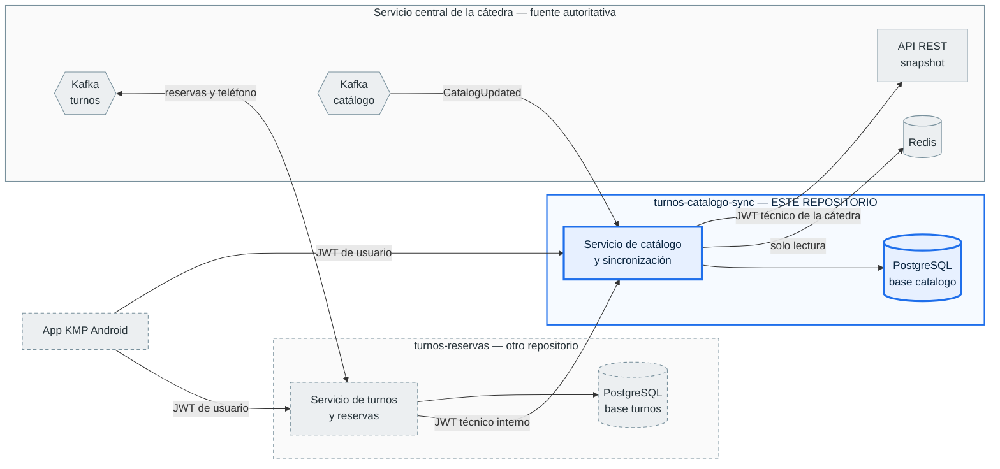
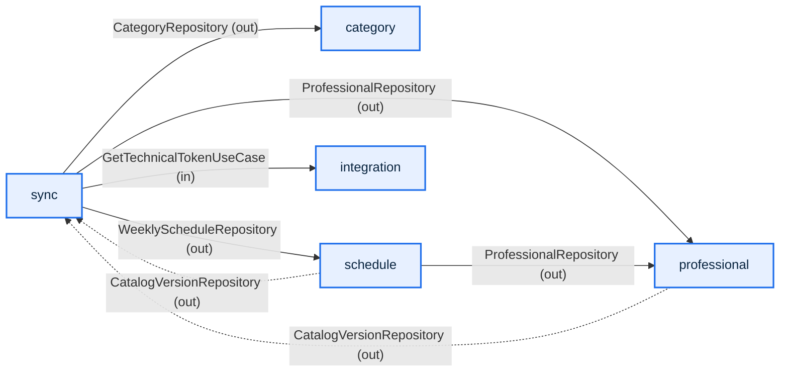

# Arquitectura del sistema y de este servicio

Este documento cubre la documentación de arquitectura que pide §12 del
enunciado: un diagrama del sistema completo —app Android, los dos servicios
backend, sus bases de datos y las integraciones con el servicio de la
cátedra— y un segundo diagrama de este servicio por dentro.

Los diagramas son texto versionado (Mermaid) y no imágenes sueltas: GitHub los
renderiza en el navegador, el diff muestra qué cambió y no hay un `.png` que
se desincronice del código.

**Lo que acá no está.** El *por qué* de la arquitectura interna —hexagonal con
slices verticales, la regla de dependencias, los desvíos respecto de la
skill— está en [`docs/adr/0001-arquitectura-hexagonal.md`](adr/0001-arquitectura-hexagonal.md)
y no se repite. Las decisiones de identidad y autenticación están en
[`docs/adr/0002-identidad-y-autenticacion-entre-servicios.md`](adr/0002-identidad-y-autenticacion-entre-servicios.md).
El contrato REST con el servicio de turnos (operaciones, DTOs, errores) está en
[`docs/contratos/catalogo-turnos.md`](contratos/catalogo-turnos.md). El diagrama
de secuencia de la sincronización va aparte, con #29.

## Convención de los diagramas

| Aspecto | Significado |
| --- | --- |
| Caja azul, borde grueso | Pertenece a **este repositorio**. |
| Caja amarilla, borde punteado | De este repositorio, pero **todavía no implementado**: es trabajo de M3. |
| Caja gris, borde continuo | Infraestructura **de la cátedra**: externa y autoritativa. No se modifica. |
| Caja gris, borde punteado | **Fuera de este repositorio**: vive en otro de los tres repos del proyecto. |
| Cilindro | Base de datos o almacén de claves. |
| Hexágono | Topic de Kafka. |

## 1. El sistema completo

Nombres exactos de cada integración, según §7, §14 y §15 de la referencia
—que es la fuente de verdad y de donde no se inventa nada—:

| Integración | Dirección | Identidad | Qué se usa |
| --- | --- | --- | --- |
| REST de la cátedra | este servicio → cátedra | JWT técnico de la cátedra | `GET /api/synchronization/snapshot` (§7) |
| Redis de la cátedra | este servicio → cátedra | `redisPassword` | solo lectura sobre `catedra:sync:*` (§14) |
| Kafka de la cátedra | cátedra → este servicio | credenciales del grupo | topic `catedra.catalog.{groupId}`, evento `CatalogUpdated` (§15.3) |
| REST propia, búsqueda | app KMP → este servicio | JWT de usuario (HS256, `JWT_USER_SECRET`) | `GET /api/professionals` |
| REST propia, agenda | servicio de turnos → este servicio | JWT técnico interno (autoridad `SERVICE_TURNOS`) | `GET /api/internal/professionals/{professionalId}/agenda` |
| Kafka de turnos | ambas | credenciales del grupo | `alumnos.turnos.acciones.{groupId}` y `catedra.turnos.telefono.{groupId}`, **fuera de este repo** |

### Qué muestra el diagrama que no se ve en el código

- **Dos bases, sin permisos cruzados.** Cada servicio es dueño exclusivo de su
  base y tiene su propio rol de PostgreSQL (§3). El servicio de turnos nunca
  lee `professional`, `weekly_schedule` ni `catalog_version`: lo que necesita
  lo pide por el contrato REST. En el diagrama no hay —ni puede haber— una
  flecha del servicio de turnos a la base de catálogo.
- **Las búsquedas no salen del servicio.** La flecha de la app a este servicio
  se resuelve contra PostgreSQL local. No hay ninguna que vaya de una consulta
  de la app a la API de la cátedra: esa es la regla que justifica que exista la
  copia local.
- **Tres identidades distintas, tres secretos distintos.** El JWT técnico de la
  cátedra es credencial *de salida* y nunca se acepta como credencial de
  entrada; el JWT de usuario lo emite el servicio de turnos; el JWT técnico
  interno identifica al servicio de turnos ante este. La separación es
  criptográfica, no una regla que alguien tenga que acordarse de escribir
  (ADR 0002).
- **Kafka no trae datos.** La flecha de `CatalogUpdated` es una notificación a
  propósito: los datos se leen de Redis o del snapshot. Si se perdiera un
  mensaje, el estado se reconstruye igual.

### Explícitamente fuera de este repositorio

Todo lo punteado y gris, más estas responsabilidades que son del servicio de
turnos o de la app:

- Cálculo de disponibilidad de turnos, holds y reservas.
- Los topics `alumnos.turnos.acciones.{groupId}` y
  `catedra.turnos.telefono.{groupId}`.
- La identidad del usuario final: tabla de usuarios, hasheo y **emisión** del
  JWT de usuario. Este servicio solo lo valida (ADR 0002).
- La aplicación KMP Android.

La "disponibilidad" de este repo es otra cosa y conviene no confundirlas: acá
es un **filtro de búsqueda sobre los horarios semanales** de la copia local
(§4.1) —qué profesionales atienden tal día a tal hora—, no la disponibilidad
real de turnos, que depende de las reservas y vive en el otro servicio.

## 2. Este servicio por dentro

Seis slices y cinco adaptadores. Nada entra ni sale del núcleo sin cruzar un
puerto, así que los puertos están dibujados como nodos y no como etiquetas:
cada frontera del diagrama **es** un puerto. Se lee de izquierda a derecha, que
es el sentido de la dependencia: quien llama está a la izquierda de lo que
llama.

```mermaid
flowchart LR
    subgraph entran["Afuera: quien llama"]
        direction TB
        kmp2["App KMP"]
        turnos2["Servicio de turnos"]
        ckafka2{{"Kafka de la cátedra"}}
    end

    subgraph adapIn["Adaptadores de entrada"]
        direction TB
        aweb["1 · API REST propia<br/>infrastructure/web"]
        akafka["4 · Kafka<br/>infrastructure/messaging"]
    end

    subgraph portIn["Puertos de entrada"]
        direction TB
        pbusqueda["SearchProfessionalsUseCase"]
        pagenda["GetCurrentAgendaUseCase"]
        pcambios["aplicación de cambios<br/>incrementales"]
    end

    subgraph nucleo["Los 6 slices · domain + application"]
        direction TB
        professional["professional"]
        schedule["schedule"]
        syncs["sync"]
        category["category"]
        integration["integration"]
        shared["shared<br/>seguridad · problem+json · OpenAPI"]
    end

    subgraph portOut["Puertos de salida"]
        direction TB
        prepos["CategoryRepository<br/>ProfessionalRepository<br/>WeeklyScheduleRepository<br/>CatalogVersionRepository<br/>SyncRunRepository"]
        prest["CatalogSnapshotPort<br/>TechnicalAuthPort<br/>IntegrationConfigPort"]
        predis["CatalogVersionPort<br/>CatalogChangesPort"]
    end

    subgraph adapOut["Adaptadores de salida"]
        direction TB
        ajpa["5 · Persistencia JPA<br/>infrastructure/persistence"]
        acliente["2 · Cliente REST de la cátedra<br/>infrastructure/client"]
        aredis["3 · Redis<br/>infrastructure/cache"]
    end

    subgraph salen["Afuera: a quien se llama"]
        direction TB
        pg2[("PostgreSQL local")]
        capi2["API REST de la cátedra"]
        credis2[("Redis de la cátedra")]
    end

    kmp2 --> aweb
    turnos2 --> aweb
    ckafka2 --> akafka

    aweb --> pbusqueda
    aweb --> pagenda
    akafka --> pcambios

    pbusqueda --> professional
    pagenda --> schedule
    pcambios --> syncs

    category --> prepos
    professional --> prepos
    schedule --> prepos
    syncs --> prepos
    syncs --> prest
    integration --> prest
    syncs --> predis

    prepos --> ajpa
    prest --> acliente
    predis --> aredis

    ajpa --> pg2
    acliente --> capi2
    aredis --> credis2

    classDef propio fill:#e7f0ff,stroke:#1f6feb,stroke-width:2px,color:#0a2540
    classDef puerto fill:#ffffff,stroke:#1f6feb,stroke-width:2px,color:#0a2540
    classDef pendiente fill:#fff8e1,stroke:#b8860b,stroke-width:2px,stroke-dasharray:5 4,color:#5d4037
    classDef externo fill:#eceff1,stroke:#78909c,stroke-width:1px,color:#263238
    classDef fuera fill:#eceff1,stroke:#78909c,stroke-width:1px,stroke-dasharray:5 4,color:#263238
    class aweb,acliente,ajpa,professional,schedule,syncs,category,integration,shared propio
    class pbusqueda,pagenda,prepos,prest puerto
    class akafka,aredis,pcambios,predis pendiente
    class capi2,credis2,pg2,ckafka2 externo
    class kmp2,turnos2 fuera
    style adapIn fill:#f6faff,stroke:#1f6feb,color:#0a2540
    style portIn fill:#f6faff,stroke:#1f6feb,color:#0a2540
    style nucleo fill:#f6faff,stroke:#1f6feb,stroke-width:2px,color:#0a2540
    style portOut fill:#f6faff,stroke:#1f6feb,color:#0a2540
    style adapOut fill:#f6faff,stroke:#1f6feb,color:#0a2540
    style entran fill:#fafafa,stroke:#78909c,color:#263238
    style salen fill:#fafafa,stroke:#78909c,color:#263238
```

Lo amarillo punteado —el adaptador de Kafka, el de Redis y sus puertos—
**todavía no está implementado**: son los issues de M3. Está en el diagrama
porque son dos de las cinco superficies externas previstas en el ADR 0001 y
porque sus puertos condicionan el diseño del slice `sync`; esos nombres salen
del ADR y pueden ajustarse al implementarlos. Todo lo demás del diagrama está
en el código hoy.

`shared` aparece dentro del núcleo y sin ninguna flecha, y es correcto que así
sea: no modela negocio ni tiene puertos. Es la seguridad, el manejo de errores
en `application/problem+json` y la configuración de OpenAPI, que envuelven al
adaptador web sin que ningún slice dependa de ellos.

### Los seis slices

| Slice | De qué es dueño | Puertos de entrada |
| --- | --- | --- |
| `category` | Categorías profesionales de la copia local. | `GetAllCategoriesUseCase`, `GetCategoryByIdUseCase` |
| `professional` | Profesionales y la búsqueda con filtros por categoría, nombre, habilitado y disponibilidad. | `SearchProfessionalsUseCase`, `GetAllProfessionalsUseCase`, `GetProfessionalByIdUseCase` |
| `schedule` | Horarios semanales, el criterio de disponibilidad y la agenda vigente. | `GetCurrentAgendaUseCase`, `GetSchedulesByProfessionalUseCase` |
| `sync` | El proceso de sincronización: versión aplicada, snapshot, incremental, estado y errores. | `RunFullSyncUseCase`, `ApplyCatalogSnapshotUseCase`, `GetLocalCatalogVersionUseCase` |
| `integration` | La cuenta técnica ante la cátedra. Único slice que conoce esas credenciales. | `GetTechnicalTokenUseCase`, `GetIntegrationConfigUseCase`, `RefreshIntegrationConfigUseCase` |
| `shared` | Transversales sin dueño de negocio: seguridad, `application/problem+json`, OpenAPI. | no tiene: no modela un caso de uso |

`category`, `professional` y `schedule` son de **solo lectura hacia afuera**:
no exponen creación, modificación ni borrado por HTTP. La única escritura
legítima viene de la sincronización.

### Los cinco adaptadores

| # | Adaptador | Slices | Puertos que cruzan la frontera | Estado |
| --- | --- | --- | --- | --- |
| 1 | API REST propia (`infrastructure/web`) | `professional`, `schedule` | `SearchProfessionalsUseCase` (in), `GetCurrentAgendaUseCase` (in) | implementado |
| 2 | Cliente REST de la cátedra (`infrastructure/client`) | `sync`, `integration` | `CatalogSnapshotPort` (out), `TechnicalAuthPort` (out), `IntegrationConfigPort` (out) | implementado |
| 3 | Redis (`infrastructure/cache`) | `sync` | `CatalogVersionPort` (out), `CatalogChangesPort` (out) | pendiente, M3 |
| 4 | Kafka (`infrastructure/messaging`) | `sync` | el caso de uso de aplicación de cambios (in) | pendiente, M3 |
| 5 | Persistencia JPA (`infrastructure/persistence`) | `category`, `professional`, `schedule`, `sync` | `CategoryRepository`, `ProfessionalRepository`, `WeeklyScheduleRepository`, `CatalogVersionRepository`, `SyncRunRepository` (todos out) | implementado |

El adaptador de Kafka es el único de entrada que no es HTTP: no implementa un
puerto de salida, invoca un caso de uso. Se cuenta entre los cinco porque es
una de las cinco superficies externas del servicio.

Hay dos componentes más en `infrastructure` que no son adaptadores de una
superficie externa, sino disparadores internos que entran por los mismos
puertos de entrada: `InitialCatalogSyncRunner`, que lanza la sincronización
completa al arrancar con la base vacía (#14), y `CatalogSyncHealthIndicator`,
que publica el estado de sincronización en `/actuator/health`.

## 3. Cómo se hablan los slices entre sí

Complemento del diagrama anterior: ahí se ve la frontera con el exterior, acá
la de adentro. La regla es la misma —lo que cruza es siempre un puerto y el
modelo de dominio, nunca una `@Entity` ni un DTO—.

- `sync` es el **único** que escribe en los otros tres, y lo hace con
  `replaceAll` y `deleteByIdIn` contra los puertos de salida que esos slices
  exponen, nunca contra su repositorio JPA.
- Las flechas punteadas son la dependencia inversa, y es deliberada:
  `professional` y `schedule` consultan la versión aplicada para **negarse a
  responder** si todavía no hay catálogo. Una búsqueda sobre una copia vacía no
  es un resultado vacío, es un error (`CatalogNotSynchronizedException`).
- `schedule` lee profesionales porque la agenda vigente necesita el nombre y el
  estado de habilitado, que son de `professional`.
- La flecha a `integration` sale en rigor del adaptador REST de `sync`, que es
  quien pide el JWT técnico antes de llamar a la cátedra. Se dibuja desde el
  slice para no repetir el diagrama anterior.
- `shared` no aparece: lo usan todos y no modela negocio. Dibujarlo sería una
  estrella que no informa nada.

## Referencias

- Enunciado [`docs/catedra/PROJECT_STATEMENT-v1.md`](catedra/PROJECT_STATEMENT-v1.md): §3, §4.1, §12.
- Referencia de integración [`docs/catedra/INTEGRATION_REFERENCE-v2.md`](catedra/INTEGRATION_REFERENCE-v2.md): §7, §14, §15.
- [`docs/adr/0001-arquitectura-hexagonal.md`](adr/0001-arquitectura-hexagonal.md) — por qué esta arquitectura, la regla de dependencias y los desvíos.
- [`docs/adr/0002-identidad-y-autenticacion-entre-servicios.md`](adr/0002-identidad-y-autenticacion-entre-servicios.md) — las tres identidades y sus secretos.
- [`docs/contratos/catalogo-turnos.md`](contratos/catalogo-turnos.md) — el contrato REST con el servicio de turnos.
- Issue #19.
