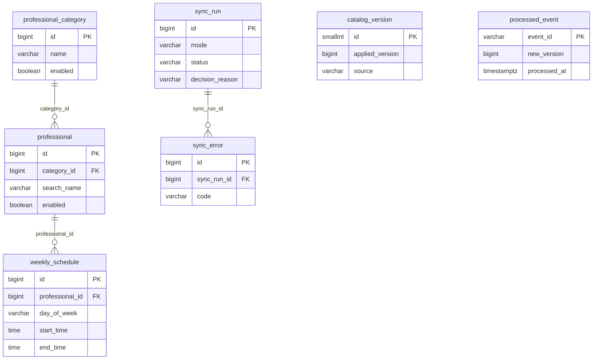

# Modelo de datos y propiedad

Cierra la viñeta 4 de §12 del enunciado ("el modelo de datos de cada servicio
y la delimitación de su propiedad") para este servicio. Issue #35.

**Lo que acá no está.** Por qué hay una base y un usuario propios, cómo
conviven con los del servicio de turnos en la instancia física compartida, y
el detalle de las migraciones están en
[`docs/adr/0003-instancia-postgres-compartida.md`](adr/0003-instancia-postgres-compartida.md)
y en la sección [La base de datos](../README.md#la-base-de-datos-una-base-y-un-usuario-propios)
del README. No se repite aquí.

## Delimitación de propiedad

Las siete tablas de este documento son **exclusivas de este servicio**. El
servicio de turnos no las toca, por tres motivos que se refuerzan entre sí y
no dependen de que nadie recuerde la regla:

- **Contrato.** §3 del enunciado prohíbe acceder a las tablas, repositorios o
  estructuras internas de otro servicio, usar una base compartida como
  mecanismo de integración, o mantener una réplica propia de este catálogo.
  La única vía de turnos hacia estos datos es el contrato REST con JWT
  técnico interno, documentado en
  [`docs/contratos/catalogo-turnos.md`](contratos/catalogo-turnos.md).
- **Usuario de base.** El rol `catalogo` es dueño solo de su base lógica, sin
  `SUPERUSER`, `CREATEDB` ni `CREATEROLE`, y el script de inicialización le
  quita a `PUBLIC` el permiso de conexión. El usuario de turnos no tiene
  credencial con la que conectarse a esta base, ni siquiera por error.
- **Migraciones independientes.** Flyway corre contra `catalogo` con su propio
  historial (`flyway_schema_history`), separado del de turnos. Ninguna
  migración de este repo puede tocar una tabla de otra base.

Nada de esto vive en este servicio y por eso no aparece en las tablas de más
abajo: usuarios finales y sus credenciales, disponibilidad, holds y reservas
(viven en turnos, D1), y el id token de la cuenta técnica de la cátedra, que
se mantiene solo en memoria (§5.1).

## Las tablas

Dos grupos con ciclos de vida distintos, separados a propósito en dos
migraciones (`V1` y `V2`): la **copia** de lo que publica la cátedra, y el
**estado propio** de la sincronización. El id de las tres tablas del primer
grupo es el id real de la cátedra —no una clave subrogada—, porque es la
identidad con la que llegan tanto el snapshot como los cambios incrementales.

### Copia local del catálogo (`V1__catalogo_local.sql`)

Reflejan uno a uno las tres colecciones del snapshot (§7 de la referencia de
integración): `professionalCategories`, `professionals` y `weeklySchedules`.

**`professional_category`**

| Columna | Tipo | Notas |
| --- | --- | --- |
| `id` | `BIGINT` | PK. Id de la cátedra. |
| `name` | `VARCHAR(255)` | |
| `description` | `TEXT` | Nullable. |
| `enabled` | `BOOLEAN` | Baja lógica (§14.4): nunca se borra una deshabilitada. |
| `created_at`, `updated_at` | `TIMESTAMPTZ` | Datos de la cátedra, no auditoría propia. |

Índice: `ix_professional_category_enabled_name (enabled, name)`, para el
listado de categorías habilitadas.

**`professional`**

| Columna | Tipo | Notas |
| --- | --- | --- |
| `id` | `BIGINT` | PK. Id de la cátedra. |
| `category_id` | `BIGINT` | FK → `professional_category.id`, `ON DELETE RESTRICT`. |
| `first_name`, `last_name` | `VARCHAR(255)` | |
| `search_name` | `VARCHAR(511)` | Nombre completo normalizado (minúsculas, sin acentos), escrito por la aplicación para la búsqueda parcial (#15). No es un campo del contrato. |
| `enabled` | `BOOLEAN` | Baja lógica (§14.4). |
| `created_at`, `updated_at` | `TIMESTAMPTZ` | |

Índices: `ix_professional_category_enabled (category_id, enabled)` para
"habilitados de esta categoría"; `ix_professional_search_name` GIN con
`gin_trgm_ops` (extensión `pg_trgm`) para la coincidencia parcial de nombre.

**`weekly_schedule`**

| Columna | Tipo | Notas |
| --- | --- | --- |
| `id` | `BIGINT` | PK. Id de la cátedra. |
| `professional_id` | `BIGINT` | FK → `professional.id`, `ON DELETE RESTRICT`. |
| `day_of_week` | `VARCHAR(9)` | `CHECK` con los siete valores de §7. |
| `start_time`, `end_time` | `TIME` | `CHECK (end_time > start_time)`. |
| `slot_duration_minutes` | `INTEGER` | `CHECK (> 0)`. |
| `enabled` | `BOOLEAN` | Baja lógica. |
| `created_at`, `updated_at` | `TIMESTAMPTZ` | |

Índice: `ix_weekly_schedule_professional_enabled (professional_id, enabled)`,
la base del filtro de disponibilidad.

Ninguna FK tiene `ON DELETE CASCADE`: las bajas son lógicas, y el único
reemplazo físico de estas tres tablas es la sincronización completa, que
borra en orden explícito (horarios, profesionales, categorías) y no por un
`DELETE` en cascada mal apuntado.

### Estado propio de sincronización (`V2__sincronizacion.sql`, `V3`)

No son datos de la cátedra: son lo que este servicio necesita para saber en
qué versión está, qué ya procesó y cómo le fue.

**`catalog_version`** — una sola fila (`CHECK (id = 1)`), la versión de
catálogo aplicada.

| Columna | Tipo | Notas |
| --- | --- | --- |
| `id` | `SMALLINT` | PK, fijo en `1`. |
| `applied_version` | `BIGINT` | `CHECK (>= 0)`. |
| `applied_at` | `TIMESTAMPTZ` | |
| `source` | `VARCHAR(16)` | `SNAPSHOT` o `INCREMENTAL`. |

**`processed_event`** — deduplicación de `CatalogUpdated` por `eventId`
(§15.3).

| Columna | Tipo | Notas |
| --- | --- | --- |
| `event_id` | `VARCHAR(255)` | PK. Insertar es la pregunta: una fila nueva es "no procesado". |
| `event_type` | `VARCHAR(64)` | |
| `new_version` | `BIGINT` | |
| `occurred_at`, `processed_at` | `TIMESTAMPTZ` | |
| `source` | `VARCHAR(64)` | Vocabulario de la cátedra (`MANUAL`, `SCHEDULED`...), sin `CHECK`. |

Índice: `ix_processed_event_new_version (new_version)`.

**`sync_run`** — una fila por intento de sincronización.

| Columna | Tipo | Notas |
| --- | --- | --- |
| `id` | `BIGINT` identity | PK. |
| `mode` | `VARCHAR(16)` | `FULL` o `INCREMENTAL`. |
| `triggered_by` | `VARCHAR(32)` | `STARTUP`, `EVENT`, `RECONCILIATION`, `DISCONTINUITY`, `MANUAL`. |
| `status` | `VARCHAR(16)` | `RUNNING`, `SUCCEEDED`, `FAILED`. |
| `decision_reason` | `VARCHAR(32)` | Agregada en `V3`. Nullable (nulo en corridas previas a esa migración). Por qué se eligió el modo: `NO_LOCAL_VERSION`, `VERSION_OUT_OF_WINDOW`, `MISSING_VERSION`, `STATE_UNVERIFIABLE`, `BEHIND_CURRENT_VERSION`, `REQUESTED`. |
| `from_version`, `to_version` | `BIGINT` | Nullable: no hay origen con base vacía, ni destino si la corrida no terminó bien. |
| `started_at`, `finished_at` | `TIMESTAMPTZ` | `finished_at` nulo solo si `status = RUNNING`. |

Índice: `ix_sync_run_started_at (started_at DESC)`.

**`sync_error`** — errores de una corrida, con `ON DELETE CASCADE` hacia
`sync_run`: un error no tiene sentido sin su corrida.

| Columna | Tipo | Notas |
| --- | --- | --- |
| `id` | `BIGINT` identity | PK. |
| `sync_run_id` | `BIGINT` | FK → `sync_run.id`, `ON DELETE CASCADE`. |
| `occurred_at` | `TIMESTAMPTZ` | |
| `code` | `VARCHAR(64)` | Código estable propio (§13). |
| `detail` | `TEXT` | Nullable. |

Índice: `ix_sync_error_run (sync_run_id)`.

Dos trabajos periódicos acotan el crecimiento de `processed_event` y
`sync_run`/`sync_error` (`PROCESSED_EVENTS_RETENTION`,
`SYNC_HISTORY_RETENTION`); el detalle de cada ventana está en
[ADR 0004](adr/0004-sincronizacion-e-idempotencia.md#3-deduplicación-por-eventid-insertar-es-la-pregunta)
y en la sección [Retención del historial](../README.md#retención-del-historial)
del README.

## Diagrama

`catalog_version` y `processed_event` no tienen relación declarada con las
otras tablas: son estado agregado del servicio, no datos que cuelguen de una
entidad del catálogo.
