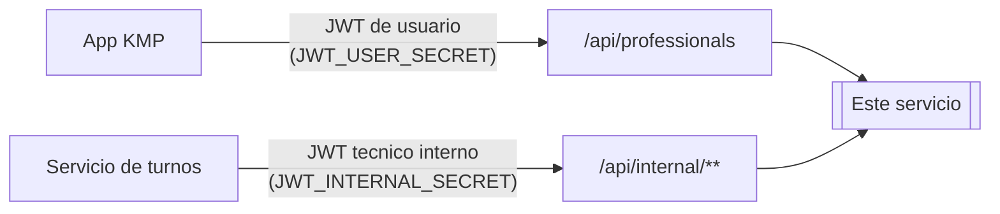

# Seguridad, autenticación y autorización

Cierra la viñeta 7 de §12 del enunciado ("una descripción de las decisiones de
seguridad, autenticación y autorización") y documenta cómo este servicio
cumple cada punto de la lista de §9 que le corresponde. Issue #32.

## Qué de §9 es responsabilidad de este repo

§9 describe la solución completa, con requisitos que viven en los tres repos
del proyecto. En este servicio:

- **No aplican**, porque son del servicio de turnos (ADR 0002, decisión D1):
  registrar y loguear usuarios, hashear contraseñas, emitir el JWT de usuario,
  impedir que un usuario toque procesos o reservas de otro. Este servicio no
  tiene tabla de usuarios ni endpoints de login.
- **Aplican y están resueltos** desde #17/#18/#15/#16 (ADR 0002): emitir y
  validar JWT entre los dos backends, autorizar cada operación según la
  identidad autenticada, proteger los endpoints que no sean públicos, evitar
  confiar en identificadores enviados por el cliente, externalizar secretos,
  configurar CORS.
- **Quedaban parcialmente abiertos y los cierra este issue**: validar la
  entrada en todos los límites, un test contra un servidor real que confirme
  que ningún secreto propio aparece en una respuesta HTTP, cabeceras de
  seguridad explícitas, y que los errores no previstos no filtren detalle
  interno.

## Modelo de identidades

El modelo completo —por qué dos JWT con secretos distintos, por qué técnico
interno y no propagado, la limitación aceptada del secreto compartido HS256,
y la tabla de qué ruta exige qué credencial— está en
[`docs/adr/0002-identidad-y-autenticacion-entre-servicios.md`](adr/0002-identidad-y-autenticacion-entre-servicios.md)
y no se repite aquí. Resumen de una línea: tres identidades, tres secretos,
ninguno compartido con la app KMP salvo el que ella misma usa para
autenticarse.

## Autorización por identidad, nunca por un identificador del cliente

`SecurityConfig` resuelve la identidad exclusivamente del JWT verificado: dos
`SecurityFilterChain`, cada una con su propio `JwtDecoder` y su propio
secreto, de forma que un token no sirve para los endpoints de la otra
identidad por **construcción criptográfica**, no por una comprobación de
claims que alguien pueda olvidarse de escribir. El caso explícito que §9
señala —no leer el `groupId` ni la identidad de un parámetro— se cumple en el
único endpoint donde podría tentar: `CurrentAgendaController` no recibe
ningún parámetro de identidad del llamante, solo el id de catálogo del
profesional cuya agenda se pide, que es un dato del recurso, no de quién
pregunta. La identidad del servicio de turnos sale del claim `authorities`
del JWT, resuelta antes de que la petición llegue al controlador.

Verificado en `ApiSecurityIntegrationTest` (`IdentidadesSeparadas`,
`ApiInterna`, `ApiDeUsuario`) y en `CurrentAgendaApiIntegrationTest`
(`Autorizacion`).

## Validación de entrada en cada límite

- **Parámetros de búsqueda**: `ProfessionalSearchRequest` con Bean Validation
  completa (`@Min`, `@Max`, `@Size`); los fallos de binding o de restricción
  terminan en `VALIDATION_ERROR` (400) por `ApiExceptionHandler`.
- **Filtro de disponibilidad**: no es un fallo de binding sino una invariante
  de dominio (día, hora o rango mal formado), y tiene su propio código,
  `INVALID_AVAILABILITY_FILTER`, para que el cliente distinga los dos
  problemas.
- **`@PathVariable` sueltos**: hasta este issue, `professionalId` en la
  agenda vigente no tenía ninguna restricción —un id negativo o cero no es
  explotable, pero tampoco es un id válido, y el controlador lo recorría
  igual hasta terminar en 404—. Se cerró con `@Validated` en la clase y
  `@Positive` en el parámetro. Como ese camino de validación es por AOP
  (`MethodValidationPostProcessor`, no el resolutor nativo de Spring MVC), la
  excepción que produce es `ConstraintViolationException` y no
  `HandlerMethodValidationException`; `ApiExceptionHandler` tiene un handler
  propio para ese tipo, con el mismo código `VALIDATION_ERROR`.
- **Cabeceras**: la única que la API exige es `Authorization`, y su ausencia
  o invalidez la valida la cadena de Spring Security, nunca el controlador.
- **Cuerpos**: no hay ninguno. Toda la API es de solo lectura; lo verifica una
  prueba que falla si aparece un `@PostMapping`/`@PutMapping`/
  `@PatchMapping`/`@DeleteMapping` en el código.

Verificado en `CurrentAgendaApiIntegrationTest` (`ValidacionDeEntrada`) y en
las pruebas existentes de `ProfessionalSearchController`.

## Secretos: cuáles hay y por qué no aparecen afuera

| Secreto | Variable | Para qué | Compartido con |
| --- | --- | --- | --- |
| JWT de usuario final | `JWT_USER_SECRET` | validar el token que emite turnos | turnos-reservas-service |
| JWT técnico interno | `JWT_INTERNAL_SECRET` | validar el token servidor a servidor | turnos-reservas-service |
| Cuenta técnica de cátedra | `CATEDRA_TECHNICAL_USERNAME`/`PASSWORD` | login contra el servicio central | nadie: nunca sale de este servicio |
| `redisPassword` | — | lo entrega `integration` en tiempo de ejecución, no es config propia | nadie |

Los cuatro están externalizados, ninguno versionado (`.env` en `.gitignore`,
`.env.example` lleva solo la forma), y ninguno tiene un valor por defecto
"que funcione a medias" en el código: donde falta alguno, el arranque falla
nombrando la variable (`ApiSecurityProperties`, `CatedraApiProperties`).

**Cómo se evita que se filtren**, en las tres superficies que §9 nombra
—código fuente, respuestas, logs—:

- Ningún secreto va hardcodeado: todos entran por variable de entorno.
- Las clases de propiedades que los llevan (`ApiSecurityProperties.Jwt`,
  `CatedraApiProperties`) sobrescriben `toString()` para no imprimirlos.
- `Secret` (tipo propio para contraseñas y tokens) no expone un getter con
  forma de propiedad Java, así que Jackson no encuentra nada que serializar.
- El camino de error que más fácil filtra un secreto —un 401 que hace eco
  del pedido rechazado, con la contraseña o el bearer adentro— no encadena la
  excepción HTTP original, así que el eco nunca llega a la traza.

**Dos pruebas, dos superficies distintas, para no dejar un hueco entre
ellas**: `SecretosNoSeFiltranTest` opera en memoria —arma el slice
`integration` a mano, sin levantar servidor— y cubre el JWT técnico de
cátedra y `redisPassword` contra logs a nivel `TRACE`, mensajes de excepción
y serialización. No llegaba a cubrir `JWT_USER_SECRET` ni
`JWT_INTERNAL_SECRET`, ni ninguna respuesta HTTP real: eso lo agrega
`ApiSecurityIntegrationTest.SecretosEnRespuestasReales` (issue #32), que pega
contra un servidor real —éxito, 401, 403, token opaco— y revisa cuerpo y
cabeceras de cada respuesta.

## CORS

Cerrado a `CORS_ALLOWED_ORIGINS`, lista exacta y nunca `"*"`:
`ApiSecurityProperties` rechaza el arranque si alguien pone `"*"`, y
`SecurityConfig.origenesPermitidos()` usa `setAllowedOrigins` —no
`allowedOriginPatterns`, que permitiría un comodín sin que se note—. Solo
métodos de lectura (`GET`, `OPTIONS`): esta API no tiene ni va a tener una
escritura por HTTP. Verificado en `ApiSecurityIntegrationTest.Cors`.

## Cabeceras de seguridad

| Cabecera | Valor | Por qué |
| --- | --- | --- |
| `X-Frame-Options` | `DENY` | explícita (issue #32): el default de Spring Security es `SAMEORIGIN`, más laxo de lo necesario para una API que nunca se sirve en un `frame` |
| `Content-Security-Policy` | `default-src 'none'` | explícita (issue #32), no es default de Spring Security: la API solo devuelve JSON, así que la política más restrictiva no rompe nada |
| `X-Content-Type-Options` | `nosniff` | default de Spring Security, dejado como está |
| `Cache-Control` | según la respuesta | default de Spring Security |
| `Strict-Transport-Security` | solo si la petición llega por HTTPS | default de Spring Security; condicionado a TLS, que en este entorno termina en la infraestructura de despliegue, no en la app |

Las dos primeras se agregaron en `SecurityConfig.cabecerasDeSeguridad()` y
las cinco quedan verificadas por una prueba contra un servidor real
(`ApiSecurityIntegrationTest.CabecerasDeSeguridad`), para que ninguna dependa
de que alguien recuerde cuáles trae Spring Security de fábrica.

## Manejo de errores sin fuga de detalle interno

`ApiExceptionHandler` traduce explícitamente cada excepción de dominio a un
`code` estable y un `detail` escrito para quien integra (§13): nunca el
mensaje crudo de una excepción técnica, nunca un id interno que el cliente no
haya mandado él mismo. Deliberadamente **no tiene** un
`@ExceptionHandler(Exception.class)` que convierta cualquier fallo en un 500
con cuerpo propio —eso tapa errores de programación detrás de una respuesta
prolija—; lo no previsto cae en el manejo por defecto de Spring Boot, que no
incluye `message` ni `stacktrace` en el cuerpo (`server.error.*` nunca se
sobrescribe a `always`). Verificado en `UnmappedExceptionResponseTest` (issue
#32): una excepción inyectada con un mensaje deliberadamente sensible llega
como 500 sin ese mensaje, sin el nombre de la excepción ni ninguna línea de
stack trace en el cuerpo.

## Limitaciones conocidas

- **El secreto simétrico compartido** (`JWT_USER_SECRET`) hace que este
  servicio sea técnicamente capaz de falsificar un token de usuario, no solo
  de verificarlo. Aceptada y declarada en el ADR 0002 §2: los dos backends
  son del mismo proyecto y se despliegan juntos. RS256 con clave pública
  queda como camino de mejora.
- **Sin límite de tasa (rate limiting) ni WAF** delante de la API. Fuera de
  alcance de este issue y no exigido por §9; si el servicio quedara expuesto
  a internet sin un proxy que lo aporte, sería lo próximo a agregar.
- **`Strict-Transport-Security` depende de que la petición llegue por
  HTTPS**, algo que esta app no termina: en este entorno de desarrollo y en
  Docker Compose no hay TLS, así que la cabecera no aparece. Es correcto así
  —HSTS sobre HTTP sin TLS no protege nada— y queda pendiente de quien
  despliegue con TLS delante.
- **El rol administrador (§9, opcional) no se implementa.** Decisión D8 del
  proyecto, descartada: ver `CLAUDE.md`. Las reservas son del servicio de
  turnos, así que un admin de reservas —si se decide hacerlo— es un issue de
  ese repo.
- **La trazabilidad del usuario final entre los dos backends es indirecta**
  (vía `X-Correlation-Id`, no un claim propagado). Ya documentado y aceptado
  en el ADR 0002 §3.

## Referencias

- Enunciado [`docs/catedra/PROJECT_STATEMENT-v1.md`](catedra/PROJECT_STATEMENT-v1.md): §9, §12.
- [`docs/adr/0002-identidad-y-autenticacion-entre-servicios.md`](adr/0002-identidad-y-autenticacion-entre-servicios.md) — el modelo de identidades completo.
- `SecurityConfig`, `ApiSecurityProperties`, `ApiExceptionHandler` — la implementación.
- `ApiSecurityIntegrationTest`, `SecretosNoSeFiltranTest`, `CurrentAgendaApiIntegrationTest`, `UnmappedExceptionResponseTest` — las pruebas que respaldan cada afirmación de este documento.
- Issues #15, #16, #17, #18, #32, #33 (las pruebas de autorización, siguiente issue).
