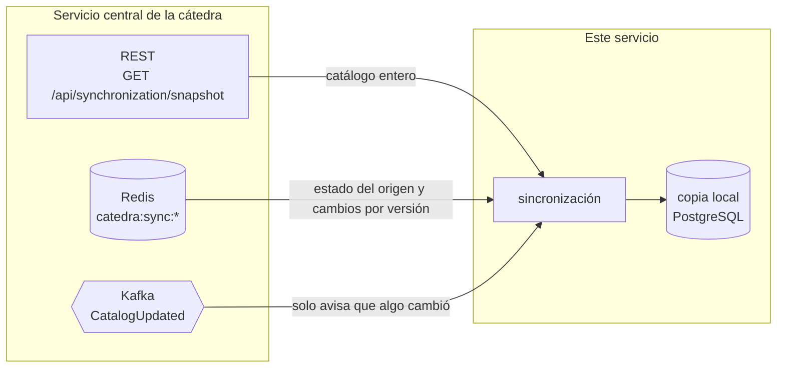
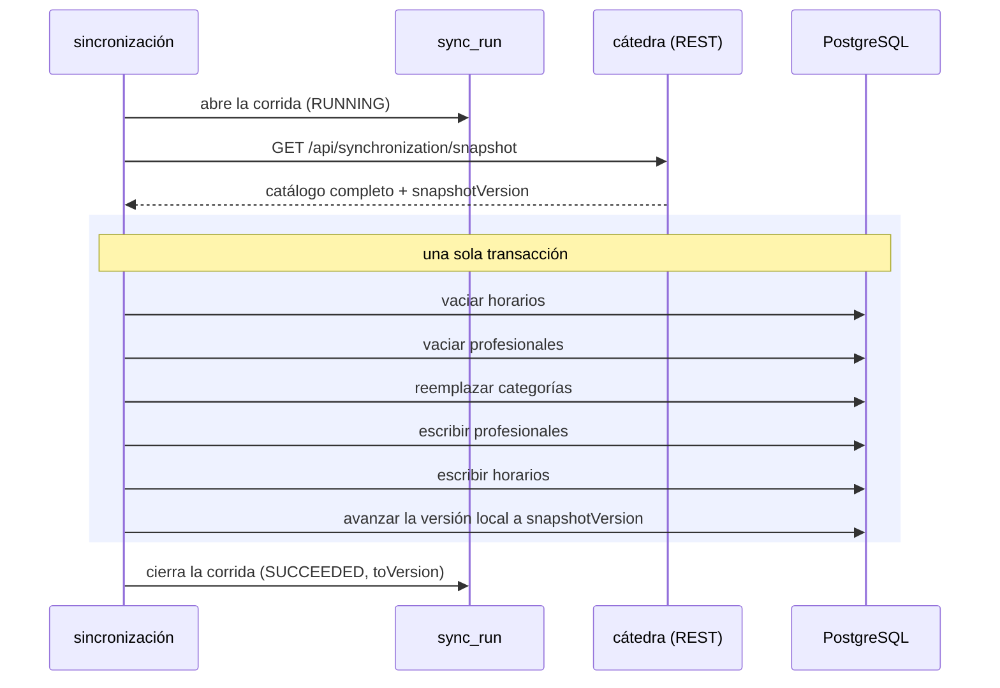
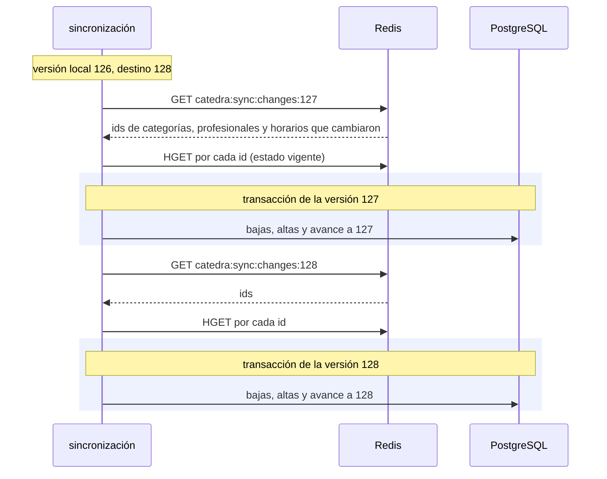
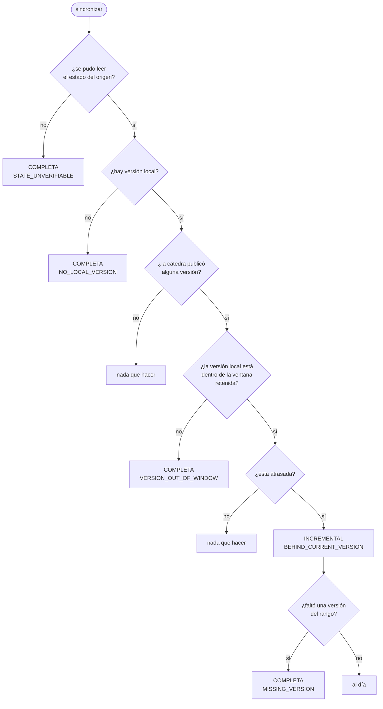
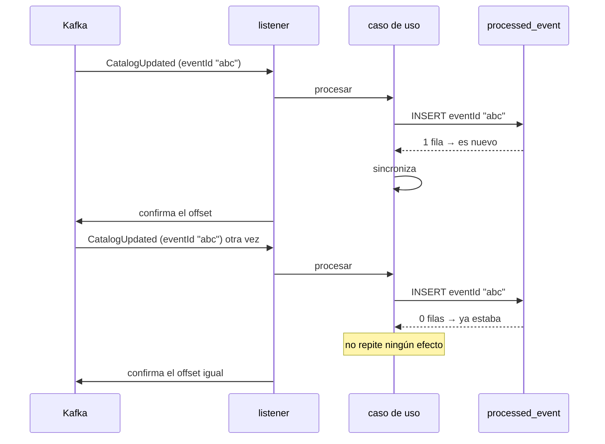

# Cómo se sincroniza el catálogo

Este documento explica **cómo** este servicio mantiene su copia local del
catálogo de la cátedra: la sincronización completa, la incremental, y qué pasa
cuando una notificación llega duplicada, no llega o llega fuera de orden. Es lo
que §12 del enunciado exige documentar.

Es la explicación narrativa. Las **decisiones** —por qué la transacción está
donde está, por qué manda Redis y no el mensaje, qué se descartó— y la tabla que
asocia cada afirmación con la prueba que la respalda están en el
[ADR 0004](adr/0004-sincronizacion-e-idempotencia.md).

## 1. El problema

La cátedra es la fuente autoritativa del catálogo: categorías, profesionales y
horarios semanales. Este servicio guarda una **copia local** y la mantiene al
día, porque §6.2 prohíbe que las búsquedas consulten al servicio central: una
búsqueda que saliera a la red por cada tecleo del usuario convertiría al
servicio de la cátedra en el cuello de botella de la app.

Entonces hay un número que lo resume todo: la **versión de catálogo aplicada**.
Es un único valor para todo el servicio, vive en la tabla `catalog_version` —una
sola fila— y significa exactamente esto: *los datos que la copia local tiene
ahora corresponden a esta versión del catálogo de la cátedra*.

La regla no negociable del proyecto (§6.1) es que ese número **avanza solo
cuando la unidad de trabajo terminó completa**. Nunca hay un momento en que la
versión diga 128 y los datos sean los de la 127.

## 2. Las tres fuentes, y para qué sirve cada una



| Fuente | Qué da | Cuándo se usa |
| --- | --- | --- |
| **REST** (§7) | el catálogo **entero** con su `snapshotVersion` | para reconstruir la copia local de cero |
| **Redis** (§14) | el estado del origen (`current-version`, `oldest-available-version`, `metadata`), los cambios de cada versión (`changes:{n}`) y el estado vigente de cada entidad | para ponerse al día de a una versión, y para saber cuán atrasados estamos |
| **Kafka** (§15) | una notificación `CatalogUpdated` con `eventId` y `newVersion` | **solo para despertar** la sincronización |

**Kafka no es la fuente del catálogo.** Esto es lo más importante del diseño y
§15.3 lo dice explícitamente: el evento notifica, los datos se leen de Redis o
del snapshot. Un mensaje perdido no pierde datos, y un mensaje duplicado no
duplica nada.

## 3. La sincronización completa

Es la reconstrucción: se pide el catálogo entero y se reemplaza la copia local.



Tres cosas que se ven en el diagrama y vale nombrar:

- **El snapshot se trae *antes* de abrir la transacción.** La llamada tarda
  cientos de milisegundos sobre ZeroTier (decisión D6) y adentro mantendría
  tomados los locks de las tres tablas todo ese tiempo.
- **El orden de los cinco pasos lo imponen las claves foráneas**, que son
  `RESTRICT` en los dos sentidos (categoría ← profesional ← horario): se borra de
  hijo a padre y se escribe de padre a hijo.
- **La versión es la última escritura.** Si cualquiera de los pasos anteriores
  falla, no se ejecuta; si falla el commit, no queda. La copia local nunca
  afirma una versión que no tiene.

Si algo falla, el rollback deja la copia **anterior intacta** —no una copia a
medias— y la corrida queda registrada como `FAILED` con un código estable, en su
propia transacción para que el rollback no se la lleve.

## 4. La sincronización incremental

Es ponerse al día: aplicar las versiones que faltan, **de a una y en orden**.



**Una transacción por versión, no una para todo el atraso.** Si la versión 128
falla, la 127 queda aplicada y la versión local queda en 127: un estado
consistente desde el cual reintentar. Con una sola transacción para las dos, la
falla de la última volvería todo al punto de partida.

Las lecturas de Redis pasan **fuera** de la transacción, por el mismo motivo que
el snapshot.

Cuatro casos que no son obvios:

- **Un id que está en los cambios pero ya no está en su hash es una baja.** El
  hash guarda el estado *actual*, no el histórico: al ponerse al día varias
  versiones de corrido, una entidad que la versión 127 modificó puede haber sido
  eliminada en la 128.
- **Una baja lógica es otra cosa.** Llega como entidad con `enabled` en `false`
  (§14.4) y la copia local la **conserva**: si se filtrara, un profesional que la
  cátedra deshabilitó desaparecería en lugar de aparecer deshabilitado.
- **Una versión con los tres arrays vacíos es válida** (§14.5) y también hace
  avanzar la versión local. Saltearla dejaría la copia atrás del origen para
  siempre.
- **Si falta la clave de cambios de una versión, el recorrido se detiene ahí.**
  No la saltea: cada versión describe una diferencia contra la anterior, así que
  un salto deja un hueco que nada posterior corrige. Lo que sigue es reconstruir
  con el snapshot.

## 5. Cómo se decide entre una y otra

Con tres datos y nada más: la versión local, `current-version` y
`oldest-available-version`.



El orden de las preguntas importa. Verificar el origen va primero porque sin ese
dato ninguna comparación posterior tiene sentido: una base recién inicializada
con Redis caído elegiría la rama correcta por el motivo equivocado. Y "no hay
versión local" va antes que la ventana porque la comparación de ventana necesita
una versión local con la que comparar.

Los cuatro motivos de reconstrucción quedan guardados en la corrida
(`sync_run.decision_reason`), y distinguirlos importa: una versión fuera de la
ventana es la retención de la cátedra funcionando normalmente, mientras que no
poder verificar el estado es un problema de conectividad.

**Que la cátedra no publique metadata no dispara una reconstrucción.** No hay
destino al que llegar, y pedir un snapshot significaría reconstruir la copia
local cada pocos minutos contra un origen que no dice nada.

## 6. Qué despierta una sincronización

| Disparador | Cuándo | `sync_run.triggered_by` |
| --- | --- | --- |
| Arranque | al levantar, si no hay versión local | `STARTUP` |
| Notificación de Kafka | cuando llega un `CatalogUpdated` nuevo | `EVENT` |
| Chequeo periódico | cada `SYNC_RECONCILIATION_INTERVAL` (5 min) | `RECONCILIATION` |

**Solo una a la vez.** Los tres pasan por el mismo lugar, que toma un lock, y
**el que no lo consigue se va en lugar de esperar**: lo que iba a hacer lo está
haciendo el otro, y encolarse solo lograría repetir la misma comparación de
versiones un rato después, cuando ya no habría nada que hacer.

Si dos se cruzaran, las dos leerían la misma versión local, las dos decidirían
avanzar, y la segunda chocaría al asentar la versión —o, peor, las dos pedirían
el snapshot completo y la cátedra atendería dos veces el mismo trabajo sobre un
enlace de 228 ms—.

**El chequeo periódico es la red de seguridad del sistema entero.** No depende de
que llegue ningún mensaje, así que cubre la notificación que nunca llegó, la
sincronización que falló después de que el evento quedó registrado, y el arranque
después de una caída larga (§8). Cuando no hay nada que hacer no registra corrida
ni escribe nada por encima de `DEBUG`: un chequeo que logueara "todo en orden"
cada cinco minutos enterraría los mensajes que importan.

## 7. Idempotencia: duplicados, perdidos y fuera de orden

La entrega de Kafka es **al menos una vez** (§15.1). No es un caso raro: pasa
cada vez que el servicio se cae entre persistir y confirmar el offset. Así que
procesar el mismo mensaje dos veces tiene que dar el mismo resultado que
procesarlo una.

### El mensaje duplicado (§18.1)



**Insertar es la pregunta.** El `eventId` es la clave primaria de
`processed_event`, así que no hay un "consultar y después escribir": se inserta y
se mira cuántas filas cambiaron. Una es nuevo, cero es duplicado. Entre un
`SELECT` y un `INSERT` habría una ventana por la que dos entregas del mismo
mensaje pasarían las dos, que es justo el caso que esto cubre.

**El duplicado también confirma el offset.** §18.1 lo pide explícitamente: el
consumidor reconoce que ya fue procesado, no repite efectos y puede confirmar. No
confirmarlo dejaría el mismo mensaje reentregándose para siempre.

**El duplicado no es un error.** Queda en `DEBUG`, no en `ERROR`, y se cuenta en
`catalog.sync.events{outcome=DUPLICATE}` —que es la evidencia de idempotencia que
§11 exige—.

La tabla no crece para siempre: un trabajo periódico borra los eventos
procesados hace más de `PROCESSED_EVENTS_RETENTION` (30 días). La única condición
que la ventana tiene que cumplir es ser más larga que el atraso máximo con el que
un duplicado puede llegar, que lo acota la retención del topic.

### El orden importa, y el offset se confirma al final

El orden es **procesar, persistir, confirmar**, y es el que exige §16. El
`acknowledge()` va después de que el caso de uso —transaccional— volvió: cuando
se confirma el offset, lo que el mensaje provocó ya está commiteado.

La ventana contraria existe a propósito: si el servicio cae entre persistir y
confirmar, el mensaje se reentrega y la deduplicación lo absorbe. La alternativa
—confirmar antes de persistir, o dejar el auto-commit de Kafka— perdería
notificaciones **sin dejar rastro**, que es mucho peor.

Hay tres finales posibles y cada uno hace algo distinto:

| Qué pasó | Offset | Qué queda |
| --- | --- | --- |
| Procesado o duplicado | se confirma | el efecto, o nada |
| Mensaje que no cumple §15.3 | se confirma, salteándolo | un `ERROR` con topic, partición y offset exactos |
| Falla transitoria (base, Redis) | **no** se confirma | el mensaje se reentrega |

El mensaje envenenado se saltea porque no se va a arreglar en el próximo intento:
reintentarlo dejaría la partición trabada en él para siempre, y con ella todas
las notificaciones posteriores. Las fallas transitorias sí se reintentan, hasta
`catedra.kafka.max-retries` veces (3), y al agotarse el consumidor **se detiene** sin
confirmar: el reintento periódico de arranque lo vuelve a levantar y Kafka
reentrega desde el último offset confirmado. Saltearlo perdería la notificación.

### El mensaje perdido

No pasa nada grave, y es el punto del diseño: Kafka solo avisa. El chequeo
periódico compara la versión local con `current-version` y recupera el atraso sin
que haya llegado ningún evento. **El peor caso de una notificación perdida es un
intervalo de atraso.**

### El mensaje fuera de orden, y Redis contradiciendo al evento

El caso real: el evento dice `newVersion: 8` y Redis todavía informa
`current-version: 7`, porque publicar en Redis y notificar en Kafka no son
atómicos entre sí.

**Manda Redis.** La `newVersion` del evento no se usa como destino: lo decide la
comparación contra el estado del origen. Vale en los dos sentidos:

- **Evento adelantado** (evento 8, Redis 7): no hay nada que aplicar todavía, así
  que la sincronización no hace nada. El `eventId` ya quedó registrado, así que
  **esa notificación no se vuelve a intentar**: lo recupera el chequeo periódico
  en cuanto Redis publique la 8.
- **Evento atrasado** (evento 8, Redis 9): se aplica hasta la 9. El número del
  mensaje no limita el destino.
- **Evento viejo** (evento 5 después de haber aplicado la 8): no retrocede nada,
  porque el destino no sale del mensaje. Y si algo lo intentara, la copia local
  rechaza retroceder por vía incremental.

La consecuencia hay que decirla: **una notificación puede no producir ningún
efecto**. Es correcto, y la recuperación es la comparación de versiones, que es
lo que §16 pide que exista justamente para esto.

## 8. La discontinuidad, con números

El caso canónico de §18.2: la copia local está en la versión **3**, la cátedra
publica `current-version: 7` y `oldest-available-version: 4`.

Los cambios que harían falta para ponerse al día son los de las versiones 4, 5, 6
y 7. La clave `changes:4` existe, pero describe la diferencia **entre la 3 y la
4**… y la cátedra ya no retiene la 3: `oldest-available-version: 4` significa que
la ventana arranca en la 4, así que el eslabón que conectaría nuestro estado con
esa ventana no está.

Por eso la regla es `versionLocal >= oldestAvailableVersion`, y con 3 ≥ 4 falso
**no se intenta** el camino incremental: se pide el snapshot completo. Una
versión local **igual** a `oldest-available-version` sí sirve, porque lo que
hacen falta son los cambios *posteriores* a ella y esos están.

No es una anomalía: es la retención de la cátedra funcionando. Pasa cuando el
servicio estuvo apagado más tiempo del que la cátedra guarda.

## 9. Cómo mirarlo desde afuera

Sin leer un log ni entrar a la base:

```bash
curl -s -H "Authorization: Bearer $JWT_INTERNO" \
  http://localhost:8080/api/internal/sync/status | jq
```

Devuelve la versión local, lo que se sabe del origen, el atraso en versiones, el
último intento completo y los últimos errores. El campo `health` distingue
`UP_TO_DATE`, `BEHIND` (se recupera solo), `REBUILDING` y `DEGRADED` (necesita
intervención). El detalle está en el
[README](../README.md#el-estado-de-sincronización-qué-tan-fresca-está-la-copia-local)
y en el [contrato con turnos](contratos/catalogo-turnos.md#5-operación-estado-de-sincronización).

Lo mismo agregado está en `/actuator/metrics`: `catalog.sync.runs`,
`catalog.sync.errors` y `catalog.sync.events`. Y el historial crudo, en las
tablas `sync_run` y `sync_error`.

## 10. Dónde está cada cosa en el código

Todo en el slice `sync` (`src/main/java/com/um/catalogsync/sync`).

| Qué | Clase |
| --- | --- |
| Decide entre completa e incremental, y toma el lock | `application/usecases/SynchronizeCatalogUseCaseImpl` |
| Orquesta la completa: registra, trae, aplica, cierra | `application/usecases/RunFullSyncUseCaseImpl` |
| **Unidad de trabajo** de la completa | `application/usecases/ApplyCatalogSnapshotUseCaseImpl` |
| Recorre las versiones que faltan, en orden | `application/usecases/ApplyIncrementalChangesUseCaseImpl` |
| **Unidad de trabajo** de una versión incremental | `application/usecases/ApplyCatalogVersionUseCaseImpl` |
| Deduplica la notificación y dispara la sincronización | `application/usecases/HandleCatalogUpdatedUseCaseImpl` |
| Arma el reporte de estado | `application/usecases/GetSyncStatusUseCaseImpl` |
| Regla de retroceso de la versión | `domain/model/CatalogVersion#allowsAdvanceTo` |
| Regla de la ventana retenida | `domain/model/PublishedCatalogMetadata#canCatchUpFrom` |
| Los cuatro estados informados | `domain/model/SyncHealth`, `domain/model/SyncStatusReport` |
| Trae el snapshot por REST | `infrastructure/client/adapter/RestCatalogSnapshotAdapter` |
| Lee el estado del origen y las entidades | `infrastructure/redis/adapter/RedisPublishedCatalogAdapter` |
| Lee los cambios de una versión | `infrastructure/redis/adapter/RedisCatalogChangesAdapter` |
| Consume el topic y confirma el offset | `infrastructure/messaging/CatalogUpdatedConsumer`, `CatalogUpdatedListener` |
| Memoria de idempotencia | `infrastructure/persistence/adapter/JpaProcessedEventRepositoryAdapter` |
| Chequeo periódico | `infrastructure/reconciliation/CatalogReconciliationJob` |
| Retenciones | `infrastructure/retention/ProcessedEventRetentionJob`, `SyncHistoryRetentionJob` |

## 11. Cómo se prueba

Todo corre con `./mvnw verify`, con PostgreSQL, Redis y Kafka reales por
Testcontainers. Las pruebas que necesitan el entorno real de la cátedra están
marcadas con `@Tag("catedra")` y quedan fuera de `verify` y de CI.

```bash
./mvnw verify                                  # todo
./mvnw test -Dtest='SyncRecoveryEndToEndTest'  # idempotencia, orden y recuperacion
./mvnw test -Dtest='FullSync*'                 # la completa
./mvnw test -Dtest='IncrementalSyncIntegrationTest'
./mvnw test -Dtest='ReconciliationIntegrationTest'
./mvnw test -Dtest='CatalogUpdatedConsumerIntegrationTest'
```

La primera es la que §11 pide poder mostrar: es la única donde los tres
transportes participan a la vez —PostgreSQL, Redis y Kafka por Testcontainers,
y la cátedra REST por WireMock— y entre el mensaje que entra al topic y la fila
que queda en la base no hay ningún doble. Cubre el duplicado de §18.1, las dos
versiones pendientes aplicadas en orden, la discontinuidad de §18.2, la caída
entre persistir y confirmar el offset, y el reinicio con una corrida que quedó
abierta.

La tabla que asocia **cada afirmación de este documento con la prueba que la
respalda** está en el
[ADR 0004](adr/0004-sincronizacion-e-idempotencia.md#cada-afirmación-con-su-prueba).
Si un test se renombra o se borra, esa tabla queda obviamente desactualizada, que
es lo que evita que el documento y el código se separen.
